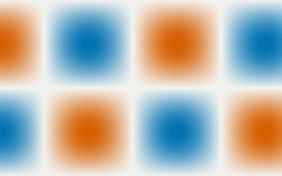
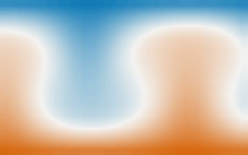
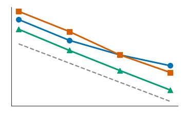
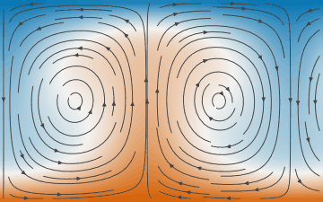
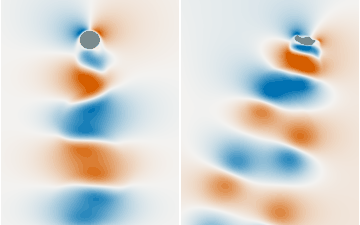

[](https://gelb-lang.org)
[](./LICENSE)
[](https://doi.org/10.5281/zenodo.23592922)

<p align="center">
    
</p>

# GeLB: Generic Lattice Boltzmann Framework

GeLB is a domain-specific programming language (DSL) and compiler framework for creating high-performance numerical simulations based on the Lattice Boltzmann Method (LBM) and finite differences (FD).

## Try it in the browser

These Google Colab notebooks install GeLB 1.0.0 and run complete simulations, with nothing to install locally. Click a picture or a badge to open one.

| Preview | Getting started |
|:---:|:---|
| <a href="https://colab.research.google.com/github/dchirila/gelb/blob/main/colab/gelb_intro_2d.ipynb"></a> | **Taylor–Green vortex, 2-D**<br>Write, compile and run a 70-line program; check it against the analytical energy decay.<br>CPU · about 2 min<br>[](https://colab.research.google.com/github/dchirila/gelb/blob/main/colab/gelb_intro_2d.ipynb) |
| <a href="https://colab.research.google.com/github/dchirila/gelb/blob/main/colab/gelb_gpu_3d.ipynb"></a> | **Rayleigh–Bénard convection, 3-D**<br>Coupled D3Q19 and D3Q7 lattices with MRT collision, compiled to CUDA.<br>T4 GPU · a few min<br>[](https://colab.research.google.com/github/dchirila/gelb/blob/main/colab/gelb_gpu_3d.ipynb) |

The SoftwareX paper's Section 3 ("Illustrative examples"), run with the programs in [examples/softwarex-2026-paper/](examples/softwarex-2026-paper/):

| Preview | Reproduce the paper |
|:---:|:---|
| <a href="https://colab.research.google.com/github/dchirila/gelb/blob/main/colab/paper_s3_1_convergence.ipynb"></a> | **§3.1 Grid convergence**<br>Taylor–Green (BGK, MRT) and Poiseuille flow, plotted with the paper's values.<br>CPU · 5–10 min<br>[](https://colab.research.google.com/github/dchirila/gelb/blob/main/colab/paper_s3_1_convergence.ipynb) |
| <a href="https://colab.research.google.com/github/dchirila/gelb/blob/main/colab/paper_s3_2_rayleigh_benard.ipynb"></a> | **§3.2 Rayleigh–Bénard, 2-D**<br>Convection at Ra = 10⁴ with the MRT and BGK programs.<br>CPU · 3–6 min<br>[](https://colab.research.google.com/github/dchirila/gelb/blob/main/colab/paper_s3_2_rayleigh_benard.ipynb) |
| <a href="https://colab.research.google.com/github/dchirila/gelb/blob/main/colab/paper_s3_3_karman_streets.ipynb"></a> | **§3.3 Kármán vortex streets**<br>Behind a cylinder (Re = 150) and behind Madeira (Re = 300).<br>T4 GPU · 15–20 min<br>[](https://colab.research.google.com/github/dchirila/gelb/blob/main/colab/paper_s3_3_karman_streets.ipynb) |

## Features

- **Easy to learn**: Intuitive syntax designed for LBM researchers and practitioners
- **Compile-time validation**: Built-in correctness checks prevent common LBM implementation bugs
- **High performance**: Automatic optimization and parallelization (portable-SIMD CPU and CUDA GPU backends)
- **Type safety**: Advanced type system with compile-time range validation
- **Extensible**: Open-source framework with clean architecture
- **Multiple backends**: serial CPU Fortran (educational reference), portable-SIMD C++ via Google Highway (`cpu_highway`, OpenMP-parallel), and GPU CUDA C++ (`gpu_cuda_cpp`, nvcc)
- **IDE Support**: VSCode extension with syntax highlighting and code snippets

## Core Concepts

GeLB programs revolve around four fundamental abstractions:

1. **Lattices**: Multi-dimensional arrays storing distribution functions
2. **Initializers**: Blocks for setting initial lattice values  
3. **Dynamics**: Blocks for lattice update operations (read and write)
4. **Gauges**: Blocks for reading values from lattices for output

Additional concepts include:
- **Node Classes**: Define behavior for different simulation node types
- **Geometry**: Spatial assignment of node classes to grid points
- **Global Constants**: Compile-time constants for simulation parameters

## Language Philosophy

GeLB is a **hybrid language** combining:
- **Imperative operations**: Expressions and assignments for lattice operations
- **Declarative specifications**: High-level descriptions of simulation structure

Key design principles:
- **Pure functions only**: No side effects for predictable parallelization
- **No traditional control flow**: No if/while/switch statements - use intrinsic functions and node classes instead
- **No print statements**: All output through Gauges for consistency
- **Automatic parallelization**: Users don't specify parallelization details

## Implementation

### Frontend
- ANTLR4-based parser with full grammar support
- Complete AST construction with visitor pattern
- Sophisticated type inference system
- Hierarchical symbol tables with scoping
- Compile-time constant folding and validation
- Range resolution and validation
- Rich set of intrinsic functions: math (`sin`, `cos`, `exp`, `log`, `sqrt`, `abs`, `min`, `max`, `mod`, `atan2`, `tan`, `tanh`), array (`sum`, `dot_prod`, `matmul`, `transpose`, `inverse`), LBM-specific (`upstream_dfs`, `bounce_back_dfs`), and `random`

### Midware
- AST optimization passes
- Constant folding and propagation
- Division by zero validation
- AST validation for backend consumption

### Backends
- **CPU Serial Fortran** (`cpu_fortran_serial`, gfortran): strictly single-threaded by design — educational source-level reference + bit-equivalence correctness anchor; 1D/2D/3D grids, multi-node-class geometry, periodic BCs, bounce-back walls, NetCDF + stdout output, automatic MLUPS measurement
- **CPU Portable SIMD** (`cpu_highway`, default; g++ + Google Highway + OpenMP): cross-platform vectorized backend (x86 AVX-512 / AVX2 / SSE; ARM NEON), the multi-threaded performance backend
- **GPU CUDA C++** (`gpu_cuda_cpp`, nvcc): CUDA backend for NVIDIA GPUs with device kernels, device-side node-class maps, multi-lattice examples, cuRAND support for `random()`, SoA layout, and optional captured `cudaGraph_t` execution. See the backend documentation and example smoke tests for the currently validated feature set.
- **Explicit-width FP types**: `real32` / `real64` with precision-aware literal emission (no implicit FP64 promotion)
- **CLI constant overrides**: `-D NAME=VALUE` to override `global_constants` without editing source
- **User-defined functions**: Single-output (Fortran `function`) and multi-output (Fortran `subroutine`) with destructuring assignment

## Installation

GeLB requires Python 3.11+. Release 1.0 is installed from a source
checkout (`git clone`, then the bootstrap script below); packaged
installers for macOS and Ubuntu, which install the same three commands
without a checkout, follow in release 1.0.1. The project uses standard
`pyproject.toml` metadata, so a conventional virtual environment plus
`pip install -e .` also works for development.

The native one-step runner (`gelb-run`) currently assumes a source
checkout because it compiles generated Fortran/C++/CUDA code and uses the
vendored Google Highway submodule. Use `git clone --recursive`, or run
`git submodule update --init --recursive` after cloning.

### Prerequisites

The bootstrap script checks for these and refuses to run if any are missing:

- **Hard**: Python ≥ 3.11, `git`, `curl`, an internet connection
- **Soft** (warns if missing, but you'll need them later): a C compiler
  (`gcc` on Linux, Xcode CLT on macOS, MSVC/MinGW on Windows), `gfortran`
  for the reference Fortran backend, and `g++` with OpenMP support for the
  default `cpu_highway` backend
- **Optional**: a JDK — only needed by `./scripts/regenerate_antlr.sh`,
  which in turn is only needed if you modify `GeLB.g4`. Day-to-day
  development does not require Java.
- **Optional**: CUDA toolkit (`nvcc`) — only needed if you want the
  GPU CUDA backend (`-b gpu_cuda_cpp`). Chapter 16 of the tutorial,
  [docs/user/16_performance_backends.rst](docs/user/16_performance_backends.rst),
  shows a first run on it and says when it pays off.

### Quick Start

1. **Clone with submodules and set up the environment**:
   ```bash
   git clone --recursive https://github.com/dchirila/gelb.git
   cd gelb

   # On Unix/MacOS:
   ./scripts/gelb_bootstrap.sh
   
   # On Windows:
   .\scripts\gelb_bootstrap.ps1
   ```

2. **Open a new terminal**. The bootstrap adds one PATH line to your
   shell's startup file (and prints it), so that `gelbc`, `gelb-run` and
   `gelb-view` are plain commands from any directory. Without that line,
   activate the environment instead, or put `uv run` in front of each
   command (`uv run gelb-run ...`) from inside the checkout:
   ```bash
   # On Unix/MacOS:
   source .venv/bin/activate
   
   # On Windows:
   .\.venv\Scripts\activate
   ```

3. **Install or synchronize dependencies**:
   ```bash
   uv sync --all-extras           # recommended: compiler + gui + docs + dev tools

   # Standards-compatible fallback:
   python -m pip install -e '.[gui,docs,dev]'
   ```

4. **Compile and run a simulation**:
   ```bash
   # One-step compile & run (CPU):
   gelb-run -n 1000 -w 100 examples/lbm/2d/taylor_green_vortex_2d_bgk.gelb
   
   # One-step compile & run (GPU, requires nvcc):
   gelb-run -b gpu_cuda_cpp -n 1000 -w 100 examples/lbm/2d/taylor_green_vortex_2d_bgk.gelb
   
   # Or compile only:
   gelbc examples/lbm/2d/taylor_green_vortex_2d_bgk.gelb -o output.f90 --num-timesteps 1000
   ```

### Optional: Clean Generated Files
```bash
# On Unix/MacOS:
./scripts/cleanup_repo.sh

# On Windows:
.\scripts\cleanup_repo.ps1
```

### VS Code extension

From the repository root, with Node.js and npm installed:

```bash
./scripts/install-vscode-ext.sh
```

The script builds the extension and copies it into `~/.vscode/extensions`
(macOS and Linux). Then reload VS Code (*Developer: Reload Window* in the
Command Palette) and open the repository folder: the extension finds
`gelbc`, `gelb-run` and `gelb-view` in the checkout by itself. On Windows,
build it with `cd vscode-gelb && npm ci && npm run compile` and copy the
folder, without `node_modules`, into `%USERPROFILE%\.vscode\extensions\`.

The extension highlights the language, lists the compiler's errors in the
Problems panel when you save, draws the geometry and stencils of a program,
and runs it from a Run view, opening the result in `gelb-view`. Chapter 2
of the [tutorial](docs/pdf/GeLB_User_Tutorial.pdf) walks through it;
[vscode-gelb/README.md](vscode-gelb/README.md) lists every feature and
setting.

## Example GeLB Program

<!-- GitHub has no highlighter for GeLB; Rust's colours its syntax closely. -->
```rust
simulation_description("2D Taylor-Green vortex (LBM-BGK, D2Q9)");

global_constants {
    const int N = 64;
    const real NU = 1.0 / 6.0;
    const real TAU_INV = 2.0 / (6.0 * NU + 1.0);
    const real U_MAX = 0.04;
    const real PI = 3.141592653589793;
    const real K = 2.0 * PI / N;
    const array[real, 9] EX = {0.0, 1.0, 0.0, -1.0,  0.0, 1.0, -1.0, -1.0,  1.0};
    const array[real, 9] EY = {0.0, 0.0, 1.0,  0.0, -1.0, 1.0,  1.0, -1.0, -1.0};
    const array[real, 9] W = {4.0/9.0,
        1.0/9.0, 1.0/9.0, 1.0/9.0, 1.0/9.0,
        1.0/36.0, 1.0/36.0, 1.0/36.0, 1.0/36.0};
}

lattices {
    lattice f(2, 9, real, {N, N}, {true, true});
}

function Macro(array[real, 9] fIn) -> (real rho, real ux, real uy) {
    rho = sum(fIn);
    ux = dot_prod(EX, fIn) / rho;
    uy = dot_prod(EY, fIn) / rho;
}

function Eq(real rho, real ux, real uy) -> (array[real, 9] feq) {
    real usq = ux*ux + uy*uy;
    array[real, 9] eu = EX * ux + EY * uy;
    feq = W * rho * (1.0 + 3.0*eu + 4.5*eu*eu - 1.5*usq);
}

initializer InitTG {
    real xc = x + 0.5;
    real yc = y + 0.5;
    real rho = 1.0 - 0.75 * U_MAX^2 * (cos(2.0*K*xc) + cos(2.0*K*yc));
    real ux = -1.0 * U_MAX * cos(K*xc) * sin(K*yc);
    real uy = U_MAX * sin(K*xc) * cos(K*yc);
    f.out[x, y | :] = Eq(rho, ux, uy);
}

dynamic BGKCollStream {
    array[real, 9] fIn = upstream_dfs(f, x, y, {EX, EY});
    real rho;
    real ux;
    real uy;
    {rho, ux, uy} = Macro(fIn);
    f.out[x, y | :] = fIn - TAU_INV * (fIn - Eq(rho, ux, uy));
}

gauge Hydro -> (real rho, real ux, real uy) {
    {rho, ux, uy} = Macro(f.in[x, y | :]);
}

node_classes {
    node_class BULK(InitTG, BGKCollStream, Hydro);
}

geometry {
    nodes[:, :] = BULK;
}
```

## Language Restrictions

GeLB intentionally restricts certain features to enable automatic parallelization:

### Not Supported
- **No print statements**: Use Gauges for all output
- **No control flow**: No if/while/switch (use intrinsic functions and node classes)
- **No recursion**: Functions must be non-recursive
- **No pointers**: Direct memory manipulation not allowed
- **No user-defined types**: Built-in types only (int, real, bool)

### Supported Alternatives
- **Intrinsic functions**: `sum`, `dot_prod`, `matmul`, `transpose`, `inverse`, `upstream_dfs`, `bounce_back_dfs`, `random`, `sin`, `cos`, `tan`, `tanh`, `sqrt`, `exp`, `log`, `abs`, `min`, `max`, `mod`, `atan2`
- **Node classes**: Different behavior for different spatial regions
- **Pure functions**: Mathematical functions without side effects
- **Compile-time computation**: Constants and ranges resolved at compile time

## Reserved Keywords

The following are reserved and cannot be used as identifiers:
- Implicit coordinates: `x`, `y`, `z` — reserved in all blocks *except* user-defined function parameters and local variables
- Implicit dimension constants: `Nx`, `Ny`, `Nz` — reserved in all blocks *except* user-defined function parameters and local variables
- Implicit timestep counter: `t` — integer holding the current outer-loop index (0 at the pre-loop gauge pass, 1..N during the time loop); available in `initializer`, `dynamic`, and `gauge` blocks; maps to `gelb_timestep` in the Fortran backends
- Types: `int` (≡ `int64`), `real` (≡ `real64`), `bool` (1-byte logical) (and explicit-width variants: `int8`, `int16`, `int32`, `int64`, `real32`, `real64`). The type names also serve as explicit cast intrinsics — e.g. `int(real_var)` truncates a real to int, `real(int_var)` promotes an int to real.
- Blocks: `lattice`, `lattices`, `initializer`, `dynamic`, `gauge`, `function`, `global_constants`
- Node specification: `node_class`, `node_classes`, `geometry`, `nodes`, `masked`
- Geometry statements: `border`
- Lattice access: `in`, `out`
- Constants: `const`, `true`, `false`
- Intrinsic functions: `sum`, `dot_prod`, `matmul`, `transpose`, `inverse`, `upstream_dfs`, `bounce_back_dfs`, `random`, `sin`, `cos`, `tan`, `tanh`, `sqrt`, `exp`, `log`, `abs`, `min`, `max`, `mod`, `atan2`, `determinant`

## Documentation

- [GeLB User Tutorial](docs/pdf/GeLB_User_Tutorial.pdf) (PDF): from installation to a reduced-gravity ocean model, with a boundary-condition cookbook, a validation chapter and the numerical-semantics contract; the sources are in [docs/user/](docs/user/).
- [Language design decisions](docs/LANGUAGE_DESIGN.md): why the language works the way it does.
- [Examples](examples/) and their [analytical validation](examples/VALIDATION.md).
- [Developer manual](docs/pdf/GeLB_Developer_Manual.pdf) (PDF): the compiler's structure, for contributors; the sources are in [docs/dev/](docs/dev/).

## Contributing

We welcome contributions! The day-to-day conventions (setting up,
branching, tests, regenerating the parser, building the manual) are
collected in [CONTRIBUTING.md](CONTRIBUTING.md).

### Development Workflow

1. **Make changes to grammar**: Edit `.g4` files
2. **Regenerate parser**: `./scripts/regenerate_antlr.sh`
3. **Run tests**: `uv run pytest`
4. **Build the manual**: `uv run sphinx-build -b html -W --keep-going docs docs/_build/html`

## Roadmap

### Planned
- Geometry file import (external mesh definitions)
- Distributed memory parallelization (MPI)
- Mesh refinement support
- Interactive simulation monitoring

Detailed priorities are tracked in the project's GitHub issues.

## Using GeLB in Your Work

If you use GeLB for your research, please cite the software release:

> Chirila, D.-B. and Lohmann, G. (2026). *GeLB: A Domain-Specific
> Language and Compiler for Lattice Boltzmann Simulations* (version
> 1.0.0) [Software]. Zenodo. https://doi.org/10.5281/zenodo.23592922

The paper describing GeLB has been submitted to *SoftwareX*; its
citation will be added here once it is published. `CITATION.cff` holds
the same information in machine-readable form (GitHub's "Cite this
repository" button).

We'd love to hear about your use cases and feature requests!

## Release Manual PDFs

The user tutorial and the developer manual of this release are in the
repository as PDFs:
[docs/pdf/GeLB_User_Tutorial.pdf](docs/pdf/GeLB_User_Tutorial.pdf) and
[docs/pdf/GeLB_Developer_Manual.pdf](docs/pdf/GeLB_Developer_Manual.pdf).
They are built from the Sphinx sources in `docs/` and rebuilt for every
release. To build them yourself from a source checkout:

```bash
uv run python scripts/build_manual_pdfs.py --manual user
uv run python scripts/build_manual_pdfs.py --manual dev
```

The commands write `GeLB_User_Tutorial.pdf` and
`GeLB_Developer_Manual.pdf` in the repository root.

## License

This project is licensed under the Mozilla Public License 2.0 (MPL-2.0).
See the [LICENSE](https://github.com/dchirila/gelb/blob/main/LICENSE) file for details.

## Authors and Acknowledgments

GeLB was created to make LBM simulations more accessible and productive for researchers. The framework represents years of experience with lattice Boltzmann implementations and lessons learned from the challenges of high-performance computing.

GeLB is written and maintained by Dragos-Bogdan Chirila.

The core ideas behind this project were produced by the author during his
PhD studies, along with the initial language specification and the first
prototypes. Transforming those initial efforts into a product that is
suitable for a wider audience took many years of intermittent work after
that (who would have thought that creating a programming language is
hard?). For the final stages of the implementation, AI agents from
Anthropic (Claude Code), OpenAI (Codex) and Google (Gemini) were used,
always with a human at the helm.

### About this history

The commits up to 8 August 2025 are the author's original development
history, kept unchanged. The commits after that, up to 18 October 2026, are a condensed timeline:
each one gathers the work on one area into a single milestone, dated near
the time that work was done, with its files in their released form. They
show how GeLB grew rather than record every change, so bisecting or
blaming inside that range points to a milestone, not to a day.

## Contact

- Website: [gelb-lang.org](https://gelb-lang.org)
- GitHub: [github.com/dchirila/gelb](https://github.com/dchirila/gelb)
- Discussions: [GitHub Discussions](https://github.com/dchirila/gelb/discussions)
- Issues: [GitHub Issues](https://github.com/dchirila/gelb/issues)

---

*"Making lattice Boltzmann simulations as easy to write as they are powerful to run."*
