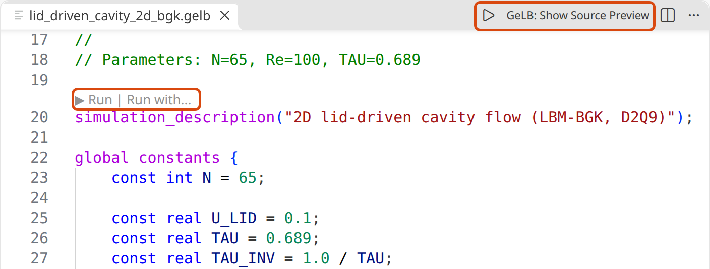
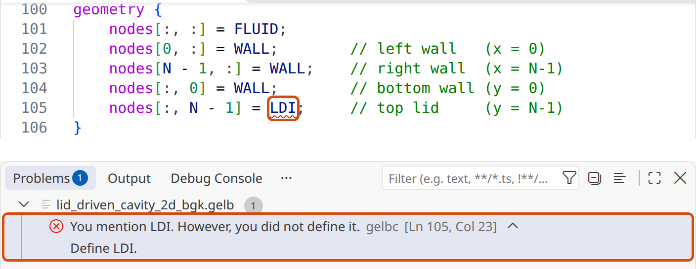
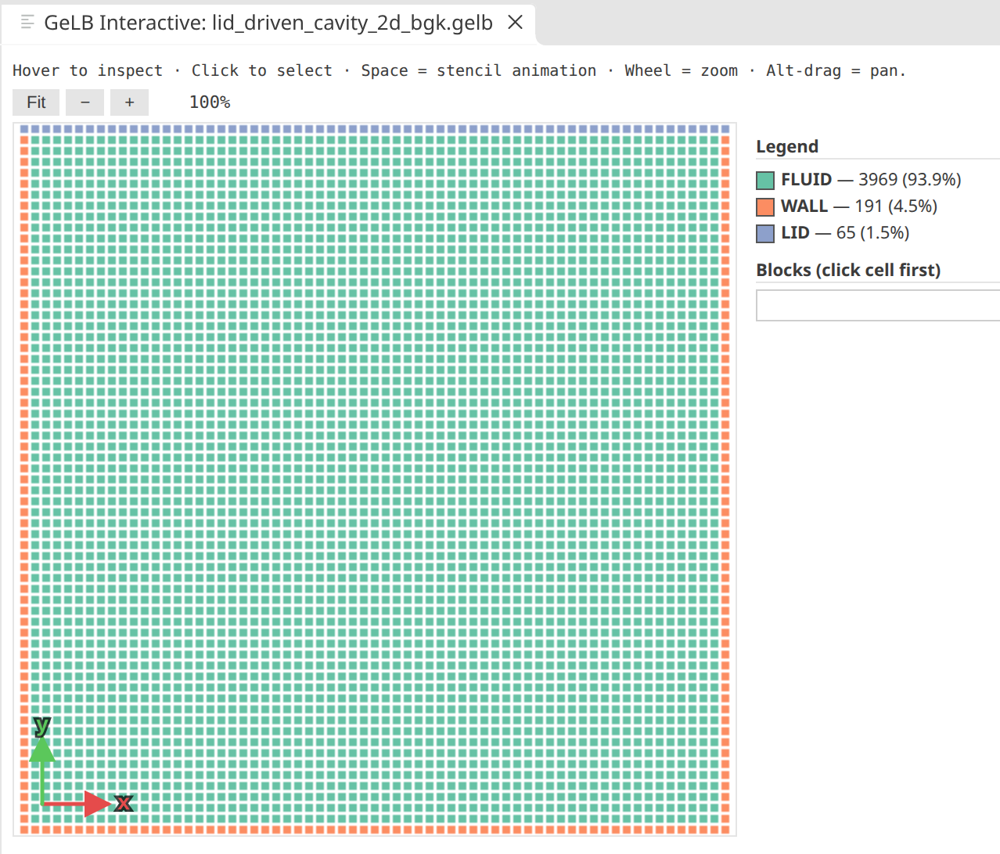
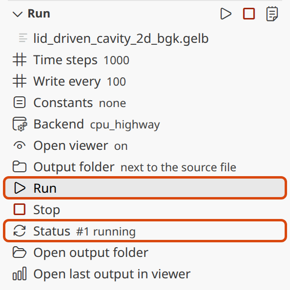
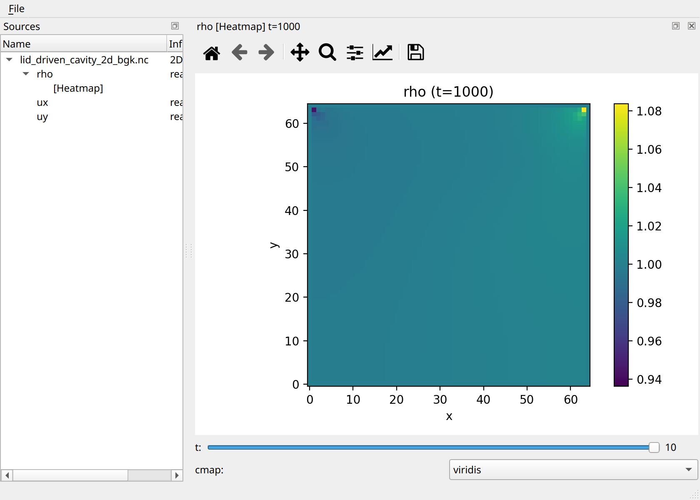

===============
Getting Started
===============

This chapter walks you from a clean checkout to a successful
first run in about ten minutes.  By the end of it you will have
installed GeLB, compiled a small example, run the resulting
binary, and viewed its output, first from the command line and
then from Visual Studio Code, where you will probably do most of
your work.

Installation
============

GeLB is developed on Linux and macOS; Windows is supported via
PowerShell scripts but less exercised.  All dependencies are
installed into a self-contained virtual environment by a single
bootstrap script.  Release 1.0 is installed from a source checkout
(``git clone``, then the bootstrap); packaged installers for macOS
and Ubuntu, which install the same three commands without a
checkout, follow in release 1.0.1.

**Hard requirements** (the bootstrap script refuses to run without
these):

- Python ≥ 3.11
- ``git``
- ``curl`` (used to fetch ``uv``, which manages the Python environment)
- An internet connection for the initial dependency download

**Soft requirements** (not checked by the bootstrap; ``gelb-run``
needs them for the backends you use):

.. list-table::
   :header-rows: 1
   :widths: 22 42 36

   * - Backend
     - Compiler
     - Output library
   * - ``cpu_highway`` (default)
     - A C++17 compiler with OpenMP: ``g++`` on Linux (part of GCC);
       on macOS ``brew install gcc``, or ``brew install libomp`` for
       Apple's ``clang++``.  The Google Highway sources come with the
       checkout as a git submodule, which the bootstrap script
       initialises.
     - NetCDF-C: ``libnetcdf-dev`` on Debian/Ubuntu, ``brew install
       netcdf`` on macOS; detected via ``nc-config``.
   * - ``gpu_cuda_cpp``
     - The CUDA toolkit (``nvcc``); see :doc:`16_performance_backends`.
     - NetCDF-C, as above.
   * - ``cpu_fortran_serial`` (educational reference)
     - ``gfortran`` (part of GCC on Linux; ``brew install gcc`` on
       macOS).
     - NetCDF-Fortran: ``libnetcdff-dev`` on Debian/Ubuntu, ``brew
       install netcdf-fortran`` on macOS; detected via ``nf-config``.

Clone the repository and run the bootstrap script:

.. code-block:: bash

    git clone https://github.com/dchirila/gelb.git
    cd gelb
    ./scripts/gelb_bootstrap.sh        # Linux / macOS
    # .\scripts\gelb_bootstrap.ps1     # Windows

The script installs ``uv`` if it is not already on your system,
creates a ``.venv/`` directory, and pins dependencies from
``pyproject.toml``.  It takes about a minute on a warm cache.

The three GeLB commands, ``gelbc``, ``gelb-run`` and ``gelb-view``,
are installed in ``.venv/bin``.  To make them plain commands, the
bootstrap ends by adding one PATH line to your shell's startup file
(``~/.bashrc`` for bash on Linux, ``~/.bash_profile`` on macOS,
``~/.zshenv`` or ``~/.zprofile`` for zsh, ``~/.tcshrc`` for tcsh,
``~/.config/fish/config.fish`` for fish; it prints which file it
changed, and running it again never adds a second line).  Open a new
terminal, or paste the one-liner the bootstrap prints into the
current one, and the commands work from any directory: every command
in this tutorial is written that way, and a packaged installation
uses the same words.  If you would rather keep your startup files as
they are, delete that line and put ``uv run`` in front of each
command instead (``uv run gelb-run ...``, and the same for ``gelbc``
and ``gelb-view``); ``uv run`` must then be typed from inside the
checkout.  The same line can be added for another shell with
``scripts/gelb-shell-setup "$PWD/.venv/bin" zsh``.

Optional components:

- **Java** (any JDK ≥ 11) is needed *only* if you modify the grammar
  in ``gelb/antlr_part/grammars/GeLB.g4`` and need to regenerate the
  ANTLR4 parser via ``./scripts/regenerate_antlr.sh``.  Day-to-day
  use does **not** need Java: the generated parser files already
  come with the source checkout and with the installers.
- **CUDA toolkit (``nvcc``)** is needed for the GPU CUDA backend.
  See :doc:`16_performance_backends` for setup notes.

Verify the install by running the GeLB compiler's ``--help``:

.. code-block:: bash

    gelbc --help

You should see a long ``Usage: gelbc [OPTIONS] INPUT_FILE`` listing.
If you do, the Python side of GeLB is up and ready.  (``command not
found`` means the PATH line is not in effect yet: open a new terminal,
or put ``uv run`` in front of the command, from inside the checkout.)

If you use Visual Studio Code, install the GeLB extension as well
(`Working in VS Code`_ below): editing and running programs there is
the most comfortable way to follow this tutorial.  The command-line
tools come first in this chapter because the extension runs them for
you.

The three CLI tools
===================

GeLB ships three command-line entry points.  You will use all of
them if you follow this tutorial.

``gelbc`` — the compiler
------------------------

``gelbc`` reads a ``.gelb`` file and emits a single source file in
the language of the chosen backend (C++ by default).  It does no
compilation or linking — just the source-to-source translation.  A
typical invocation:

.. code-block:: bash

    gelbc examples/basic/1d/ex0_int_vec_setto_one.gelb \
        -o /tmp/hello.cpp \
        --num-timesteps 10

Useful flags:

- ``-o FILE`` — where to write the generated source.
- ``--num-timesteps N`` — number of simulation time steps to run.
  Default 1; you almost always want to set this.
- ``--write-every N`` — write gauge output every ``N`` steps
  (default: every step).  Reduce this for long runs to save disk.
- ``--backend`` — ``cpu_highway`` (default; portable-SIMD C++ via
  Google Highway, OpenMP-parallel), ``gpu_cuda_cpp`` (CUDA C++), or
  ``cpu_fortran_serial`` (single-threaded educational reference).

The remaining flags are collected under `Advanced options`_ below.

``gelb-run`` — compile, link, run
---------------------------------

``gelbc`` gives you C++, CUDA or Fortran source; ``gelb-run`` gives
you an executable and runs it.  It wraps ``gelbc``, the native
compiler, execution and cleanup into one command, analogous to
``go run`` or ``cargo run``.

.. code-block:: bash

    gelb-run -n 100 \
        examples/basic/1d/ex0_int_vec_setto_one.gelb

That compiles the example, links it against NetCDF, runs it for 100
time steps, and writes the resulting ``ex0_int_vec_setto_one.nc``
into the current directory.  Useful flags mirror those of ``gelbc``,
with a few additions:

- ``-b BACKEND`` — ``cpu_highway`` (default), ``gpu_cuda_cpp``, or
  ``cpu_fortran_serial``.
- ``-n N`` / ``-w N`` — ``--num-timesteps`` / ``--write-every``.
- ``-m stdout`` — print gauge output to the terminal with
  ``-b cpu_fortran_serial`` instead of writing NetCDF (useful for tiny
  examples and debugging).
- ``-V`` — launch ``gelb-view`` automatically after the run.
- ``-k`` — keep the generated source and binary instead of cleaning
  them up.
- ``-v`` — print each compilation step.

The common options have the same short and long forms in both
tools: ``-b``/``--backend``, ``-n``/``--num-timesteps``,
``-w``/``--write-every``, ``-m``/``--output-mode``, ``-s``/``--seed``.

``gelb-run`` also detects the NetCDF libraries and shows a progress
bar during long runs; it inherits your shell's resource limits.

Advanced options
----------------

You will not need these for the tutorial; they are listed here for
later reference.  Each is accepted by ``gelbc`` and by ``gelb-run``
unless stated otherwise.

- ``-D NAME=VALUE`` — override a global constant at compile time
  (e.g. ``-D N=128`` to raise a resolution); repeatable.  See
  :doc:`03_gelb_in_10_minutes`.
- ``--seed N`` — fixed seed for reproducible runs of programs that
  use the ``random()`` intrinsic.
- ``--stencils`` (``gelbc`` only) — print the stencil analysis report
  and exit; see :doc:`15_stencil_visualisation`.
- ``--no-geometry-lint`` — suppress the non-fatal geometry-lint
  warnings.  By default the compiler warns about suspicious
  disconnected regions and isolated fluid pockets.
- ``--poison-uninit`` — debugging aid: fill lattice storage with NaN
  at startup instead of zeros, so a read of a lattice cell that no
  initializer or update ever wrote surfaces as NaN in the gauge
  output instead of hiding behind a benign zero.  A correct program
  produces output bitwise identical to a normal run (masked cells
  are unaffected — they hold zero DFs by language guarantee).
- ``OMP_NUM_THREADS=1`` in the environment — a single-threaded
  ``cpu_highway`` run, for example when comparing against
  ``cpu_fortran_serial``.

``gelb-view`` — the visualiser
-------------------------------

``gelb-view`` is a PySide6 + matplotlib viewer.  Subcommands:

.. code-block:: bash

    # View simulation output (NetCDF)
    gelb-view data out.nc
    gelb-view data out.nc --no-gui -o plot.png

    # View geometry and/or stencil diagrams from a .gelb source file
    gelb-view source program.gelb
    gelb-view source program.gelb --show=both --no-gui -o preview.png

    # Bare filename works too — .gelb routes to `source`, .nc routes to `data`
    gelb-view program.gelb
    gelb-view out.nc

The ``data`` subcommand opens an interactive window with a source/
variable/plot tree pane, dockable plot panels, cross-section line
plots, and multi-variable composite plots (vector fields,
streamlines, vorticity, particle animation).  Pass ``--no-gui`` or
``-o`` to run it headless; that mode is used throughout this tutorial
to generate the committed figures under ``docs/user/figures/``.

The ``source`` subcommand visualises both the geometry (per-cell
node-class heatmap) and the per-block read/write stencils from a
``.gelb`` source file.  Four render modes (``geo``, ``algo``,
``both``, ``combined``), plus flags for geometry-lint warnings
(``--lint``), stats (``--stats``), ASCII grid (``--text``), and a
JSON export used by the VSCode extension (``--export-json``).  See
:doc:`15_stencil_visualisation` for the full flag reference.

PySide6 is optional (but highly recommended): ``pip install
'gelb[gui]'`` adds it if you
want the interactive GUI.  Without PySide6, only the ``--no-gui``
matplotlib path is available.

Your first simulation
=====================

Let's compile and run the smallest example in the repository —
``examples/basic/1d/ex0_int_vec_setto_one.gelb``.  The whole program
is 30 lines:

.. code-block:: gelb

    simulation_description("Pretty much the hello world of GeLB");

    lattices {
      lattice f(1,        // d
                1,        // q
                int,      // df_type
                32,       // grid_size
                false     // periodicity
      );
    }

    initializer SetDFsToZero {
      f.out[x | 0] = 0;
    }

    dynamic SetDFsToOne {
      f.out[x | 0] = 1;
    }

    gauge CurrentState -> (int state) {
      state = f.in[x | 0];
    }

    node_classes {
      node_class BULK(SetDFsToZero, SetDFsToOne, CurrentState);
    }

    geometry {
      nodes[:] = BULK;
    }

It declares a 1D lattice of 32 integer cells, an initialiser that
sets every cell to 0, a dynamic that overwrites every cell with 1 at
every time step, and a gauge that reads the current value back out.
The complete program in 30 lines.  We will dissect this program
properly in :doc:`04_hello_world`; for now, just run it.

Compile and run in one step:

.. code-block:: bash

    gelb-run -b cpu_fortran_serial -n 10 -m stdout \
        examples/basic/1d/ex0_int_vec_setto_one.gelb

The ``-m stdout`` flag tells the Fortran reference backend to print
gauge values to the terminal instead of writing NetCDF — convenient for
a tiny example.  After the compiler's own messages it prints one gauge
value per line: the 32 zeros of the initial state (``t=0``) first,
then 32 ones for each of the ten steps (from ``t=1`` onwards the
dynamic overwrites everything to ``1``), 352 values in all, followed
by a short timing report.

Now try the same thing without ``-m stdout`` — the default NetCDF
mode:

.. code-block:: bash

    gelb-run -n 100 \
        examples/basic/1d/ex0_int_vec_setto_one.gelb

That writes an ``ex0_int_vec_setto_one.nc`` file to your current
directory.  Open it in ``gelb-view``:

.. code-block:: bash

    gelb-view data ex0_int_vec_setto_one.nc

The GUI opens with a space-time heatmap of the ``state`` variable —
``0`` in the first row, ``1`` in the 100 rows after it, across all
32 cells (right-click a variable in the file tree for other plot
types).  Boring, as hello-world programs should be.  We will start
doing real physics in :doc:`05_1d_diffusion`.

If you want to see the generated code, pass ``-k`` to keep it:

.. code-block:: bash

    gelb-run -k -n 10 \
        examples/basic/1d/ex0_int_vec_setto_one.gelb
    # prints the path of the generated file, kept next to the binary

``gelb-run`` leaves ``ex0_int_vec_setto_one.cpp`` and the binary
in the current directory.  The file is 122 lines of C++: the
lattice storage, the initializer loop, the gauge output, and the
time loop that runs the dynamic.  You don't need to read it.  Throughout the rest of the tutorial we will mostly
pretend the generated layer does not exist.

Troubleshooting
===============

**"gfortran not found"** (``-b cpu_fortran_serial`` only) —
install GCC.  On Ubuntu/Debian: ``sudo apt install gfortran``.  On
macOS: ``brew install gcc``.

**"nf-config not found"** (``-b cpu_fortran_serial`` only) —
install NetCDF-Fortran.  On Ubuntu/Debian: ``sudo apt install
libnetcdff-dev``.  On macOS: ``brew install netcdf netcdf-fortran``.
The default backend needs NetCDF-C (``nc-config``) instead.

**"The ANTLR4 Java tool failed to compile the GeLB.g4 grammar"** —
you have picked up a fresh grammar change but do not have Java
installed.  Install a JDK (``brew install openjdk`` on macOS,
``sudo apt install default-jdk`` on Ubuntu/Debian), then rerun
``./scripts/regenerate_antlr.sh``.  Day-to-day use does not need
Java; this only fires when ``GeLB.g4`` changes and the generated
parser is out of date.

**"warning: VIRTUAL_ENV=... does not match the project
environment path"** — this is a harmless warning from ``uv`` when
your shell has a different virtualenv active and you run the commands
through ``uv run``.  You can silence it by running ``deactivate``
first; ``gelb-run`` itself clears the outer ``VIRTUAL_ENV`` before it
invokes ``uv``.

.. _working-in-vscode:

Working in VS Code
==================

The GeLB extension for Visual Studio Code highlights the language,
reports errors when you save, draws the geometry of a program, and
runs it with ``gelb-run`` from a sidebar, opening ``gelb-view`` on the
result.  It does what the previous sections did by hand: the commands
stay what stands behind it, and every "Running it" section of the
tutorial gives both.

**Installing it.**  From the repository root (the build needs Node.js
and ``npm``):

.. code-block:: bash

    ./scripts/install-vscode-ext.sh

The script builds the extension and copies it into
``~/.vscode/extensions``.  Reload VS Code afterwards (*Developer:
Reload Window* in the Command Palette, :kbd:`Ctrl+Shift+P`, or
:kbd:`Cmd+Shift+P` on macOS).  The macOS installer offers to install
the extension too.  Then open the repository folder (*File → Open
Folder…*): the extension finds ``gelbc``, ``gelb-view`` and
``gelb-run`` in the checkout by itself, so there is nothing to
configure.

**Editing.**  Open a program, for example
``examples/lbm/2d/lid_driven_cavity_2d_bgk.gelb``, the lid-driven
cavity of :doc:`07_lid_driven_cavity`.  The editor colours keywords,
names and numbers, and the extension adds two buttons to the editor's
title bar and a *Run* link above ``simulation_description``
(figure below).  The GeLB icon in the activity bar on
the left opens the GeLB sidebar: *Program Structure* lists the
program's blocks and constants, and a click jumps to one.

   A program open in VS Code.  Outlined: the *Run* and *Run with…*
   links above ``simulation_description``, and in the title bar the
   Run button (the triangle) and *GeLB: Show Source Preview*.

**Errors.**  Each time you save, the extension has ``gelbc`` check
the file and lists what it finds in the *Problems* panel (*View →
Problems*), with the compiler's message and hint; the name or number
it points at is underlined in the editor (figure below).  A click on the entry jumps to the
line.  The check runs on save, not while you type.

   ``LID`` misspelt as ``LDI`` in the ``geometry`` block, after
   saving: the name is underlined, and the *Problems* panel shows
   the compiler's message and hint.

**The geometry.**  *GeLB: Show Source Preview* opens a preview beside
the editor: the lattice with every node coloured by its node class,
and a legend that counts them (figure below).  It is
the quickest check that the ``geometry`` block paints what you meant.
Hover over a node to see its coordinates and class; click one to list
the blocks of its node class and draw the cells the chosen block reads
and writes, which :kbd:`Space` then animates.  The preview is redrawn each time
you save, and refuses to open while the file has errors.

   The preview of the lid-driven cavity: 3969 fluid nodes, the walls
   on three sides and the moving lid on top.

**Running.**  The sidebar's *Run* view (figure below) holds the parameters ``gelb-run`` would get on the command line, as
rows you click to edit: the number of time steps (``-n``), how often
the gauges are written (``-w``), constant overrides (``-D``), the
backend (``-b``), whether to open the viewer at the end (``--view``),
and the output folder, where the ``.nc`` file lands (next to the
source file unless you choose another).  They are remembered per
file.  *Run*, or the Run button of the editor, saves the file and
starts ``gelb-run`` with them: its output, from the compiler messages
to the progress bar and the MLUPS report, appears in a terminal of
the panel named after the file, and the *Status* row follows the run.
*Stop* ends it, together with everything it started.  The view's
*Show Run Log* button (in its title bar) shows, for each run, the
command line it amounts to; you can paste that line into a terminal
to add the less common ``gelb-run`` flags of `Advanced options`_.

   The Run view while a run is going: its parameters as rows, the
   *Run* row and the *Status* row (outlined).

With *Open viewer* on, ``gelb-view`` opens on the output when the
simulation ends (figure below).  For a 2D program it shows a heatmap
of the first variable at the last record; the slider below it steps
through the records, and a right-click on a variable in the *Sources*
tree offers the other plots.  The run counts as going until you close
the viewer; *Open last output in viewer* opens it again later.

   ``gelb-view`` as the run opens it: the file's variables on the
   left, a heatmap of the density ``rho`` at the last record on the
   right.

Where to next
=============

- :doc:`03_gelb_in_10_minutes` — the language cheat-sheet.  Bookmark
  it and come back to it whenever you need to look up a keyword.
- :doc:`04_hello_world` — a line-by-line annotation of the
  hello-world program you just ran.
- ``vscode-gelb/README.md`` — everything the VS Code extension does,
  and its settings.
