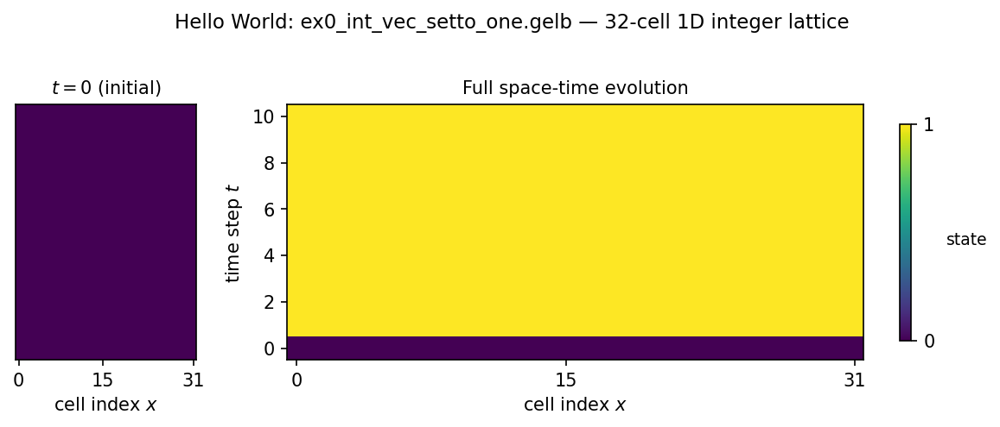

=============
Hello World
=============

This chapter walks line-by-line through the smallest meaningful
program in the GeLB repository:
``examples/basic/1d/ex0_int_vec_setto_one.gelb``.  It does not do
any physics — it is a "hello world" program that declares a 1D
integer lattice, sets every cell to 0, then overwrites every cell
with 1 at every time step.  By the end of this chapter you will
know what every block in a GeLB program is for, how the compiler
turns it into a per-cell loop, and what the NetCDF output file
actually contains.

.. note::

   If :doc:`03_gelb_in_10_minutes` felt abstract, this chapter is
   the concrete counterpart.  Every construct from the cheat-sheet
   is used here exactly once, in its simplest possible form.

The program
===========

The entire program is 30 lines.  Read it top to bottom:

.. code-block:: gelb

    simulation_description("Pretty much the hello world of GeLB");

    lattices {
      lattice f(1,        // d         — one spatial dimension
                1,        // q         — one distribution function per cell
                int,      // df_type   — 64-bit integer
                32,       // grid_size — 32 cells
                false     // periodic  — no (x=0 and x=31 are distinct walls)
      );
    }

    initializer SetDFsToZero {
      f.out[x | 0] = 0;
    }

    dynamic SetDFsToOne {
      f.out[x | 0] = 1;
    }

    gauge CurrentState -> (int state) {
      state = f.in[x | 0];
    }

    node_classes {
      node_class BULK(SetDFsToZero, SetDFsToOne, CurrentState);
    }

    geometry {
      nodes[:] = BULK;
    }

Let's walk through it.

``simulation_description`` — one-line metadata
-----------------------------------------------

.. code-block:: gelb

    simulation_description("Pretty much the hello world of GeLB");

Every GeLB program begins with this one-line call.  The string is
stored as a NetCDF global attribute; ``gelbc`` prints it after
parsing, as ``Simulation: "..."``, and ``gelb-view`` shows it in
the *Info* column of its file tree.  Its only purpose is human
orientation — strip it out and the program still compiles and
runs identically, but future-you will thank present-you for
writing a one-sentence summary.

``lattices`` — where the data lives
------------------------------------

.. code-block:: gelb

    lattices {
      lattice f(1, 1, int, 32, false);
    }

This block declares a single lattice called ``f``.  Its five
arguments, in order:

- **Dimensionality** ``1`` — a one-dimensional lattice (a line of cells).
- **Q** ``1`` — one distribution function per cell.  Real LBM
  programs use ``q=3`` for D1Q3 diffusion, ``q=9`` for D2Q9 flow,
  ``q=19`` for D3Q19.  Here we use ``q=1`` because we are not
  doing LBM yet; we just want one integer per cell.
- **DF type** ``int`` — 64-bit signed integers.  Most real LBM
  programs use ``real`` (= ``real64``, double precision); we use
  ``int`` here because integers make space-time plots trivially
  readable.
- **Grid size** ``32`` — 32 cells along the single spatial dimension.
- **Periodicity** ``false`` — the two endpoints ``x = 0`` and
  ``x = 31`` are distinct non-periodic boundaries.  Since the
  program never references neighbours (``f.in[x-1, ...]`` or
  ``f.in[x+1, ...]``), this choice is irrelevant here — but it
  would matter the moment we introduced streaming.

After this declaration, ``f`` behaves like a 1D array of 32
integers that the rest of the program can read and write at each
time step.

``initializer`` — what the lattice starts as
---------------------------------------------

.. code-block:: gelb

    initializer SetDFsToZero {
      f.out[x | 0] = 0;
    }

An ``initializer`` block describes how the lattice is populated
*before* the main time loop starts.  Inside the block, every
reference to ``x`` is implicitly bound to the current cell's
coordinate (``0``, ``1``, ..., ``31``), and the compiler wraps the
block body in an implicit loop over every cell in the node class.
You never write the loop yourself.

The left-hand side ``f.out[x | 0]`` reads as "DF index 0 at site
``x``, write channel".  The ``|`` separator is phase-space
notation (the creator of GeLB is a physicist, and it looks nice) —
spatial coordinates on the left, DF index on the right — so ``f.out[x | 0]`` means "write to the 0th distribution function
at cell ``x``".  Because the lattice has only one DF, ``| 0`` is
the only valid choice.

The right-hand side is a plain integer literal ``0``.  After the
implicit loop runs, every cell of ``f`` holds ``0``.

In an ``initializer`` block only ``f.out`` is writable.  There is
no "previous" time step yet, so ``f.in`` is not in scope.

``dynamic`` — how the lattice evolves
--------------------------------------

.. code-block:: gelb

    dynamic SetDFsToOne {
      f.out[x | 0] = 1;
    }

A ``dynamic`` block describes one time-step update.  It has access
to both ``f.in`` (the previous time step's state, read-only) and
``f.out`` (the next time step's state, write-only).  Here the
update is trivial: unconditionally set every cell to 1.

The "previous / next" split is a *language-level contract*
(see :doc:`03_gelb_in_10_minutes` — the ``f.in`` / ``f.out``
section).  Inside any single dynamic block, reads from ``f.in``
cannot observe writes from ``f.out`` made earlier in the same
timestep, anywhere on the grid, by any worker.  The compiler
guarantees this illusion, even across OpenMP threads and CUDA
kernels, by maintaining a ping-pong double buffer under the
hood.  In this particular program the contract is not exercised
(we never read ``f.in`` at all), but understanding it matters as
soon as you write your first real LBM kernel — see
:doc:`05_1d_diffusion`.

``gauge`` — what the program outputs
-------------------------------------

.. code-block:: gelb

    gauge CurrentState -> (int state) {
      state = f.in[x | 0];
    }

A ``gauge`` block is how GeLB does I/O — by *declaring* the output
variables it writes and filling them once per cell per time step.
GeLB does not have ``print``, ``write``, or any other statement
with observable side effects; every number that ever leaves a
running simulation passes through a gauge block.

This gauge declares one output variable, ``int state``, and
fills it with the single DF at each cell.  The compiler's NetCDF
writer collects all the gauge outputs across all cells and time
steps into a NetCDF file with dimensions ``(time, x)`` and a
variable named ``state`` of type ``int64``.  (In 2D programs the
variable becomes ``state(time, y, x)``; in 3D,
``state(time, z, y, x)``.)

Gauges run once before the main time loop, capturing the initial
condition as the ``t=0`` record, and then once at the end of every
time step.  For a run of 10 time steps the NetCDF file therefore
has 11 records.

``node_classes`` — binding the three blocks together
------------------------------------------------------

.. code-block:: gelb

    node_classes {
      node_class BULK(SetDFsToZero, SetDFsToOne, CurrentState);
    }

A node class bundles exactly three blocks — an ``initializer``, a
``dynamic``, and a ``gauge`` — into one named unit.  The order
matters: ``(initializer, dynamic, gauge)``.  Here we name the
class ``BULK`` and bind our three blocks to it.

Real GeLB programs typically declare several node classes to
distinguish interior cells from wall cells, inflow/outflow
boundaries, solid obstacles, and so on.  Each class can have its
own dynamic — that is the GeLB idiom for "different physics at
different points of the geometry", replacing the ``if (cell_type
== WALL) { ... } else { ... }`` branches you would write in a
hand-coded LBM solver.

``geometry`` — which cells run which node class
------------------------------------------------

.. code-block:: gelb

    geometry {
      nodes[:] = BULK;
    }

Finally, ``geometry`` paints node classes onto the grid.  The
slice ``nodes[:]`` means "every cell", so every one of our 32
cells is painted as BULK.  Every cell must be painted by at
least one statement, or the compiler rejects the program:

.. code-block:: text

    [Problem] Geometry does not cover node (5)

Paint statements apply in source order, top to bottom, with
CSS-like override semantics — a later statement can overwrite cells
painted by an earlier one.
This is how you write "everything is BULK except the top and
bottom rows, which are WALL":

.. code-block:: gelb

    nodes[:, :]     = BULK;
    nodes[:, 0]     = BOT_WALL;     // overrides row 0
    nodes[:, N - 1] = TOP_WALL;     // overrides row N-1

(You'll see exactly that pattern in :doc:`05_1d_diffusion` and
every chapter after.)

Running it
==========

From the repository root:

.. code-block:: bash

    gelb-run -n 10 \
        examples/basic/1d/ex0_int_vec_setto_one.gelb

In VS Code (:ref:`working-in-vscode`), set *Time steps* to 10 and
*Write every* to 1 in the Run view and press **Run**: it runs this
command with ``--view`` added, so the viewer opens on the result, and
the ``.nc`` file lands next to the source file.  The commands shown
here are what stands behind it.

The compiler prints a warning that the dynamic block writes
``f.out`` but never reads ``f.in``, with a hint about Dirichlet-style
boundary conditions.  That is expected for this program — the
dynamic really does ignore the previous state — and you can ignore
it here.

That produces an ``ex0_int_vec_setto_one.nc`` file in the current
directory containing 11 records (one at ``t=0``, then one per
time step).  Open it in the viewer:

.. code-block:: bash

    gelb-view data ex0_int_vec_setto_one.nc

The viewer opens with a space-time heatmap of ``state``; right-click
a variable in the file tree for other plot types.  You can also
render a headless snapshot to a PNG (the same heatmap):

.. code-block:: bash

    gelb-view data ex0_int_vec_setto_one.nc \
        -o hello.png --no-gui

   The integer lattice over time.  **Left:** the ``t=0`` pre-loop
   snapshot captured by the gauge block — all cells are ``0``
   because ``SetDFsToZero`` has run but ``SetDFsToOne`` has not.
   **Right:** the full space-time evolution over 10 time steps.
   From ``t=1`` onwards every cell is ``1``, because the dynamic
   block overwrites every cell unconditionally.  The two-colour
   transition at ``t=0 → t=1`` is the visual signature of the
   initial-condition snapshot that every GeLB gauge block
   produces.

The figure reads as follows: the horizontal axis is space (cell
index ``x`` from 0 to 31), the vertical axis is time (``t`` from 0
to 10), and the colour is the value of ``state``.  Row 0 is the
initial condition; row 1 is the first post-dynamic snapshot; row 10
is the final state.

What the compiler actually emitted
===================================

Pass ``-k`` to ``gelb-run`` and it will tell you where the
generated code was saved:

.. code-block:: bash

    gelb-run -k -n 10 \
        examples/basic/1d/ex0_int_vec_setto_one.gelb

You don't need to read the generated code — GeLB's whole point is
that you shouldn't have to — but opening it once is worth it.  The
thing you wrote is 30 lines of GeLB; the thing GeLB generated, with
the default ``cpu_highway`` backend, is 122 lines of C++ in one
``main`` function.  You'll see the grid constants and the lattice
storage (two copies of the lattice, for the previous and the next
time step), the NetCDF setup, the initializer loop, a gauge pass
before the time loop, a ``for`` loop over the 10 time steps
containing the dynamic body and the gauge writes, and a timing
report at the end.  All of that is boilerplate the compiler writes
for you.

You can also look at what the compiler thinks the program's
read/write pattern is:

.. code-block:: bash

    gelbc examples/basic/1d/ex0_int_vec_setto_one.gelb \
        --stencils

That prints a stencil report for every dynamic block — which DFs
it reads, which it writes, and the spatial offsets.  For this
program the report is trivial ("writes DF 0 at offset (0)"), but
for real LBM programs it is how you verify that your collision
and streaming steps are touching the right cells.  See
:doc:`15_stencil_visualisation` for the full story.

What's next
===========

The hello world program is as simple as a GeLB program gets.  The
next chapter, :doc:`05_1d_diffusion`, does the minimum to turn this
into real LBM: a D1Q3 lattice (so we have three DFs, one per
velocity direction), a BGK collision step, actual streaming, and
Dirichlet walls at both ends.  It is still a 1D program, still in
under a hundred lines, but it produces a meaningful physics result
you can compare against the analytical steady-state solution.

.. seealso::

   **Krüger et al. (2017)** §3.2 (*The Lattice Boltzmann Equation
   in a Nutshell*) for the method in two pages, and §3.3.1–3.3.2
   (*Initialisation*, *Time Step Algorithm*) for the sequence a
   GeLB program declares as lattice, initializer, dynamic and
   gauge.
