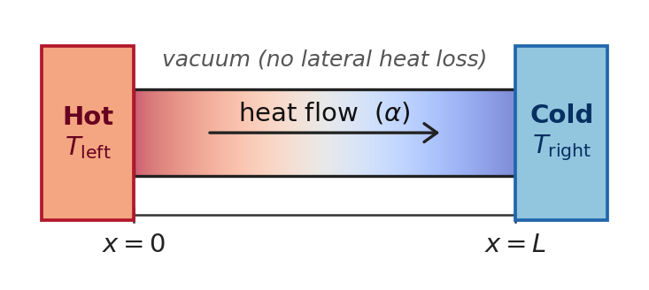
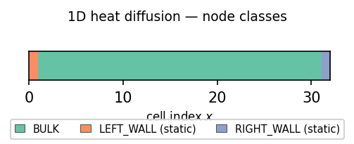
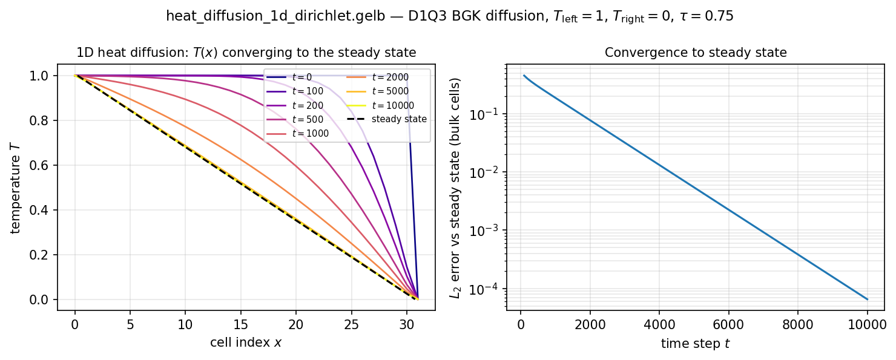

==============
1D Diffusion
==============

This chapter turns the hello-world program into a real LBM
simulation.  We solve 1D heat diffusion on a D1Q3 lattice with
fixed-temperature walls at both ends, and watch the temperature
profile relax from a hot initial condition toward the analytical
linear steady state.  Everything the chapter uses is already in
:doc:`03_gelb_in_10_minutes`; this is the first time you see it
deployed on a real problem.

.. note::

   The example walked here is
   ``examples/lbm/1d/heat_diffusion_1d_dirichlet.gelb``.  Open it
   in another pane as you read.

The physics
===========

Picture a thin metal bar in vacuum, its left end held in a hot
reservoir at temperature :math:`T_\mathrm{left}` and its right end in
a cold one at :math:`T_\mathrm{right}`.  Nothing enters or leaves
through the sides, so heat flows only along the bar.  Whatever the
bar's temperature is at the start, it ends up varying linearly from
the hot end to the cold end; how fast it gets there is set by the
material's diffusivity :math:`\alpha`.

   A bar of length :math:`L` in vacuum between two constant-temperature
   reservoirs :math:`T_\mathrm{left}` and :math:`T_\mathrm{right}`.

We solve the 1D heat equation

.. math::

   \frac{\partial T}{\partial t} = \alpha \, \frac{\partial^2 T}{\partial x^2}

on the interval :math:`x \in [0, L]` with Dirichlet boundary
conditions :math:`T(0) = T_\mathrm{left}` and
:math:`T(L) = T_\mathrm{right}`.  The analytical steady state is
linear,

.. math::

   T_\infty(x) = T_\mathrm{left} + (T_\mathrm{right} -
   T_\mathrm{left}) \cdot x / L\,,

and any initial condition relaxes toward it at a rate set by the
diffusivity :math:`\alpha`.  The transient is a superposition of
sinusoidal eigenmodes :math:`\sin(k \pi x / L)` each decaying as
:math:`\exp(-\alpha k^2 \pi^2 t / L^2)`.

LBM on D1Q3 represents this with three distribution functions per
cell — one for each discrete velocity in the set
:math:`c = \{0, +1, -1\}` — plus corresponding weights
:math:`w = \{4/6, 1/6, 1/6\}`.  The equilibrium distribution for a
passive scalar is :math:`f^{eq}_i = w_i T`, and the BGK collision
operator relaxes the DFs toward equilibrium:

.. math::

   f_i^*(x, t) = (1 - \omega) f_i(x, t) + \omega \, f^{eq}_i(T(x, t))\,.

After collision, the populations stream to their neighbours —
in our "pull" formulation, every cell reads its upstream DF
from the previous time step:

.. math::

   f_i(x, t+1) = f_i^*(x - c_i, t)\,.

The effective diffusivity is :math:`\alpha = c_s^2 (\tau - 1/2)`
with :math:`c_s^2 = 1/3` for D1Q3 and :math:`\tau = 1/\omega`.
For :math:`\tau = 0.75` we get :math:`\alpha = (0.75 - 0.5)/3 =
1/12 \approx 0.0833` in lattice units.  See Mohamad (2019)
§5.3 and §5.5 or Krüger et al. (2017) §8.1 and §8.3.4 for the
Chapman–Enskog derivation of :math:`\alpha`.

The program
===========

.. code-block:: gelb

    simulation_description("1D heat diffusion with Dirichlet BCs (D1Q3)");

    global_constants {
        const int GRID = 32;
        const array[real, 3] W  = {4.0/6.0, 1.0/6.0, 1.0/6.0};
        const array[real, 3] EX = {0.0, 1.0, -1.0};
        const real tau   = 0.75;
        const real omega = 1.0 / tau;
        const real T_left  = 1.0;
        const real T_right = 0.0;
    }

    lattices {
        lattice f(1, 3, real, GRID, false);
    }

    function DiffusionEq(real T) -> (array[real, 3] feq) {
        feq = W * T;
    }

    initializer InitBulk  { f.out[x | :] = DiffusionEq(T_left);  }
    initializer InitLeft  { f.out[x | :] = DiffusionEq(T_left);  }
    initializer InitRight { f.out[x | :] = DiffusionEq(T_right); }

    dynamic CollideAndStream {
        array[real, 3] fIn = upstream_dfs(f, x, EX);
        real T = sum(fIn);
        array[real, 3] feq = DiffusionEq(T);
        f.out[x | :] = (1.0 - omega) * fIn + omega * feq;
    }

    gauge Temperature -> (real temperature) {
        temperature = sum(f.in[x | :]);
    }

    node_classes {
        node_class BULK(InitBulk, CollideAndStream, Temperature);
        node_class LEFT_WALL(InitLeft,  Temperature);
        node_class RIGHT_WALL(InitRight, Temperature);
    }

    geometry {
        nodes[:]        = BULK;
        nodes[0]        = LEFT_WALL;
        nodes[GRID - 1] = RIGHT_WALL;
    }

Forty-six lines of GeLB expressing the complete physics.  If you
notice a little repetition, you are right: ``InitBulk`` and
``InitLeft`` have the same effect, and two initializers would do;
the example keeps one per node class for clarity.  Let's walk
through the new constructs.

Global constants and the velocity set
--------------------------------------

.. code-block:: gelb

    global_constants {
        const int GRID = 32;
        const array[real, 3] W  = {4.0/6.0, 1.0/6.0, 1.0/6.0};
        const array[real, 3] EX = {0.0, 1.0, -1.0};
        const real tau   = 0.75;
        const real omega = 1.0 / tau;
        const real T_left  = 1.0;
        const real T_right = 0.0;
    }

The ``global_constants`` block is how you declare compile-time
constants — grid size, relaxation rates, wall temperatures, and
in particular *the D1Q3 velocity set itself*.  GeLB does not have
a built-in "D1Q3" keyword; you provide the weights ``W`` and the
velocity components ``EX`` as two global arrays.  This is a
deliberate choice: instead of baking velocity sets into the
language, GeLB lets you write BGK (D1Q3, D1Q5, D2Q9, D2Q17, ...)
in exactly the same way, and also lets you use non-standard sets
for research purposes.  We're using the standard D1Q3 numbering
here — DF 0 is the rest particle, DF 1 moves in the ``+x``
direction, DF 2 moves in the ``-x`` direction — but you'd write
the code identically for any other choice.

Notice the types: ``W`` and ``EX`` are ``array[real, 3]`` — 3-element
1D arrays of ``real`` (= ``real64``).  Array types couple element
type and shape into a single type; see
:doc:`03_gelb_in_10_minutes`.

The relaxation rate ``omega = 1.0 / tau`` is a compile-time
constant computed by the compiler (``tau`` is a literal, ``/`` is
a constant-foldable operator, the result is a scalar literal).
You can use ``omega`` anywhere you'd use a literal.

User-defined functions
----------------------

.. code-block:: gelb

    function DiffusionEq(real T) -> (array[real, 3] feq) {
        feq = W * T;
    }

This is our first user-defined function.  The ``function`` block
starts with a comma-separated parameter list, then ``->`` introduces
the parenthesized list of named results.  Here ``T`` is the input and
``feq`` is the single, array-type result.  The body computes the result by assigning
to its declared name.

``DiffusionEq`` computes the equilibrium distribution of a D1Q3
passive scalar from the scalar value :math:`T`.  The expression
``W * T`` multiplies the 3-element array ``W`` by the scalar
``T``, returning a 3-element array (array operations are
element-wise by default).  The compiler inlines this into the
call site, so there is no runtime function call in the generated
code.

Functions in GeLB are **pure** — they have no side effects, cannot
read or write lattices, and cannot recurse (the compiler rejects
recursion at compile time).  The one exception to purity is
``random()``, which a function may call; runs stay reproducible
with a fixed ``--seed`` for the same backend and execution
configuration, thread count included (see
:doc:`19_numerical_semantics`).

Because ``DiffusionEq`` has a single output, it is
called as an expression: ``DiffusionEq(T_left)`` in the initializer, or
``DiffusionEq(T)`` later in the dynamic block.  Multi-output
functions (which we'll see in :doc:`07_lid_driven_cavity`) are
called via destructuring assignment (similar to Python's tuple
unpacking): ``{rho, u} = ComputeMacros(fIn);``.

Three initializers, three node classes
---------------------------------------

.. code-block:: gelb

    initializer InitBulk  { f.out[x | :] = DiffusionEq(T_left);  }
    initializer InitLeft  { f.out[x | :] = DiffusionEq(T_left);  }
    initializer InitRight { f.out[x | :] = DiffusionEq(T_right); }

    node_classes {
        node_class BULK(InitBulk, CollideAndStream, Temperature);
        node_class LEFT_WALL(InitLeft,  Temperature);
        node_class RIGHT_WALL(InitRight, Temperature);
    }

Three initializers, each writing the *full DF array* at a cell
(``f.out[x | :]`` — the ``:`` slice over the DF dimension).  The
right-hand side is a 3-element array literal from
``DiffusionEq(...)``, and because GeLB checks that the shapes
agree, assigning it to ``f.out[x | :]`` writes all three DFs at
once.

Notice what's new compared to :doc:`04_hello_world`:

1. **Three node classes, not one.**  ``BULK`` is the interior,
   ``LEFT_WALL`` and ``RIGHT_WALL`` are the two endpoints.
2. **Two of them have no dynamic block.**  ``LEFT_WALL`` and
   ``RIGHT_WALL`` list only two blocks, ``(InitLeft, Temperature)``
   and ``(InitRight, Temperature)`` — that's GeLB's idiom for a
   **static node class**.  For a cell which belongs to a static class,
   the values are those its initializer set: the DFs are written once and
   keep that value for the entire run.  This is precisely what a
   fixed-temperature wall
   needs: the equilibrium distribution for the boundary
   temperature is set at ``t = 0`` and stays put forever, so the
   interior cells keep streaming "from" a fixed-temperature source
   every timestep.

   The two-block tuple ``(initializer, gauge)`` is one of GeLB's
   boundary-condition patterns, explained in more detail in
   :doc:`14_boundary_conditions_cookbook`.  You can also omit the
   gauge if you don't want wall cells to appear in the output, or
   use the ``masked`` keyword to NaN-fill them.
3. **Every node class shares the same gauge.**  ``Temperature`` is
   listed in all three class tuples, so every cell — interior,
   left wall, right wall — writes a ``temperature`` value to the
   NetCDF output every timestep.  This is how the figure below
   can show a smooth profile that includes the wall values.

   Node-class layout: BULK (teal) fills the interior, LEFT_WALL
   (orange, cell 0) and RIGHT_WALL (blue, cell 31) are static
   boundary cells with no dynamic block.

The dynamic block: BGK collision + pull streaming
--------------------------------------------------

.. code-block:: gelb

    dynamic CollideAndStream {
        array[real, 3] fIn = upstream_dfs(f, x, EX);
        real T = sum(fIn);
        array[real, 3] feq = DiffusionEq(T);
        f.out[x | :] = (1.0 - omega) * fIn + omega * feq;
    }

Four lines of physics.  Line by line:

**Line 1:** ``upstream_dfs(f, x, EX)`` is the streaming intrinsic.
It returns a 3-element array where the ``i``-th entry is the DF
``i`` at the upstream cell — that is, the cell you would reach by
taking one step *against* the direction of motion encoded in
``EX[i]``.  For D1Q3:

- DF 0 (rest particle, ``EX[0] = 0``) → reads from ``f.in[x | 0]``
  (no offset)
- DF 1 (``+x``, ``EX[1] = +1``) → reads from ``f.in[x-1 | 1]``
- DF 2 (``-x``, ``EX[2] = -1``) → reads from ``f.in[x+1 | 2]``

The compiler computes these offsets from the ``EX`` array at
compile time and generates the corresponding index expressions —
you don't have to write ``x - 1`` by hand for this common LBM
operation.

On a non-periodic grid, GeLB checks that no block reads outside
it.  ``CollideAndStream`` runs only on the bulk cells 1 to 30, so
its reads at ``x - 1`` and ``x + 1`` stay inside the grid.  The
wall classes are static: their initializers set their DFs, and no
collision or streaming code runs there.  If you assigned this
dynamic to ``LEFT_WALL`` as well, the compiler would reject the
program as an out-of-bounds access, naming the block, the node
class and the offending offset, and suggesting a periodic axis or
a different block for the boundary cells.

**Line 2:** ``real T = sum(fIn);``.  The macroscopic temperature
is the sum of the distribution functions (the zeroth moment of
the DF population).  ``sum`` is a built-in reduction intrinsic
that reduces an array to a scalar.

**Line 3:** ``array[real, 3] feq = DiffusionEq(T);``.  Compute the
equilibrium distribution at the local temperature, via the user-
defined function from earlier.  The compiler inlines this so
there is no function-call overhead in the inner loop.

**Line 4:** the BGK collision step proper:

.. code-block:: gelb

    f.out[x | :] = (1.0 - omega) * fIn + omega * feq;

Element-wise array arithmetic: multiply the 3-element arrays
``fIn`` and ``feq`` by scalars, add, assign to the 3-element DF
slot ``f.out[x | :]``.  The compiler checks the shapes: an array
must fit the selected DF slice, and an array cannot be assigned to
a single scalar DF slot.  A scalar on the right broadcasts across
the slice, so ``f.out[x | :] = 3.0`` sets all three DFs to 3.0.

The gauge
---------

.. code-block:: gelb

    gauge Temperature -> (real temperature) {
        temperature = sum(f.in[x | :]);
    }

One scalar output per cell per timestep: the temperature, computed
as the sum of the three DFs.  Same pattern as the gauge in
:doc:`04_hello_world`, but now the underlying computation is
physically meaningful.  Note that the gauge reads ``f.in``, not
``f.out``: gauges observe the state the just-completed dynamic
produced, which the ``f.in`` / ``f.out`` contract of
:doc:`03_gelb_in_10_minutes` presents as the new ``f.in``.

Running it
==========

From the repository root, or in VS Code with *Time steps* 10000 and
*Write every* 100 in the Run view (:ref:`working-in-vscode`):

.. code-block:: bash

    gelb-run -n 10000 -w 100 \
        examples/lbm/1d/heat_diffusion_1d_dirichlet.gelb

Ten thousand timesteps writing a gauge snapshot every 100 steps
gives you 101 NetCDF records.  That's enough to watch the profile
relax from the uniform-hot initial condition down to within
:math:`10^{-4}` of its steady state.

That steady state is a straight line, but not the one through the two
wall cells: a static wall cell holding the equilibrium for
:math:`T_\mathrm{wall}` imposes that temperature :math:`1 - \tau`
cells from its own centre, towards the bulk (a quarter of a cell here,
and exactly at the wall cell only for :math:`\tau = 1`).  The bulk
cells therefore settle on the line from :math:`T = 1` at
:math:`x = 0.25` to :math:`T = 0` at :math:`x = N - 1.25 = 30.75`, a
length :math:`L = 30.5`, and that is the dashed line in the figure.

A proper way to remove this offset is the anti-bounce-back scheme
(Krüger et al. (2017) §8.5.2.1), shown in
``examples/lbm/1d/heat_diffusion_1d_antibounceback.gelb``: each end
cell takes back the DF it sent towards the wall with its sign flipped,
plus twice the equilibrium at the wall temperature, which puts the wall
half a cell beyond the end cell for any :math:`\tau`.  Its steady
profile is the straight line between the two walls to round-off.

   **Left:** the temperature profile :math:`T(x)` at eight time
   slices from ``t=0`` (hot everywhere, the initial condition)
   to ``t=10000`` (indistinguishable from the steady state).  The
   dashed black line is that steady state,
   :math:`T(x) = 1 - (x - 0.25)/L`, drawn between the two points
   where the walls impose their temperatures.
   Early profiles are curved because the hot interior hasn't yet
   "seen" the cold right wall; as time progresses the curvature
   relaxes out and the profile straightens.  **Right:** the
   :math:`L_2` error of the bulk cells against the steady state,
   plotted on a log scale.  The exponential
   approach is the sum of the diffusive eigenmode decays — at
   large ``t`` the slowest mode (:math:`k=1`) dominates and the
   decay rate tends to
   :math:`\alpha \pi^2 / L^2 \approx 10^{-3}` per step.

The repository also ships
``examples/lbm/1d/heat_diffusion_1d_periodic.gelb``: the same kernel
on a ring (periodic boundaries, no walls), where one cell heated at the
start spreads its heat out until the whole ring is uniformly warm.

The compiler catches a common mistake
======================================

Suppose you write only the first DF in the initializer, thinking
"this is fine, I'll set DF 1 and DF 2 in the dynamic block on the
first step":

.. code-block:: gelb

    initializer InitBulk {
        array[real, 3] feq = DiffusionEq(T_left);
        f.out[x | 0] = feq[0];   // only DF 0!
    }

Run ``gelbc`` on that program and it refuses to compile:

.. code-block:: text

    [Problem] Initializer 'InitBulk' (for node class 'BULK') does
    not write all DFs of lattice 'f': missing DFs [1, 2]

    [Hint] Add write statements for the missing distribution
    functions, or use the full-range syntax f.out[...|:] to write
    all DFs at once.

This is the **initializer-coverage check** — one of the LBM-
specific compile-time validations GeLB performs by running a
stencil analysis pass over every initializer block and checking
that every DF of every lattice that participates in the
subsequent dynamic is written at least once.  If you forget one,
you get the error above with the exact lattice name and the exact
set of missing DF indices, *before* the first line of code is
generated and *before* any simulation has ever run.

The same check catches partial array writes
(``f.out[x | 0:2] = ...`` when ``q = 3``), out-of-range DF
indices (``f.out[x | 5] = ...`` when ``q = 3``), and write
statements that only run for some node classes — all the
variations on "oops, I didn't actually initialise that DF" that
are easy to make in a hand-written LBM code and notoriously hard
to spot when the result is just a slightly wrong answer.

Peeking at the stencil
=======================

Assuming your program is correct (undo any changes if you followed
the previous error-message showcase), you can ask the compiler to
print its stencil analysis:

.. code-block:: bash

    gelbc \
        examples/lbm/1d/heat_diffusion_1d_dirichlet.gelb \
        --stencils

That prints, for every initializer, dynamic and gauge block, the
per-DF read and write offsets.  For ``CollideAndStream`` you'll see
three reads at offsets ``{0, -1, +1}`` and three writes at offset
``0`` — exactly what the D1Q3 streaming-in-plus-collision step
does.  This same stencil information drives the boundary checks,
the geometry coverage check, and the visualization in
:doc:`15_stencil_visualisation`.

What's next
===========

The next chapter, :doc:`07_lid_driven_cavity`, moves to two
dimensions and to fluid flow: the D2Q9 lattice, multi-output
functions and bounce-back walls.  Everything you learned in this
chapter carries forward unchanged.

.. seealso::

   **Mohamad (2019)** chapter 5 (§5.1–5.5): a self-contained
   treatment of pure 1D diffusion with the lattice Boltzmann
   method, with a Matlab implementation and the Dirichlet boundary
   condition used here.

   **Krüger et al. (2017)** §3.2 (*The Lattice Boltzmann Equation
   in a Nutshell*) for the BGK formula; §8.1 (*Lattice Boltzmann
   Advection-Diffusion in a Nutshell*) and §8.3 (*Lattice Boltzmann
   for Advection-Diffusion*; §8.3.2 for the scalar equilibrium
   :math:`f^{eq}_i = w_i T`, §8.3.4 for the Chapman–Enskog argument
   that the lattice method solves the heat equation).
