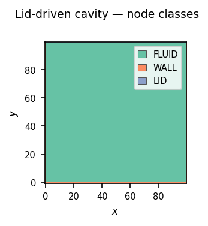
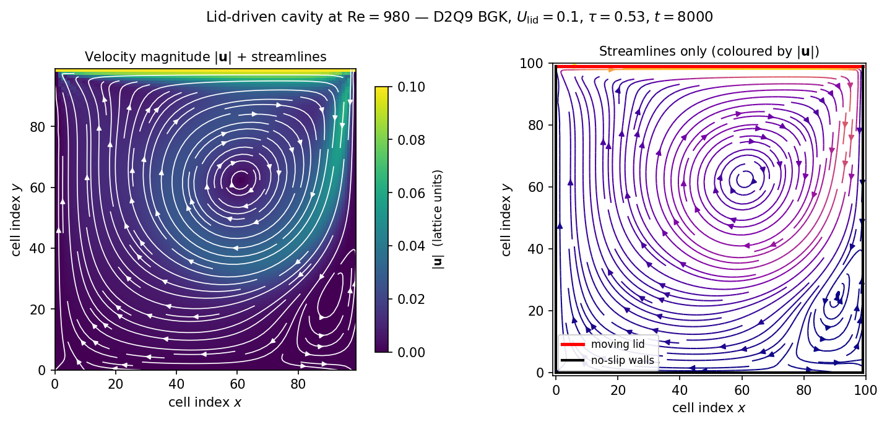
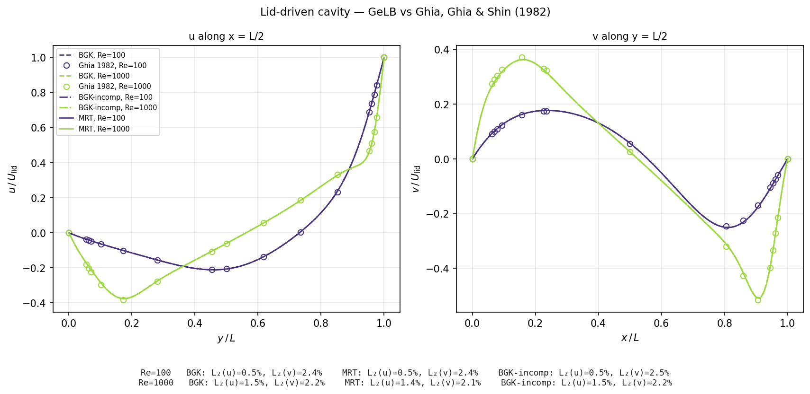

====================
Lid-Driven Cavity
====================

The lid-driven cavity is a canonical benchmark in computational fluid
dynamics.  Ghia, Ghia & Shin (1982) published reference centreline
velocity profiles across a wide range of Reynolds numbers, and
textbooks such as Krüger et al. (2017) and Mohamad (2019) use the
square cavity to validate incompressible flow solvers.  This chapter
runs the setup of Mohamad (2019) §8.8.1 in GeLB.

.. note::

   The example walked here is
   ``examples/lbm/2d/lid_driven_cavity_2d_bgk_re1000.gelb``,
   which uses the parameters of Mohamad (2019) §8.8.1 (pp.
   124–125, Figs. 8.10 and 8.11).  It is the first 2D fluid-flow
   example in the tutorial.

The physics
===========

Consider a square cavity of side length :math:`L` filled with a
viscous fluid.  Three of its walls are stationary (no-slip), while
the top wall (the "lid") slides tangentially in the :math:`+x`
direction at a constant speed :math:`U_\mathrm{lid}`.  Shear at the
lid drags the adjacent fluid toward the upper-right corner, where the
stationary right wall deflects the stream downward and drives a
recirculating vortex across the cavity.

The governing macroscopic equations are the incompressible
Navier–Stokes equations,

.. math::

   \nabla \cdot \mathbf{u} = 0\,, \qquad
   \frac{\partial \mathbf{u}}{\partial t} +
   (\mathbf{u} \cdot \nabla) \mathbf{u} = -\frac{1}{\rho} \nabla p +
   \nu \nabla^2 \mathbf{u}\,,

which we solve indirectly in LBM by time-stepping the lattice
Boltzmann equation on a D2Q9 lattice and extracting :math:`\rho` and
:math:`\mathbf{u}` as moments of the distribution function at every
step.  The flow regime is governed by the Reynolds number

.. math::

   \mathrm{Re} = \frac{U_\mathrm{lid} L}{\nu}\,.

Mohamad (2019) §8.8.1 uses :math:`\mathrm{Re} = 1000`, which is high
enough to produce the characteristic three-vortex flow (one primary
vortex shifted toward the upper-right by advection, plus two
counter-rotating secondary vortices in the lower corners) while
remaining laminar and steady.

D2Q9 and the macroscopic moments
================================

The 1D examples in the preceding chapters used one or three
distribution functions per cell.  For 2D isothermal fluid flow we
move to **D2Q9** — nine populations per cell, consisting of one rest
particle (:math:`i = 0`), four cardinal neighbours
(:math:`i = 1, \ldots, 4`), and four diagonal neighbours
(:math:`i = 5, \ldots, 8`) arranged in a Moore stencil:

.. math::

   \mathbf{c}_i \in \{
     (0, 0),
     (\pm 1, 0), (0, \pm 1),
     (\pm 1, \pm 1)
   \}\,.

The macroscopic density and velocity are the zeroth and first
moments of the DF population:

.. math::

   \rho(\mathbf{x}, t) = \sum_{i=0}^{8} f_i(\mathbf{x}, t)\,,
   \qquad
   \rho(\mathbf{x}, t)\, \mathbf{u}(\mathbf{x}, t)
   = \sum_{i=0}^{8} \mathbf{c}_i \, f_i(\mathbf{x}, t)\,,

and the second-order truncated Maxwell–Boltzmann equilibrium
distribution (with lattice sound speed :math:`c_s^2 = 1/3`) is

.. math::

   f^{\mathrm{eq}}_i = w_i \rho \left(
     1 + 3 \mathbf{c}_i \cdot \mathbf{u}
     + \tfrac{9}{2} (\mathbf{c}_i \cdot \mathbf{u})^2
     - \tfrac{3}{2} |\mathbf{u}|^2
   \right)

with D2Q9 weights :math:`w = \{4/9, 1/9 \times 4, 1/36 \times 4\}`
(Krüger et al. (2017) §3.4.7, Table 3.1).

These two formulas — macroscopic moments and equilibrium — form the
bulk core of an isothermal incompressible flow solver in GeLB; the
remaining sections of the file specify boundary conditions and
geometry.

The program
===========

Here is the core of
``examples/lbm/2d/lid_driven_cavity_2d_bgk_re1000.gelb``, followed by
a walkthrough of the three new GeLB constructs it introduces:

.. code-block:: gelb

    global_constants {
        const int N = 100;
        const real U_LID = 0.1;
        const real NU = 0.01;
        const real TAU = 3.0 * NU + 0.5;      // = 0.53
        const real TAU_INV = 1.0 / TAU;

        const array[real, 9] EX = {0.0, 1.0, 0.0, -1.0,  0.0, 1.0, -1.0, -1.0,  1.0};
        const array[real, 9] EY = {0.0, 0.0, 1.0,  0.0, -1.0, 1.0,  1.0, -1.0, -1.0};
        const array[real, 9] W  = {4.0/9.0,
            1.0/9.0, 1.0/9.0, 1.0/9.0, 1.0/9.0,
            1.0/36.0, 1.0/36.0, 1.0/36.0, 1.0/36.0};
    }

    lattices {
        lattice f(2, 9, real, {N, N}, {false, false});
    }

    function Macro(array[real, 9] fIn) -> (real rho, real ux, real uy) {
        rho = sum(fIn);
        ux = dot_prod(EX, fIn) / rho;
        uy = dot_prod(EY, fIn) / rho;
    }

    function Eq(real rho, real ux, real uy) -> (array[real, 9] feq) {
        real usq = ux * ux + uy * uy;
        array[real, 9] eu = EX * ux + EY * uy;
        feq = W * rho * (1.0 + 3.0 * eu + 4.5 * eu * eu - 1.5 * usq);
    }

    initializer InitFluid { f.out[x, y | :] = W; }

    dynamic FluidDynamic {
        array[real, 9] fIn = upstream_dfs(f, x, y, {EX, EY});
        real rho; real ux; real uy;
        {rho, ux, uy} = Macro(fIn);
        f.out[x, y | :] = fIn - TAU_INV * (fIn - Eq(rho, ux, uy));
    }

    gauge Hydro -> (real rho, real ux, real uy) {
        {rho, ux, uy} = Macro(f.in[x, y | :]);
    }

    dynamic BounceBack {
        f.out[x, y | :] = bounce_back_dfs(f, x, y, {EX, EY});
    }

    dynamic MovingLid {
        f.out[x, y | :] = bounce_back_dfs(f, x, y, {EX, EY})
                          + 6.0 * W * (EX * U_LID);
    }

    gauge BoundaryHydro -> (real rho, real ux, real uy) {
        rho = 1.0;
        ux = U_LID * real(y == N - 1);
        uy = 0.0;
    }

    node_classes {
        node_class FLUID(InitFluid, FluidDynamic, Hydro);
        node_class WALL(InitFluid, BounceBack, BoundaryHydro);
        node_class LID(InitFluid, MovingLid, BoundaryHydro);
    }

    geometry {
        nodes[:, :]     = FLUID;
        nodes[0, :]     = WALL;     // left
        nodes[N - 1, :] = WALL;     // right
        nodes[:, 0]     = WALL;     // bottom
        nodes[:, N - 1] = LID;      // top lid
    }

The three new constructs are multi-output functions, the ``dot_prod``
intrinsic, and ``bounce_back_dfs``.

Multi-output functions: ``Macro`` and destructuring
----------------------------------------------------

The ``Macro`` function returns *three* values — the density and
the two velocity components — via a multi-output signature:

.. code-block:: gelb

    function Macro(array[real, 9] fIn) -> (real rho, real ux, real uy) {
        rho = sum(fIn);
        ux = dot_prod(EX, fIn) / rho;
        uy = dot_prod(EY, fIn) / rho;
    }

.. important::

   A multi-output function cannot be called inside an expression.
   Instead, destructure its return tuple into pre-declared variables:

   .. code-block:: gelb

       real rho; real ux; real uy;
       {rho, ux, uy} = Macro(fIn);

   The names after ``->`` establish the result order.  Every named
   result must have a target on the destructuring left-hand side, in
   the same order, and every target variable must already be declared
   with the matching type.

The compiler inlines the function body, so ``Macro`` carries no
function-call overhead in the inner loop — the three outputs become
three scalar assignments in the generated target code.

``dot_prod``: fast first moment
--------------------------------

.. code-block:: gelb

    ux = dot_prod(EX, fIn) / rho;

``dot_prod(a, b)`` returns the inner product :math:`\sum_i a_i b_i`
as a scalar.  Using ``dot_prod(EX, fIn)`` instead of
``sum(EX * fIn)`` states the mathematical operation directly and lets
backends emit a fused multiply-accumulate reduction.  The two forms
are semantically equivalent.

The first velocity moment is :math:`\rho u_x = \sum_i c_{i,x} f_i`;
since each ``EX[i]`` multiplies the corresponding ``fIn[i]`` and the
results are summed, ``dot_prod(EX, fIn)`` is the direct translation.

Bounce-back with ``bounce_back_dfs``
-------------------------------------

The no-slip walls use **full-way bounce-back** (Krüger et al. (2017)
§5.3.3.2): a wall cell stores the populations that arrive from the
fluid and sends each one back, inverted, on the next step.  In GeLB
this is a one-liner:

.. code-block:: gelb

    dynamic BounceBack {
        f.out[x, y | :] = bounce_back_dfs(f, x, y, {EX, EY});
    }

``bounce_back_dfs(f, x, y, {EX, EY})`` is a streaming intrinsic, like
``upstream_dfs``, but it reads the other way round: the ``i``-th entry
of the returned array is ``f.in[x + EX[i], y + EY[i] | opp(i)]``, the
population of the neighbour in direction ``i`` that points back at the
wall cell, where ``opp(i)`` is the index of the DF with the opposite
velocity vector :math:`\mathbf{c}_{\mathrm{opp}(i)} = -\mathbf{c}_i`.
On the next step the fluid neighbour pulls slot ``i`` from the wall
cell, so every population that reaches the wall goes back along the
link it came in on.  A link that points out of the grid (the wall
cells sit on its edge) gives the cell's own ``f.in[x, y | opp(i)]``;
no cell ever pulls that slot, so it only has to be defined.  The
compiler computes the ``opp`` permutation from the velocity arrays at
compile time, avoiding manual index-permutation errors in bounce-back
implementations.

For D2Q9 with the standard numbering the permutation is
``opp = (0, 3, 4, 1, 2, 7, 8, 5, 6)`` — the rest population stays
fixed, the four cardinals swap in pairs, and the four diagonals swap
in pairs.  If you use a different D2Q9 ordering, ``bounce_back_dfs``
derives the corresponding permutation automatically from your
velocity arrays.

The wall cells occupy the outer rows of the grid, but the no-slip
surface does not: with bounce-back it lies midway between the wall
node and the first fluid node, at :math:`x = 0.5` and
:math:`x = N - 1.5` (and likewise in :math:`y`).  The fluid therefore
spans :math:`L = N - 2` lattice spacings, and that is the length in
the Reynolds number: the program's :math:`N = 100`,
:math:`U_\mathrm{lid} = 0.1` and :math:`\nu = 0.01` give
:math:`\mathrm{Re} = 0.1 \times 98 / 0.01 = 980`, and
``-D NU=0.0098`` gives exactly 1000.

Moving-wall bounce-back: adding the lid velocity
-------------------------------------------------

A moving wall combines bounce-back with a momentum-transfer
correction:

.. code-block:: gelb

    dynamic MovingLid {
        f.out[x, y | :] = bounce_back_dfs(f, x, y, {EX, EY})
                          + 6.0 * W * (EX * U_LID);
    }

Following Ladd (1994) and Krüger et al. (2017) §5.3.3 (Eq. 5.26),
for a wall moving tangentially at velocity :math:`\mathbf{u}_w`,
the bounce-back rule in terms of the incoming pre-reflection
direction :math:`i` (with opposite outgoing direction :math:`\bar{i}`)
reads

.. math::

   f_{\bar{i}}(\mathbf{x}_b, t+1) = f_i^*(\mathbf{x}_b, t)
   - 2 w_i \rho_w \,\frac{\mathbf{c}_i \cdot \mathbf{u}_w}{c_s^2}\,,

where :math:`\mathbf{x}_b` is the fluid node next to the wall,
:math:`\rho_w \approx 1` at the wall in the incompressible limit and
:math:`c_s^2 = 1/3` for D2Q9 — giving the prefactor
:math:`2 / (1/3) = 6`.  In the full-way form the reflected population
passes through the wall cell and comes back a step later than in
Eq. (5.26), carrying the same correction.  Because
``bounce_back_dfs(f, x, y, {EX, EY})`` indexes the wall cell's output
slot by the *post-reflection* direction :math:`i` (whose lattice
velocity is opposite to the pre-reflection direction,
:math:`\mathbf{c}_i = -\mathbf{c}_{\bar{i}}`), the sign of the
momentum correction flips from minus to plus:

.. math::

   f_i^{\mathrm{out}}(\mathbf{x}_w, t) =
   f_{\bar{i}}^{\mathrm{in}}(\mathbf{x}_w + \mathbf{c}_i, t)
   + 6 w_i (\mathbf{c}_i \cdot \mathbf{u}_w)\,,

with :math:`\mathbf{x}_w` the wall node and
:math:`\mathbf{x}_w + \mathbf{c}_i` the fluid node the population came
from.

In GeLB that correction is ``6.0 * W * (EX * U_LID)``: a 9-element
vector that the compiler adds to the bounced-back DFs element-wise
(compare also Mohamad (2019) §8.3.1, Eq. 8.17).  Here ``U_LID`` is a
scalar, ``EX`` and ``W`` are 9-element arrays, ``EX * U_LID``
broadcasts the scalar across the array, and the remaining products
are element-wise.

Because the lid moves in the ``+x`` direction, only the DFs with
non-zero ``EX[i]`` components (the east/west cardinals and the four
diagonals) receive a non-zero correction; the rest and north/south
components of ``EX`` are zero and vanish automatically.

The BGK dynamic block
---------------------

.. code-block:: gelb

    dynamic FluidDynamic {
        array[real, 9] fIn = upstream_dfs(f, x, y, {EX, EY});
        real rho; real ux; real uy;
        {rho, ux, uy} = Macro(fIn);
        f.out[x, y | :] = fIn - TAU_INV * (fIn - Eq(rho, ux, uy));
    }

The bulk dynamic follows the standard four-step pattern: pull-stream
from upstream neighbours, compute macroscopic moments, evaluate the
equilibrium distribution, and relax.  The BGK relaxation is written
in the form :math:`f - \omega (f - f^{\mathrm{eq}})` rather than
:math:`(1 - \omega) f + \omega f^{\mathrm{eq}}`; the two are
algebraically equivalent, and the subtraction form composes cleanly
with body-force source terms (see :doc:`08_poiseuille_body_force`).
Whereas interior ``FLUID`` cells pull from all eight neighbours via
``upstream_dfs``, the boundary ``WALL`` and ``LID`` cells execute
``BounceBack`` and ``MovingLid``, which use ``bounce_back_dfs``: from
each neighbour they read the population that points back at them,
and the links that leave the grid are guarded, so these classes may
sit on the grid edge.  A wall cell holds populations on their way
back into the fluid, so their moments are not a fluid velocity; the
walls report the prescribed wall velocity through their own gauge,
``BoundaryHydro`` (0 on the walls, :math:`U_\mathrm{lid}` on the lid,
and :math:`\rho = 1` as a display value).

Geometry: painting the walls
=============================

.. code-block:: gelb

    geometry {
        nodes[:, :]     = FLUID;
        nodes[0, :]     = WALL;     // left
        nodes[N - 1, :] = WALL;     // right
        nodes[:, 0]     = WALL;     // bottom
        nodes[:, N - 1] = LID;      // top lid
    }

Five assignments define the domain layout: the first line fills the
entire grid with ``FLUID``, and the next four lines overwrite the
outer edges with ``WALL`` (left, right, bottom) and ``LID`` (top).
Because geometry statements execute in order ("last paint wins"),
each of the four corner cells is painted twice: the two bottom
corners ``(0, 0)`` and ``(N - 1, 0)`` remain ``WALL``, while the two
top corners ``(0, N - 1)`` and ``(N - 1, N - 1)`` are overwritten last
by ``nodes[:, N - 1] = LID`` and become ``LID`` cells.  The physical
and numerical consequences of this corner assignment are examined in
detail below.

   Node-class layout: FLUID (teal) interior, WALL (orange) on
   three sides, LID (blue) on the top edge.

Running it
==========

.. code-block:: bash

    # Default: cpu_highway (portable-SIMD C++ + OpenMP)
    ./scripts/gelb-run -n 8000 -w 8000 \
        examples/lbm/2d/lid_driven_cavity_2d_bgk_re1000.gelb

    # Single-threaded Fortran reference — same source, no code changes
    ./scripts/gelb-run -b cpu_fortran_serial -n 8000 -w 8000 \
        examples/lbm/2d/lid_driven_cavity_2d_bgk_re1000.gelb

The ``-w 8000`` flag instructs the gauge to write only at the final
step.  A single ``gelb-run`` invocation takes 2–3 seconds on an
8-core laptop with the default ``cpu_highway`` backend; the
single-threaded ``cpu_fortran_serial`` reference is several times
slower.  In VS Code (:ref:`working-in-vscode`), set *Time steps* and
*Write every* to 8000 in the Run view and press **Run**; the *Backend*
row chooses ``cpu_fortran_serial`` for the second command.

   **Left:** velocity magnitude :math:`|\mathbf{u}|` with
   streamlines overlaid in white.  The lid (top edge) drives the
   flow from left to right; the fluid accelerates along the lid,
   descends the right wall, recirculates through the cavity,
   and climbs the left wall.  The boundary layer along the lid
   is thin and intense (bright yellow) where the shear is
   highest.  **Right:** streamline topology coloured by speed,
   showing the **primary vortex** (shifted toward the upper-right
   by advection at :math:`\mathrm{Re} = 980`) and the
   **counter-rotating vortex** in the lower-right corner; the one in
   the lower-left corner is still forming at ``t = 8000`` (the flow
   along the bottom has just begun to reverse there).  This qualitative
   pattern matches Mohamad (2019) §8.8.1 Fig. 8.10 (p. 125) and
   Ghia, Ghia & Shin (1982) Fig. 6.  At ``t = 8000`` steps the
   vortex topology is already established, though the flow is still
   developing: the viscous time :math:`L^2 / \nu` at these parameters
   is about :math:`10^6` steps.  The quantitative comparison with
   Ghia, Ghia & Shin (1982) below uses runs long enough to reach the
   steady state.

A note on the Mach number
==========================

The tutorial's example files default to :math:`U_\mathrm{lid}
= 0.1` to match the parameters of Mohamad (2019) §8.8.1, which gives a
lid Mach number of
:math:`\mathrm{Ma}_\mathrm{lid} = U_\mathrm{lid} / c_s =
U_\mathrm{lid} \sqrt{3} \approx 0.173`.  That exceeds the
:math:`\mathrm{Ma} \ll 0.1` (:math:`U_\mathrm{max}^* < 0.03\text{–}0.1`)
accuracy guideline of Krüger et al. (2017) §7.2.1–7.2.3 (Table 7.2)
for quantitative incompressible comparisons.

For the quantitative validation below, we override the defaults to
:math:`U_\mathrm{lid} = 0.05` (:math:`\mathrm{Ma} \approx 0.087`) on
an :math:`N = 129` grid, the grid size Ghia, Ghia & Shin (1982) used.
The validation script passes :math:`N`, :math:`U_\mathrm{lid}` and the
:math:`\tau` that holds :math:`\mathrm{Re}` fixed as ``-D``
command-line overrides; the ``.gelb`` source file itself is unchanged.

Corners and the no-slip discontinuity
======================================

The four cavity corners warrant closer inspection.  Each corner is
the intersection of two walls, and at the **top corners** those two
walls have *different* prescribed velocities: the lid moves at
:math:`U_\mathrm{lid}` while the left and right walls are stationary.
Continuum hydrodynamics therefore has a velocity **discontinuity** at
the two upper corners (jumping from :math:`u_x = U_\mathrm{lid}` to
:math:`u_x = 0`).  Krüger et al. (2017) §5.3.6 (footnote 23) note
explicitly that standard smooth-corner LBM analysis excludes the
lid-driven cavity for this reason.

In our GeLB geometry block:

.. code-block:: gelb

    nodes[:, :]     = FLUID;
    nodes[0, :]     = WALL;
    nodes[N - 1, :] = WALL;
    nodes[:, 0]     = WALL;
    nodes[:, N - 1] = LID;     // last paint wins at the top corners

the top-left and top-right cells are assigned ``LID`` (by paint
order), while the bottom-left and bottom-right cells are assigned
``WALL``.  There is **no separate corner node class** — each corner
cell executes the standard ``MovingLid`` or ``BounceBack`` dynamic of
its wall.  This works because ``bounce_back_dfs`` sends back every
population that arrives at the cell, along whichever link it came in
on, which matches the corner prescription of the **link-wise**
bounce-back approach (Krüger et al. (2017) §5.3.6.1).

For the **wet-node / Zou–He / NEBB** family of boundary conditions,
corners require dedicated closures.  At a concave corner like the
bottom-left node, five non-rest post-streaming populations
(``E``, ``N``, ``NE``, ``NW``, ``SE``) plus the rest population
:math:`f_0` are unknown, whereas the flat-wall NEBB relations supply
only three equations.  The standard concave-corner closure of Krüger
et al. (2017) §5.3.6.2 (Eqs. 5.55–5.59) proceeds in four steps:

1. Apply the non-equilibrium bounce-back rule to the three
   normal-direction pairs pointing into the fluid domain:
   :math:`f_1^{\mathrm{neq}} = f_3^{\mathrm{neq}}`,
   :math:`f_2^{\mathrm{neq}} = f_4^{\mathrm{neq}}`,
   :math:`f_5^{\mathrm{neq}} = f_7^{\mathrm{neq}}`.
2. Substitute these into the macroscopic momentum equations; the two
   momentum constraints collapse to a single equation for the
   difference :math:`f_6 - f_8 = \frac{1}{6c}\,\rho_w\,(u_{w,y} - u_{w,x})`.
3. Close the system by requiring the remaining "buried" link
   populations :math:`f_6` and :math:`f_8` to have equal magnitude and
   opposite sign (:math:`f_6 = -f_8`), yielding
   :math:`f_6 = -f_8 = \frac{1}{12c}\,\rho_w\,(u_{w,y} - u_{w,x})`
   (Krüger et al. (2017) Eq. 5.58), which simplifies to
   :math:`f_6 = f_8 = 0` at a stationary corner.
4. Recover :math:`f_0` from mass conservation (Eq. 5.59), with
   :math:`\rho_w` extrapolated from neighbouring nodes.

At the **top corners**, where the wall velocity is discontinuous, this
wet-node closure is not well-posed.  Standard practice in the LBM
literature is either to extrapolate from the interior or to use
link-wise bounce-back, which absorbs the corner singularity locally
without destabilising the bulk (the buried links never stream into the
fluid interior).  Near-corner boundary-layer resolution remains one of
the contributors to the residual :math:`L_2` error at high Reynolds
numbers, where the lid boundary layer thins to a few lattice spacings.

Both ``lid_driven_cavity_2d_bgk.gelb`` and
``lid_driven_cavity_2d_mrt.gelb`` use link-wise bounce-back, so the
corners are handled by the same wall dynamics as the straight edges.

.. seealso::

   **Krüger et al. (2017)** §5.3.6 (*Corners*) for the full taxonomy:
   convex versus concave corners, link-wise versus wet-node
   treatments, and the buried-link closure.

Quantitative validation against Ghia, Ghia & Shin (1982)
=========================================================

To complement the qualitative streamline comparison with a
quantitative benchmark, we compare the steady-state velocity profiles
against Ghia, Ghia & Shin (1982), who tabulated centreline velocities
at :math:`\mathrm{Re} = 100, 400, 1000, 3200, \ldots` for the
unit-square lid-driven cavity at 17 non-uniform :math:`y/L` and
:math:`x/L` stations (Tables I and II of their paper).

The validation script ``scripts/validate_ldc.py`` runs
``examples/lbm/2d/lid_driven_cavity_2d_bgk.gelb`` (and its MRT and
incompressible siblings, ``lid_driven_cavity_2d_mrt.gelb`` and
``lid_driven_cavity_2d_incomp_zou.gelb``) at each Reynolds number
until the flow is steady, extracts :math:`u(y)` along the vertical
centreline (:math:`x = L/2`) and :math:`v(x)` along the horizontal
centreline (:math:`y = L/2`), interpolates onto the 17 stations of
Ghia, Ghia & Shin (1982), and reports the relative :math:`L_2` error.
The table below comes from

.. code-block:: bash

    uv run python scripts/validate_ldc.py --re 100 1000 --n 129 \
        --u-lid 0.05 --collision bgk mrt incomp_zou --backend gpu_cuda_cpp
    # → docs/user/figures/data/07_ldc_ghia_validation.json

on a CUDA host; on a CPU host substitute ``--backend cpu_highway``
(portable-SIMD C++ + OpenMP) or ``--backend cpu_fortran_serial``
(single-threaded reference, the script's default).  The reference
tables are stored in ``gelb/tests/data/ghia_1982_ldc.py`` for both
:math:`\mathrm{Re} = 100` and :math:`\mathrm{Re} = 1000`.

         Ghia, Ghia & Shin (1982) points
   :align: center
   :width: 95%

   Centreline velocity profiles at :math:`\mathrm{Re} = 100`
   (purple) and :math:`\mathrm{Re} = 1000` (green) on an
   :math:`N = 129` grid with :math:`U_\mathrm{lid} = 0.05`
   (:math:`\mathrm{Ma} \approx 0.087`): GeLB curves (lines) overlaid
   on the reference points of Ghia, Ghia & Shin (1982) (open circles).
   **Left:** :math:`u(y)` along the vertical centreline at
   :math:`x = L/2`.  **Right:** :math:`v(x)` along the horizontal
   centreline at :math:`y = L/2`.  Both velocities are normalised by
   :math:`U_\mathrm{lid}`.

The relative :math:`L_2` errors on an :math:`N = 129` grid with
:math:`U_\mathrm{lid} = 0.05` (:math:`\mathrm{Ma} \approx 0.087`),
run on the ``gpu_cuda_cpp`` backend, are:

.. list-table::
   :header-rows: 1
   :widths: 20 16 16 16 16 16

   * - Re
     - Collision
     - :math:`\tau`
     - Steps
     - :math:`L_2(u)`
     - :math:`L_2(v)`
   * - 100
     - BGK
     - 0.691
     - 1.3 M
     - 0.50 %
     - 2.40 %
   * -
     - MRT
     - 0.691
     - 1.3 M
     - 0.50 %
     - 2.41 %
   * -
     - BGK-incomp (Zou 1995)
     - 0.691
     - 1.3 M
     - 0.49 %
     - 2.46 %
   * - 1000
     - BGK
     - 0.519
     - 13 M
     - 1.52 %
     - 2.21 %
   * -
     - MRT
     - 0.519
     - 13 M
     - 1.45 %
     - 2.07 %
   * -
     - BGK-incomp (Zou 1995)
     - 0.519
     - 13 M
     - 1.50 %
     - 2.21 %

At :math:`\mathrm{Re} = 100` the GeLB curves lie on the
Ghia, Ghia & Shin (1982) points: the relative :math:`L_2` error is
0.5 % on the primary :math:`u`-profile and about 2.4 % on :math:`v`,
and the three collision operators agree to within 0.06 percentage
points.  At :math:`\mathrm{Re} = 1000` the errors are 1.5 % on
:math:`u` and 2.1–2.2 % on :math:`v`; MRT is slightly closer to the
benchmark than BGK (1.45 % and 2.07 % against 1.52 % and 2.21 %), and
the incompressible equilibrium of Zou et al. (1995) gives the same
errors as standard BGK to within a few hundredths of a percentage
point.

What's next
===========

:doc:`08_poiseuille_body_force` keeps the 2D setting and
introduces body forcing and MRT collision — the two ingredients
needed for pressure- or force-driven channel flow with second-order
accuracy, validated directly against the exact parabolic Poiseuille
solution.

If you want to push the lid-driven cavity to higher Reynolds numbers,
switching from BGK to MRT or adding a subgrid turbulence model
improves stability — see :doc:`08_poiseuille_body_force` for MRT and
``examples/lbm/2d/lid_driven_cavity_2d_bgk_smagorinsky.gelb`` for a
Smagorinsky LES variant.

.. seealso::

   **Krüger et al. (2017)** §5.3.3 (*Solid Boundaries: Bounce-Back
   Approach*) for the moving-wall bounce-back derivation and the
   half-grid-spacing wall location that makes bounce-back
   second-order accurate; §7.2 (*Parameter Selection*, specifically
   Eq. 7.22 and Table 7.2) for the Mach-number bound and the trade-off
   between :math:`\mathrm{Re}`, grid size, :math:`\tau`, and timestep
   count.

   **Mohamad (2019)** §8.8.1 (*Lid-Driven Cavity*, pp. 124–125) for
   the worked :math:`\mathrm{Re} = 1000`, :math:`N = 100`,
   :math:`U_\mathrm{lid} = 0.1` setup, with streamline topology in
   Fig. 8.10 and horizontal/vertical centreline velocity profiles
   compared against a finite-volume benchmark in Fig. 8.11.

   **Ghia, U., Ghia, K. N. & Shin, C. T. (1982)** "High-Re
   solutions for incompressible flow using the Navier-Stokes
   equations and a multigrid method." *Journal of Computational
   Physics*, **48**, 387–411.  The canonical reference benchmark for
   the 2D lid-driven cavity.
