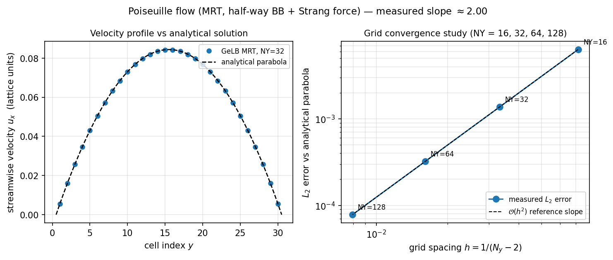

===========================
Poiseuille with Body Force
===========================

The :doc:`07_lid_driven_cavity` benchmark ran the Navier–Stokes
equations at :math:`\mathrm{Re} = 1000` and compared the centreline
velocity profiles against a reference tabulation.  Where an exact
closed-form solution exists, we can go further and verify the formal
order of accuracy across a sequence of grids.  This chapter sets up
a body-force-driven planar Poiseuille flow with analytical validation
and a four-grid convergence study.  Along the way, it introduces
three ingredients used throughout quantitative LBM simulations:
**MRT collision**, **Strang-split body forcing**, and **full-way
bounce-back** (the wall midway between the nodes).

.. note::

   The example walked here is
   ``examples/lbm/2d/poiseuille_flow_2d_mrt.gelb``.  Its header
   comment marks it as validated, with second-order convergence;
   this chapter explains how each of the three ingredients
   contributes to that rate.

The physics
===========

Consider incompressible flow between two infinite parallel plates
separated by a distance :math:`H`, driven by a uniform streamwise
body force density :math:`G = \rho g_x` (Krüger et al. (2017)
§6.2.1; Mohamad (2019) §8.8.2).  In steady state the flow is
unidirectional (:math:`\partial_x = 0`, :math:`u_y = 0`), pressure
is uniform, and the streamwise momentum balance
:math:`\nu \, \mathrm{d}^2 u_x / \mathrm{d}y^2 + G/\rho = 0` with
no-slip walls at :math:`y_\mathrm{eff} = 0` and
:math:`y_\mathrm{eff} = H` integrates to the familiar parabola:

.. math::

   u(y) = \frac{G}{2 \rho \nu} \, y_\mathrm{eff} \, (H - y_\mathrm{eff})\,,
   \qquad u_\mathrm{max} = \frac{G H^2}{8 \rho \nu}\,,

with :math:`\rho = \rho_0 = 1` in lattice units and
:math:`y_\mathrm{eff}` measured from the bottom no-slip plane.
Because both the velocity profile and its :math:`L_2` error norm
have closed-form expressions, planar Poiseuille flow is the standard
benchmark for testing spatial order of accuracy.

Specifically, we can measure the relative :math:`L_2` error of the
simulated profile against the exact parabola across several grid
resolutions and plot the error against the grid spacing
:math:`h = 1/H`.  For a second-order-accurate scheme the error scales
as :math:`\mathcal{O}(h^2)`, which appears on a log-log plot against
:math:`h` as a straight line of slope :math:`+2` (or slope
:math:`-2` when plotted against the cell count :math:`H`).  If the
measured slope flattens toward :math:`1`, at least one component of
the discretisation — the collision operator, the forcing scheme, or
the wall boundary condition — is introducing a first-order error.

Why MRT, and why now?
======================

The :doc:`07_lid_driven_cavity` example used single-relaxation-time
BGK collision, which is compact and effective at moderate viscosity
when qualitative or engineering-level accuracy suffices.  For strict
convergence studies and low-viscosity flows, however, BGK has two
well-known limitations (Krüger et al. (2017) §10.1–10.4):

1. **All moments relax at a single rate** (:math:`\omega = 1/\tau`).
   In the Chapman–Enskog expansion, the conserved moments (density
   and momentum) do not relax; the shear and normal stress moments
   relax at the rate :math:`1/\tau` that fixes the kinematic
   viscosity :math:`\nu = c_s^2 (\tau - \tfrac{1}{2}) \Delta t`; and
   the higher-order kinetic ("ghost") moments do not enter the
   incompressible Navier–Stokes equations at leading order.  Tying
   all nine rates together forces a compromise between stability at
   low :math:`\tau` and small truncation error at high :math:`\tau`.

2. **Viscosity-dependent wall slip with bounce-back.**
   Under BGK collision, the effective no-slip plane of
   bounce-back shifts away from the geometric mid-link plane by a
   term proportional to :math:`(\tau - \tfrac{1}{2})^2` (Ginzburg
   (2008); Krüger et al. (2017) §5.3.3.3 and §10.4).  Unless the
   relaxation rates of the odd and even moments are decoupled,
   that numerical slip alters the apparent channel width as
   :math:`\tau` varies.

**MRT** (Multiple-Relaxation-Time collision; Lallemand & Luo (2000);
d'Humières et al. (2002); Krüger et al. (2017) §10.4) resolves both
issues.  Distribution functions are mapped into *moment space* via a
fixed invertible transformation matrix
:math:`\mathbf{m} = M \mathbf{f}`, each moment relaxes independently
via a diagonal relaxation matrix :math:`S`, and the post-collision
state is mapped back to velocity space:

.. math::

   \mathbf{f}^*(\mathbf{x}, t) = \mathbf{f}(\mathbf{x}, t)
   - M^{-1} S \bigl(\mathbf{m}(\mathbf{x}, t) - \mathbf{m}^\mathrm{eq}(\mathbf{x}, t)\bigr)\,.

For the D2Q9 lattice, the orthogonal Gram–Schmidt basis of
Lallemand & Luo (2000) (Krüger et al. (2017) §10.4.2, Eq. 10.30)
orders the nine moments as

.. math::

   \mathbf{m} = (\rho,\, e,\, \epsilon,\, j_x,\, q_x,\, j_y,\, q_y,\, p_{xx},\, p_{xy})^\mathsf{T}\,,

representing density (:math:`\rho`), energy (:math:`e`), energy
squared (:math:`\epsilon`), momentum (:math:`j_x, j_y`), energy flux
(:math:`q_x, q_y`), and the diagonal and off-diagonal viscous stress
components (:math:`p_{xx}, p_{xy}`).  The conserved moments have zero
relaxation rate (:math:`s_\rho = s_{jx} = s_{jy} = 0`), the two
deviatoric stress moments relax at :math:`s_{pxx} = s_{pxy} = 1/\tau`
to set the shear viscosity, and the non-hydrodynamic rates
(:math:`s_e, s_\epsilon, s_{qx}, s_{qy}`) are chosen around
:math:`1.1` to damp acoustic and kinetic modes cleanly.

In GeLB, MRT is not a special built-in collision keyword — you express
it directly in the ``dynamic`` block using the ``matmul`` and
``inverse`` intrinsics.  Because ``M`` is a compile-time constant,
``inverse(M)`` is evaluated at compile time as well.

Body forcing with Strang splitting
===================================

Adding a body force :math:`\mathbf{g}` to the lattice Boltzmann
equation requires care to avoid discrete lattice artefacts of order
:math:`\mathcal{O}(\Delta t)` (Guo, Zheng & Shi (2002); Krüger et al.
(2017) §6.2–6.4).  If the force is applied only before or only after
collision, the macroscopic momentum recovered by the Chapman–Enskog
analysis differs from the physical velocity by half a forcing step.
Second-order accuracy requires two conditions:

1. The macroscopic velocity entering the equilibrium distribution
   must be shifted by half a force impulse:
   :math:`\rho \mathbf{u} = \sum_i \mathbf{e}_i f_i + \tfrac{1}{2} \mathbf{G} \Delta t`.
2. The total momentum increment over the time step must equal
   :math:`\mathbf{G} \Delta t`.

In moment space, both conditions are satisfied cleanly by **Strang
splitting** the momentum impulse around the collision step (compare
Krüger et al. (2017) §6.2.3 and §10.5):

1. Transform pre-collision distributions to moments:
   :math:`\mathbf{m} = M \mathbf{f}^\mathrm{in}`.
2. Add half the force impulse (:math:`\tfrac{1}{2} G \Delta t`) to
   the streamwise momentum moment :math:`j_x`.
3. Evaluate the equilibrium moments :math:`\mathbf{m}^\mathrm{eq}(\rho, \mathbf{u})`
   using the half-step velocity :math:`u_x = j_x / \rho`,
   :math:`u_y = j_y / \rho`, and relax:
   :math:`\mathbf{m} \leftarrow \mathbf{m} - S(\mathbf{m} - \mathbf{m}^\mathrm{eq})`.
4. Add the second half of the force impulse (:math:`\tfrac{1}{2} G \Delta t`)
   to :math:`j_x`.
5. Transform back to populations:
   :math:`\mathbf{f}^\mathrm{out} = M^{-1} \mathbf{m}`.

Because :math:`j_x` is a conserved moment (:math:`s_{jx} = 0`), the
first half-impulse passes through the relaxation step unchanged and
automatically supplies the half-step velocity shift
:math:`\mathbf{u} = (\sum_i \mathbf{e}_i f_i + \tfrac{1}{2}\mathbf{G}\Delta t)/\rho`
to :math:`\mathbf{m}^\mathrm{eq}`, while the second half-impulse
completes the full momentum increment :math:`G \Delta t`.  (For a
unidirectional channel flow with :math:`u_y = 0`, :math:`G_y = 0`,
and :math:`\partial_x = 0`, the higher-order velocity-force product
terms in the full MRT forcing source of Krüger et al. (2017) §10.5
Eq. (10.35) vanish identically, so Strang splitting of :math:`j_x`
is exact to second order.)

Bounce-back — what, and why
===========================

In a pull-streaming solver, fluid cells gather their incoming
populations from neighbouring cells' ``f.out`` arrays via
``upstream_dfs``.  The wall cells at :math:`y = 0` (bottom) and
:math:`y = N_y - 1` (top) sit outside the fluid domain: they do not
run fluid collision, and their sole job is to place the reflected
populations into their own ``f.out`` slots so that the adjacent
fluid row (:math:`y = 1` or :math:`y = N_y - 2`) pulls them on the
next time step.

To achieve second-order spatial accuracy, we use **bounce-back**
(Krüger et al. (2017) §5.3.3), in which the physical
no-slip plane sits *midway* along each lattice link crossing the
boundary — at :math:`y = 0.5` between the bottom wall row
(:math:`y = 0`) and the first fluid row (:math:`y = 1`), and at
:math:`y = N_y - 1.5` at the top.  The effective channel height
spanned by the :math:`N_y - 2` interior fluid rows is therefore
:math:`H = N_y - 2`, with cell centres located at
:math:`y_\mathrm{eff} = y - 0.5 \in \{0.5, 1.5, \dots, H - 0.5\}`.

In GeLB the bottom-wall dynamic block implements this reflection by
reading the *outgoing* populations of the adjacent fluid row
(:math:`y + 1 = 1`) along each link that crosses the wall and storing
them in the opposite (upward-pointing) slots of the wall row:

.. code-block:: gelb

    dynamic BounceBackBot {
        f.out[x, y | 0] = 0.0;
        f.out[x, y | 1] = 0.0;
        f.out[x, y | 2] = f.in[x,     y + 1 | 4];   // N  ← S  at (x,   1)
        f.out[x, y | 3] = 0.0;
        f.out[x, y | 4] = 0.0;
        f.out[x, y | 5] = f.in[x + 1, y + 1 | 7];   // NE ← SW at (x+1, 1)
        f.out[x, y | 6] = f.in[x - 1, y + 1 | 8];   // NW ← SE at (x-1, 1)
        f.out[x, y | 7] = 0.0;
        f.out[x, y | 8] = 0.0;
    }

The pattern is: for each *wall-incoming* DF index entering the fluid
from the bottom wall (N = 2, NE = 5, NW = 6), read the *opposite*
downward-pointing DF (S = 4, SW = 7, SE = 8) from the fluid cell
from which that link originated.  At steady state, when the fluid row
at :math:`y = 1` pulls ``upstream_dfs`` from :math:`y = 0`, it
receives back the exact post-collision populations it sent toward the
wall.  The remaining six DFs at the wall node are never read by the
fluid interior and are set to zero.

.. important::

   **Rule:** Every ``dynamic`` block that writes individual distribution
   functions must assign all :math:`Q` populations of the lattice
   (either via explicit per-DF statements ``f.out[... | i] = ...`` for
   each :math:`i \in \{0, \dots, Q-1\}` or via the slice shorthand
   ``f.out[... | :] = ...``).

   If you omit one of the nine writes, the GeLB compiler rejects the
   program with an initialiser-coverage diagnostic::

       [Problem] Dynamic block 'BounceBackBot' (for node class
       'WALL_BOT') does not write all DFs of lattice 'f':
       missing DFs [8]

       [Hint] Add write statements for the missing distribution
       functions, or use the full-range syntax f.out[...|:] to
       write all DFs at once.

   Combined with the boundary-stencil check, this prevents silently
   leaving distribution slots uninitialised or reading across an
   out-of-bounds domain edge.

The program
===========

Here is the core of ``examples/lbm/2d/poiseuille_flow_2d_mrt.gelb``,
starting with the constants and lattice declarations:

.. code-block:: gelb

    global_constants {
        const int NY = 32;    // wall-normal resolution
        const int NX = 128;   // streamwise extent
        const real TAU = 0.54;
        const real TAU_INV = 1.0 / TAU;

        // Body force: G ∝ 1/(NY-2)^2 so Mach number is constant
        // as NY grows during a convergence sweep.
        const int  NY_BASE = 32;
        const real G_BASE  = 0.00001;
        const real G = G_BASE * real((NY_BASE - 2) * (NY_BASE - 2))
                              / real((NY - 2) * (NY - 2));

        const array[real, 9] EX = {0.0, 1.0, 0.0, -1.0,  0.0, 1.0, -1.0, -1.0,  1.0};
        const array[real, 9] EY = {0.0, 0.0, 1.0,  0.0, -1.0, 1.0,  1.0, -1.0, -1.0};
        const array[real, 9] W  = {4.0/9.0,
            1.0/9.0, 1.0/9.0, 1.0/9.0, 1.0/9.0,
            1.0/36.0, 1.0/36.0, 1.0/36.0, 1.0/36.0};

        // MRT transformation matrix M (Lallemand & Luo, 2000)
        const array[real, {9, 9}] M = {
            { 1.0,  1.0,  1.0,  1.0,  1.0,  1.0,  1.0,  1.0,  1.0},
            {-4.0, -1.0, -1.0, -1.0, -1.0,  2.0,  2.0,  2.0,  2.0},
            { 4.0, -2.0, -2.0, -2.0, -2.0,  1.0,  1.0,  1.0,  1.0},
            { 0.0,  1.0,  0.0, -1.0,  0.0,  1.0, -1.0, -1.0,  1.0},
            { 0.0, -2.0,  0.0,  2.0,  0.0,  1.0, -1.0, -1.0,  1.0},
            { 0.0,  0.0,  1.0,  0.0, -1.0,  1.0,  1.0, -1.0, -1.0},
            { 0.0,  0.0, -2.0,  0.0,  2.0,  1.0,  1.0, -1.0, -1.0},
            { 0.0,  1.0, -1.0,  1.0, -1.0,  0.0,  0.0,  0.0,  0.0},
            { 0.0,  0.0,  0.0,  0.0,  0.0,  1.0, -1.0,  1.0, -1.0}};

        const array[real, {9, 9}] M_INV = inverse(M);

        const array[real, 9] S_DIAG = {0.0, 1.1, 1.1, 0.0, 1.1,
                                        0.0, 1.1, TAU_INV, TAU_INV};
    }

    lattices { lattice f(2, 9, real, {NX, NY}, {true, false}); }

Four points to note in this block:

- **The MRT transformation matrix** ``M`` is a two-dimensional
  ``array[real, {9, 9}]`` constant initialised by a nested array
  literal.  Because ``M`` is known at compile time, ``matmul(M, ...)``
  compiles into a direct unrolled matrix–vector product in the
  generated target code.
- **The inverse matrix** ``M_INV`` is computed at compile time
  via the ``inverse`` intrinsic.  ``inverse`` can only be called on a
  compile-time constant matrix; the compiler evaluates the inverse
  once during compilation and embeds the resulting constant array
  directly in the generated solver, avoiding the need to write out
  81 fractional coefficients by hand.
- **The relaxation-rate vector** ``S_DIAG`` has three zeros (for
  the conserved moments :math:`\rho, j_x, j_y`), four non-hydrodynamic
  rates at :math:`1.1` (for :math:`e, \epsilon, q_x, q_y`), and two
  viscous stress rates at :math:`1/\tau` (for :math:`p_{xx}, p_{xy}`).
  The ordering matches the rows of ``M`` (Krüger et al. (2017)
  §10.4.2, Eqs. 10.30–10.33).
- **Diffusive scaling of the body force** (``G``) keeps the peak
  velocity :math:`u_\mathrm{max} = G H^2 / (8 \rho \nu)` — and
  therefore the Mach number :math:`\mathrm{Ma} = u_\mathrm{max}/c_s`
  and Reynolds number — constant across all grids in the convergence
  sweep by scaling :math:`G \propto (N_y - 2)^{-2}` at fixed
  :math:`\tau = 0.54` (Krüger et al. (2017) §7.2.2).
- **The lattice is periodic in x** (``{true, false}``) — the
  exact steady-state flow is translation-invariant along the
  streamwise direction.  We take ``NX = 128`` so that transient modes
  excited by the impulsive start from rest damp cleanly before steady
  state is sampled.

Function blocks
---------------

.. code-block:: gelb

    function Macro(array[real, 9] fIn) -> (real rho, real ux, real uy) {
        rho = sum(fIn);
        ux = dot_prod(EX, fIn) / rho;
        uy = dot_prod(EY, fIn) / rho;
    }

    function EqMoments(real rho, real ux, real uy) -> (array[real, 9] meq) {
        real usq = ux * ux + uy * uy;
        meq = {rho,
               -2.0 * rho + 3.0 * rho * usq,
               rho - 3.0 * rho * usq,
               rho * ux,
               -1.0 * rho * ux,
               rho * uy,
               -1.0 * rho * uy,
               rho * (ux * ux - uy * uy),
               rho * ux * uy};
    }

Two user-defined functions appear here.  ``Macro`` is the same
multi-output helper used in :doc:`07_lid_driven_cavity` to compute
:math:`(\rho, u_x, u_y)` for VTK output.  ``EqMoments`` returns the
standard low-Mach D2Q9 **moment-space equilibrium**
:math:`\mathbf{m}^\mathrm{eq} = M \mathbf{f}^\mathrm{eq}` of
Lallemand & Luo (2000) (Krüger et al. (2017) §10.4.2, Eq. 10.32) as a
9-element array literal.

The dynamic block — Strang-split MRT
-------------------------------------

.. code-block:: gelb

    dynamic MRTCollStream {
        array[real, 9] fIn = upstream_dfs(f, x, y, {EX, EY});

        array[real, 9] moments = matmul(M, fIn);

        // 1st half body force: add 0.5*G to the jx moment (index 3)
        moments = moments + {0.0, 0.0, 0.0, 0.5 * G,
                             0.0, 0.0, 0.0, 0.0, 0.0};

        real rho = moments[0];
        real ux = moments[3] / rho;
        real uy = moments[5] / rho;

        array[real, 9] meq = EqMoments(rho, ux, uy);
        moments = moments - S_DIAG * (moments - meq);

        // 2nd half body force.
        moments = moments + {0.0, 0.0, 0.0, 0.5 * G,
                             0.0, 0.0, 0.0, 0.0, 0.0};

        f.out[x, y | :] = matmul(M_INV, moments);
    }

Step by step:

**Streaming.**  ``upstream_dfs(f, x, y, {EX, EY})`` gathers the nine
incoming distributions from neighbouring cells, just as in
:doc:`07_lid_driven_cavity`.

**Into moment space.**  ``matmul(M, fIn)`` multiplies the
:math:`9 \times 9` transformation matrix by the 9-vector of incoming
populations, yielding the moment vector ``moments``.  When applied to
a compile-time constant matrix like ``M``, the compiler emits an
unrolled matrix–vector product in the generated target code.

**First half body force.**  Adding ``0.5 * G`` at index 3 (:math:`j_x`)
applies the first half of the streamwise force impulse.  Because
``S_DIAG[3] == 0.0``, this increment is preserved through collision.

**Extract the macroscopic velocity.**  Reading ``ux = moments[3] / rho``
after the first half-force step automatically includes the
:math:`\tfrac{1}{2} G \Delta t / \rho` velocity shift required for
second-order accuracy when ``EqMoments(rho, ux, uy)`` is evaluated.

**Relax.**  ``moments - S_DIAG * (moments - meq)`` performs
element-wise relaxation of each moment toward its equilibrium at its
own rate.

**Second half body force.**  Adding the second ``0.5 * G`` to
``moments[3]`` completes the :math:`G \Delta t` momentum increment.

**Back to velocity space.**  ``f.out[x, y | :] = matmul(M_INV, moments);``
maps the relaxed moments back to the outgoing populations via the
compile-time inverse matrix ``M_INV``.

Running it
==========

.. code-block:: bash

    # Single run, default resolution NY=32
    ./scripts/gelb-run -n 300000 -w 300000 \
        examples/lbm/2d/poiseuille_flow_2d_mrt.gelb

    # Convergence sweep — override NY on the command line
    for NY in 16 32 64 128; do
        N_STEPS=$((5 * (NY-2) * (NY-2) * 75))   # ≈ 5 * H^2 / nu
        ./scripts/gelb-run -D NY=$NY -n $N_STEPS -w $N_STEPS \
            examples/lbm/2d/poiseuille_flow_2d_mrt.gelb
    done

In VS Code (:ref:`working-in-vscode`), the single run is *Time steps*
and *Write every* 300000; one point of the sweep is a *Constants*
override such as ``NY=64`` with its own step count, while the loop
itself stays a shell command.

The loop form matches the Poiseuille test in
``scripts/validate_analytical.py``.  Because the viscous diffusion
time across the channel scales as :math:`t_\mathrm{diff} = H^2 / \nu`
(with :math:`\nu = (\tau - \tfrac{1}{2})/3 = 0.04/3 \approx 1/75` at
:math:`\tau = 0.54`), scaling the step count as
:math:`5 (N_y - 2)^2 / \nu` ensures that every resolution runs for
five full diffusion times and reaches steady state to machine
precision.  At ``NY = 128`` this corresponds to roughly five million
steps, which executes in under half a minute on a modern multicore
CPU with the default ``cpu_highway`` backend.

   **Left:** steady-state streamwise velocity profile :math:`u_x(y)`
   at ``NY = 32`` (blue circles, sampled along a vertical column)
   compared against the analytical parabola
   :math:`u(y) = G y_\mathrm{eff} (H - y_\mathrm{eff}) / (2 \rho \nu)`
   (dashed black).  **Right:** log-log plot of the relative
   :math:`L_2` error against grid spacing :math:`h = 1/(N_y - 2)` for
   ``NY`` :math:`\in \{16, 32, 64, 128\}`.  The dashed reference line
   has slope :math:`+2` (:math:`\mathcal{O}(h^2)`), and the least-squares
   log-log fit gives a measured slope of :math:`2.00`, confirming
   second-order spatial convergence of the combined MRT collision,
   Strang-split forcing, and bounce-back scheme.

Summary
=======

Running the same GeLB model across four grid resolutions via
``-D NY=...`` overrides and comparing against the exact Poiseuille
parabola verifies second-order accuracy quantitatively.  Each piece of
the numerical method — the 9-moment transformation ``matmul(M, fIn)``
and its compile-time inverse ``inverse(M)``, the Strang-split force
impulse in moment space, and the per-population bounce-back
stencil — is written directly using the core language constructs
introduced in :doc:`03_gelb_in_10_minutes`.

What's next
===========

:doc:`09_rayleigh_benard` introduces **multi-lattice coupling**: one
lattice for fluid momentum and a second lattice for temperature,
coupled through a Boussinesq buoyancy force in the fluid dynamic
block.  The MRT collision, Strang-split forcing, and bounce-back
patterns from this chapter carry over directly.

GeLB also includes examples of related advanced collision operators:
``examples/lbm/2d/poiseuille_flow_2d_trt.gelb`` uses the
two-relaxation-time (TRT) operator with magic parameter
:math:`\Lambda = 3/16` (Krüger et al. (2017) §10.6), and
``examples/lbm/2d/channel_flow_square_obstacle_2d_cascaded.gelb``
uses a central-moment (cascaded) collision operator.

.. seealso::

   **Krüger et al. (2017)** §5.3.3 (*Solid Boundaries: Bounce-Back*)
   for bounce-back and its second-order accuracy; Chapter 6
   (*Forces*), especially §6.2–6.4, for body-force schemes and the
   half-step velocity shift; §7.2.2 (*Diffusive Scaling*) for grid
   refinement at fixed :math:`\tau`; and Chapter 10 (*MRT and TRT*),
   especially §10.4.2 and §10.5, for the D2Q9 Gram–Schmidt moment
   basis and MRT forcing.

   **Mohamad (2019)** §8.8.2 (*Developing Flow in a Two-Dimensional Channel*) for the channel-flow
   benchmark setup.

   **Lallemand, P. & Luo, L.-S.** (2000) "Theory of the lattice
   Boltzmann method: Dispersion, dissipation, isotropy, Galilean
   invariance, and stability." *Phys. Rev. E*, **61**, 6546–6562.

   **d'Humières, D., Ginzburg, I., Krafczyk, M., Lallemand, P.
   & Luo, L.-S.** (2002) "Multiple-relaxation-time lattice
   Boltzmann models in three dimensions." *Phil. Trans. R.
   Soc. Lond. A*, **360**, 437–451.

   **Guo, Z., Zheng, C. & Shi, B.** (2002) "Discrete lattice
   effects on the forcing term in the lattice Boltzmann
   method." *Phys. Rev. E*, **65**, 046308.

   **Ginzburg, I.** (2008) "Two-relaxation-time lattice
   Boltzmann scheme: About parametrization, velocity, pressure
   and mixed boundary conditions." *Commun. Comput. Phys.*,
   **3**, 519–581.
