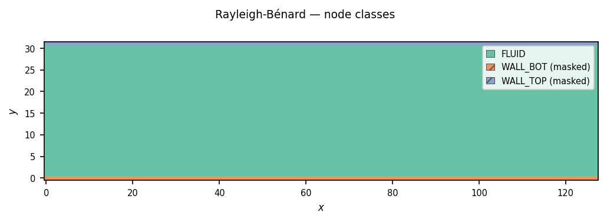
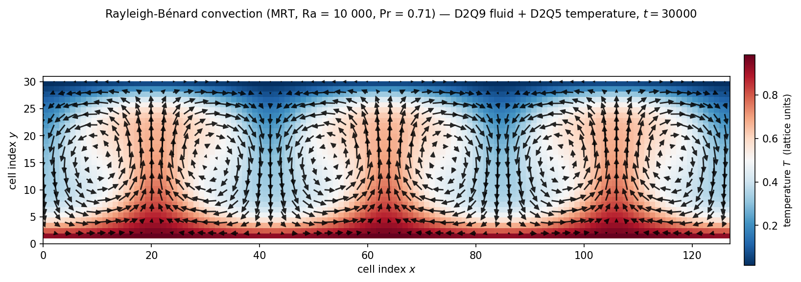

============================
Rayleigh-Bénard Convection
============================

Rayleigh–Bénard convection is the canonical thermal-convection
benchmark: a horizontal fluid layer heated from below and cooled from
above, with no externally imposed flow.  Below a critical Rayleigh
number the fluid remains at rest and heat is transported purely by
conduction from the bottom wall to the top wall; above the critical
threshold, buoyancy overcomes viscous damping and thermal diffusion,
and the layer organises into counter-rotating convection rolls.  For
rigid (no-slip) isothermal top and bottom boundaries, linear stability
theory places the onset at :math:`\mathrm{Ra}_c \approx 1707.8` with
critical wavenumber :math:`k_c \approx 3.117 / H` (Krüger et al.
(2017) §8.4.3).

This chapter introduces **multi-lattice simulations** — two coupled
lattices in a single GeLB program, one for fluid momentum and one for
temperature, exchanging fields every time step through the Boussinesq
approximation.

.. note::

   The example walked here is
   ``examples/lbm/2d/rayleigh_benard_2d_mrt.gelb``, which couples a
   D2Q9 incompressible MRT fluid solver with a D2Q5 MRT thermal
   solver (Wang et al. (2013); Yoshida & Nagaoka (2010)) and is paired
   with a snapshot regression test
   (``gelb/tests/integration/test_rayleigh_benard_mrt_e2e.py``).

The physics
===========

In the **Boussinesq approximation** (Krüger et al. (2017) §8.4.1;
Mohamad (2019) §9.6), material properties are treated as constant
everywhere except in the gravitational body force, where density
variations are linearised with respect to temperature around a
reference state :math:`(\rho_0, T_0)`.  The coupled incompressible
Navier–Stokes and advection–diffusion equations read:

.. math::

   \frac{\partial \mathbf{u}}{\partial t} + (\mathbf{u} \cdot \nabla) \mathbf{u}
     &= -\frac{1}{\rho_0} \nabla p + \nu \nabla^2 \mathbf{u} +
        \alpha g \, (T - T_0) \, \hat{\mathbf{e}}_y\,, \\
   \frac{\partial T}{\partial t} + (\mathbf{u} \cdot \nabla) T
     &= \kappa \nabla^2 T\,, \\
   \nabla \cdot \mathbf{u} &= 0\,,

where :math:`\alpha` is the thermal expansion coefficient, :math:`g`
the gravitational acceleration, :math:`\nu` the kinematic viscosity,
and :math:`\kappa` the thermal diffusivity.  The buoyancy term
:math:`\alpha g (T - T_0) \hat{\mathbf{e}}_y` drives warm fluid
upward and cool fluid downward.

With channel height :math:`H = N_y - 2` (between the two no-slip
planes at :math:`y = 0.5` and :math:`y = N_y - 1.5`: full-way
bounce-back, the wall midway between the nodes) and imposed wall
temperature difference
:math:`\Delta T = T_\mathrm{hot} - T_\mathrm{cold}`, the dynamics are
governed by the **Rayleigh number** and **Prandtl number**:

.. math::

   \mathrm{Ra} = \frac{\alpha g \Delta T H^3}{\nu \kappa}\,,
   \qquad
   \mathrm{Pr} = \frac{\nu}{\kappa}\,.

For :math:`\mathrm{Ra} > \mathrm{Ra}_c \approx 1708` and
:math:`\mathrm{Pr} = 0.71` (air), small perturbations grow into steady
two-dimensional convection rolls.  The example runs at
:math:`\mathrm{Ra} = 10\,000`, well inside the steady supercritical
regime.  Characteristic buoyancy velocity
:math:`U_f = \sqrt{\alpha g \Delta T H}` is mapped to lattice units via
the convective Mach parameter ``MAX_MACH = 0.1``
(:math:`U_f = \mathrm{Ma}\, c_s = \mathrm{Ma}/\sqrt{3}`), which sets

.. math::

   \alpha g \Delta T = \frac{\mathrm{Ma}^2}{3 H}\,,
   \qquad
   \nu = H \, \mathrm{Ma} \sqrt{\frac{\mathrm{Pr}}{3\,\mathrm{Ra}}}\,,
   \qquad
   \kappa = \frac{H \, \mathrm{Ma}}{\sqrt{3\,\mathrm{Ra}\,\mathrm{Pr}}}\,.

The LBM strategy
================

The standard double-distribution LBM for Boussinesq thermal flows
(Krüger et al. (2017) §8.4.2; Mohamad (2019) §9.6) uses **two
lattices**:

1. A **D2Q9 fluid lattice** ``f`` carrying the pressure/density
   fluctuation :math:`\delta\rho` and velocity :math:`\mathbf{u}`.
2. A **D2Q5 temperature lattice** ``g`` carrying the temperature
   :math:`T`.

The two lattices interact locally inside the interior ``dynamic``
block:

- **Temperature to fluid (buoyancy):** the fluid collision step reads
  the local temperature :math:`T = \sum_i g_i^\mathrm{in}` and applies
  the vertical buoyancy impulse :math:`F_y = \alpha g T` to the
  vertical momentum moment :math:`j_y` via Strang splitting, just as
  :doc:`08_poiseuille_body_force` applied the streamwise body force to
  :math:`j_x`.
- **Fluid to temperature (advection):** the temperature collision step
  uses the half-step fluid velocity :math:`\mathbf{u} = (u_x, u_y)` to
  evaluate the advective thermal equilibrium moments
  :math:`(T,\, T u_x,\, T u_y,\, a T,\, 0)^\mathsf{T}`.

Both lattices use MRT collision (Wang et al. (2013); Yoshida & Nagaoka
(2010)):

- The fluid uses the **incompressible D2Q9 MRT** formulation (He & Luo
  (1997); Lallemand & Luo (2000)), in which the momentum moments equal
  the velocity components directly (:math:`j_x^\mathrm{eq} = u_x`,
  :math:`j_y^\mathrm{eq} = u_y`) and the stress equilibria are
  :math:`p_{xx}^\mathrm{eq} = u_x^2 - u_y^2` and
  :math:`p_{xy}^\mathrm{eq} = u_x u_y` without factors of :math:`\rho`.
- The temperature lattice uses a **D2Q5 MRT** operator with
  transformation matrix :math:`N` mapping :math:`\mathbf{g}` to
  :math:`(T,\, j_{Tx},\, j_{Ty},\, e_T,\, \epsilon_T)^\mathsf{T}`,
  relaxation rates :math:`\sigma_k = 3 - \sqrt{3}` and
  :math:`\sigma_{\nu e} = 2(2\sqrt{3} - 3)`, and equilibrium parameter
  :math:`a = 60\kappa/\sqrt{3} - 4`.  At the horizontal walls, the
  fluid uses bounce-back and the temperature uses the Yoshida
  & Nagaoka (2010) **anti-bounce-back** rule with Dirichlet correction
  :math:`2\sqrt{3}\kappa T_\mathrm{wall}` (since the cardinal D2Q5
  equilibrium weight in this calibration is
  :math:`w_{1..4} = (4 + a)/20 = \sqrt{3}\kappa`, this matches the
  standard anti-bounce-back term :math:`2 w_i T_\mathrm{wall}` of
  Krüger et al. (2017) §8.5.2.1, Eq. 8.54; see also
  :doc:`05_1d_diffusion` and
  :doc:`14_boundary_conditions_cookbook`).

Declaring two lattices
======================

``rayleigh_benard_2d_mrt.gelb`` declares both lattices in a single
``lattices`` block:

.. code-block:: gelb

    lattices {
        lattice f(2, 9, real, {NX, NY}, {true, false});   // fluid (D2Q9)
        lattice g(2, 5, real, {NX, NY}, {true, false});   // temperature (D2Q5)
    }

.. important::

   **Rule:** All lattices in a GeLB program share the same grid
   dimensions (here ``{NX, NY}``) and periodicity flags (here
   ``{true, false}``), while each lattice defines its own velocity-set
   size :math:`Q` and maintains its own independent ``.in`` and
   ``.out`` buffers.  Every ``initializer`` and ``dynamic`` block must
   assign all :math:`Q` outgoing populations of **every** declared
   lattice.

Because each lattice has its own ping-pong buffers, a ``dynamic``
block can freely read ``f.in[...]`` and ``g.in[...]`` and write both
``f.out[...]`` and ``g.out[...]`` in the same time step without race
conditions or manual staging passes.

Equilibrium functions and the coupled MRT dynamic block
=======================================================

The moment-space equilibria for the two lattices are defined in two
short ``function`` blocks:

.. code-block:: gelb

    function FluidEqMoments(real dRho, real uX, real uY) -> (array[real, 9] meq) {
        real uX2  = uX * uX;
        real uY2  = uY * uY;
        real e_eq = -2.0 * dRho + 3.0 * (uX2 + uY2);
        meq = { dRho,            // ρ
                uX,              // jx
                uY,              // jy
                e_eq,            // e
                uX2 - uY2,       // pxx
                uX * uY,         // pxy
                -1.0 * uX,       // qx
                -1.0 * uY,       // qy
                -1.0 * e_eq - dRho };  // ε
    }

    function TempEqMoments(real T, real uX, real uY) -> (array[real, 5] neq) {
        neq = {T, T * uX, T * uY, A_PARAM * T, 0.0};
    }

Note that ``rayleigh_benard_2d_mrt.gelb`` orders the nine fluid moments
as :math:`(\delta\rho,\, j_x,\, j_y,\, e,\, p_{xx},\, p_{xy},\, q_x,\, q_y,\, \epsilon)`,
placing the vertical momentum :math:`j_y` at index ``2``.  With those
two helpers in place, the entire coupled interior update fits in a
single ``dynamic`` block:

.. code-block:: gelb

    dynamic BulkDynamic {
        // Pull-stream both lattices.
        array[real, 9] fIn = upstream_dfs(f, x, y, {EX, EY});
        array[real, 5] gIn = upstream_dfs(g, x, y, {EX5, EY5});

        // Moment transforms.
        array[real, 9] fluidMoms = matmul(M, fIn);
        array[real, 5] tempMoms  = matmul(N, gIn);

        // Strang splitting: 1st half of buoyancy force into the jy moment (index 2).
        fluidMoms = fluidMoms +
            {0.0, 0.0, 0.5 * ALPHA_G * tempMoms[0],
             0.0, 0.0, 0.0, 0.0, 0.0, 0.0};

        // Read macroscopic moments AFTER the half-force.
        real dRho = fluidMoms[0];
        real uX   = fluidMoms[1];
        real uY   = fluidMoms[2];
        real T    = tempMoms[0];

        // Equilibrium moments.
        array[real, 9] fluidMeq = FluidEqMoments(dRho, uX, uY);
        array[real, 5] tempMeq  = TempEqMoments(T, uX, uY);

        // MRT collision in moment space.
        fluidMoms = fluidMoms - S_FLUID * (fluidMoms - fluidMeq);
        tempMoms  = tempMoms  - S_TEMP  * (tempMoms  - tempMeq);

        // Strang splitting: 2nd half of buoyancy force.
        fluidMoms = fluidMoms +
            {0.0, 0.0, 0.5 * ALPHA_G * tempMoms[0],
             0.0, 0.0, 0.0, 0.0, 0.0, 0.0};

        // Back-transform to distribution space.
        f.out[x, y | :] = matmul(M_INV, fluidMoms);
        g.out[x, y | :] = matmul(N_INV, tempMoms);
    }

Compare this with ``MRTCollStream`` in
:doc:`08_poiseuille_body_force`:

1. **Two pull-streaming calls:** ``upstream_dfs`` is called once on
   ``f`` with its 9-velocity stencil ``{EX, EY}`` and once on ``g``
   with its 5-velocity stencil ``{EX5, EY5}`` (rest plus the four
   cardinal directions).
2. **Two moment transforms:** ``matmul(M, fIn)`` maps ``fIn`` into the
   9-vector ``fluidMoms``, and ``matmul(N, gIn)`` maps ``gIn`` into
   the 5-vector ``tempMoms`` (whose zeroth entry ``tempMoms[0]`` is the
   local temperature :math:`T = \sum_{i=0}^4 g_i^\mathrm{in}`).
3. **Two-way Boussinesq coupling:** before relaxation, half of the
   buoyancy impulse ``0.5 * ALPHA_G * tempMoms[0]`` is added to
   ``fluidMoms[2]`` (:math:`j_y`).  The updated velocity components
   ``uX = fluidMoms[1]`` and ``uY = fluidMoms[2]`` then feed both
   ``FluidEqMoments(dRho, uX, uY)`` and ``TempEqMoments(T, uX, uY)``.
4. **Independent MRT relaxation and back-transform:** each lattice
   relaxes with its own rate vector (``S_FLUID`` and ``S_TEMP``), the
   second half of the buoyancy impulse is added to ``fluidMoms[2]``,
   and ``M_INV`` and ``N_INV`` transform both moment vectors back to
   ``f.out`` and ``g.out``.

The geometry and wall boundary conditions
=========================================

.. code-block:: gelb

    node_classes {
        node_class FLUID(InitBulk, BulkDynamic, RBOutput);
        node_class WALL_BOT(InitWallBot, WallBotDynamic) masked;
        node_class WALL_TOP(InitWallTop, WallTopDynamic) masked;
    }

    geometry {
        nodes[:, :]      = FLUID;
        nodes[:, 0]      = WALL_BOT;
        nodes[:, NY - 1] = WALL_TOP;
    }

Three node classes partition the domain: ``FLUID`` in the interior,
``WALL_BOT`` at ``y = 0`` (held at ``T_HOT = 1.0``), and ``WALL_TOP``
at ``y = NY - 1`` (held at ``T_COLD = 0.0``).  The two wall classes are
marked ``masked`` so their boundary dynamics execute every time step
while excluding the ghost rows ``y = 0`` and ``y = NY - 1`` from the
saved NetCDF gauge output.

In ``WallBotDynamic``, the fluid populations undergo bounce-back
exactly as in :doc:`08_poiseuille_body_force`, while the
northward temperature population (slot 2) is reflected from the first
fluid row ``y + 1`` with the isothermal anti-bounce-back source:

.. code-block:: gelb

    g.out[x, y | 0] = 0.0;
    g.out[x, y | 1] = 0.0;
    g.out[x, y | 2] = -g.in[x, y + 1 | 4]
                      + 2.0 * sqrt(3.0) * DIFFUSIVITY * T_HOT;
    g.out[x, y | 3] = 0.0;
    g.out[x, y | 4] = 0.0;

   Node-class layout for ``rayleigh_benard_2d_mrt.gelb``: ``FLUID``
   (teal) fills the interior rows ``y = 1 .. NY - 2``, while
   ``WALL_BOT`` (orange, hot) and ``WALL_TOP`` (blue, cold) are
   single-row masked boundary classes at ``y = 0`` and ``y = NY - 1``.

.. note::

   In a multi-lattice program, coverage checks run independently on
   every declared lattice.  If a wall block omits writes to the
   temperature lattice ``g``, the compiler reports specifically which
   lattice and DF indices are missing::

       [Problem] Dynamic block 'WallBotDynamic' (for node class
       'WALL_BOT') does not write all DFs of lattice 'g':
       missing DFs [0, 1, 2, 3, 4]

       [Hint] Add write statements for the missing distribution
       functions, or use the full-range syntax g.out[...|:] to
       write all DFs at once.

Running it
==========

Because the instability is seeded with a small random perturbation on
top of the conductive linear temperature profile, pass ``--seed`` for a
reproducible roll pattern:

.. code-block:: bash

    ./scripts/gelb-run --seed 42 -n 30000 -w 30000 \
        examples/lbm/2d/rayleigh_benard_2d_mrt.gelb

In VS Code (:ref:`working-in-vscode`), set *Time steps* and *Write
every* to 30000 and *Seed* to 42; set *Write every* to 500 to watch
the rolls form.

At the default resolution (``NY = 32``, ``NX = 128``), 30 000 steps are
sufficient for the initial perturbation to grow and saturate into
steady convection rolls at :math:`\mathrm{Ra} = 10\,000`.  With the
default ``cpu_highway`` backend, the run finishes in about 15 seconds
on a modern multicore CPU.

   Steady-state temperature field :math:`T` (colour map: red hot, blue
   cold) and velocity vectors (black arrows) at :math:`t = 30\,000` for
   :math:`\mathrm{Ra} = 10\,000`, :math:`\mathrm{Pr} = 0.71`.  The
   periodic domain of aspect ratio
   :math:`\Gamma = N_x / (N_y - 2) = 128 / 30 \approx 4.27` supports
   three pairs of counter-rotating convection rolls (six rolls in
   total): three warm upwelling plumes rise near
   :math:`x \approx 20, 63, 106` while three cool downwelling plumes
   descend near :math:`x \approx 0, 42, 85`.

Validation: the snapshot regression test
=========================================

Analytical solutions exist for the linear stability threshold
:math:`\mathrm{Ra}_c`, but the finite-amplitude post-critical roll
state is governed by the full nonlinear coupled equations.  To guard
against numerical regressions, GeLB pairs this example with an
end-to-end snapshot test
(``gelb/tests/integration/test_rayleigh_benard_mrt_e2e.py``) that
compiles and runs the model and compares the resulting temperature and
velocity fields against a reference NetCDF snapshot
(``gelb/tests/data/rb_mrt_snapshot.nc``) to a tolerance of
:math:`\sim 10^{-10}`.  Whereas :doc:`08_poiseuille_body_force`
illustrated validation against a closed-form analytical profile,
snapshot regression provides automated verification for nonlinear
multi-physics benchmarks once a reference solution has been established.

What's next
===========

Multi-lattice coupling completes the core set of GeLB language
constructs.  The remaining chapters of the guided tour combine the
features you have already seen on new physical regimes:
:doc:`10_karman_vortex` uses ``border()`` and coordinate-expression
paints to place a circular cylinder in an open channel flow;
:doc:`11_shan_chen_multiphase` computes non-local pseudopotential
forces via ``upstream_dfs`` on an auxiliary lattice; and
:doc:`12_beyond_lbm_gol` applies the same stencil primitives to a
cellular automaton outside fluid dynamics.

.. seealso::

   **Krüger et al. (2017)** §8.4 (*Thermal Flows*) for the
   Boussinesq approximation (§8.4.1), the double-distribution LBM
   formulation (§8.4.2), and the Rayleigh–Bénard benchmark (§8.4.3);
   §8.2.2 and §8.6.2 for D2Q5 advection–diffusion models; and §8.5.2.1
   (Eq. 8.54) for Dirichlet anti-bounce-back boundary conditions.

   **Mohamad (2019)** Chapter 9 (*Nonisothermal Incompressible Fluid
   Flow*), especially §9.6 (*Natural Convection*), for worked
   two-lattice thermal convection examples.

   **Wang, J., Wang, D., Lallemand, P. & Luo, L.-S.** (2013) "Lattice
   Boltzmann simulations of thermal convective flows in two
   dimensions." *Computers & Mathematics with Applications*, **65**,
   262–286.

   **Yoshida, H. & Nagaoka, M.** (2010) "Multiple-relaxation-time
   lattice Boltzmann model for the convection and anisotropic diffusion
   equation." *Journal of Computational Physics*, **229**, 7774–7795.
