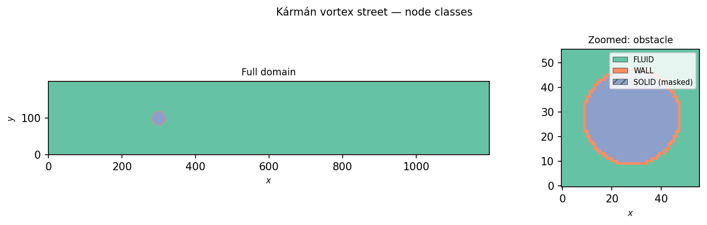
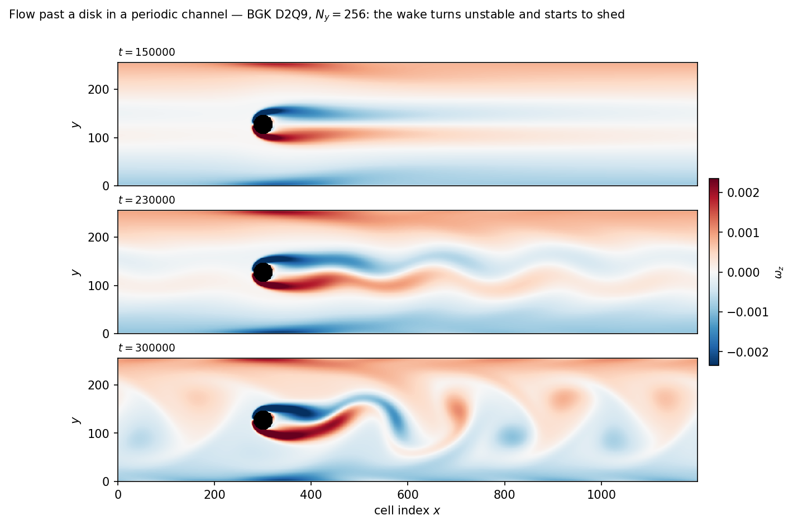

=========================
Kármán Vortex Street
=========================

Flow past a circular cylinder is a classic unsteady fluid-dynamics
benchmark: above a critical Reynolds number
(:math:`\mathrm{Re}_c \approx 47`) the steady, symmetric recirculation
bubble behind the cylinder loses stability and transitions into a
staggered train of alternating counter-rotating vortices shed
downstream — the **Kármán vortex street**.  For
:math:`\mathrm{Re} \in [100, 200]` the shedding is laminar and
periodic with dimensionless Strouhal frequency
:math:`\mathrm{St} = f D / U \approx 0.16\text{--}0.17`.

This chapter walks a setup adapted from Sukop & Thorne (2006) §5.3 and
introduces three pieces of GeLB geometry machinery: **conditional
painting** via a user-defined Boolean predicate function, the
``border()`` statement for automatic boundary-layer assignment
around solid obstacles, and the ``masked`` modifier for excluding
solid interiors from gauge output.

.. note::

   The example walked here is
   ``examples/sukop/karman_vortex_street_2d_bgk.gelb``.  Its header is
   tagged ``STATUS: EXPERIMENTAL``: in a periodic channel driven by a
   body force, the flow takes its viscous time to spin up, and the wake
   that leaves the domain re-enters it upstream, so the shedding it
   shows is a demonstration, not a benchmark.  For a cylinder with an
   inflow and an outflow (Zou–He velocity boundaries), see
   ``examples/softwarex-2026-paper/flow_past_cylinder_2d_bgk_zouhe.gelb``.

The physics
===========

A circular cylinder of diameter :math:`D = 2R` is placed in a stream of
characteristic velocity :math:`U` and kinematic viscosity :math:`\nu`.
The wake regime is governed by the cylinder Reynolds number
:math:`\mathrm{Re} = U D / \nu` (Mohamad (2019) §8.8.3):

- :math:`\mathrm{Re} \lesssim 1`: creeping (Stokes) flow, fore–aft
  symmetric with no separation.
- :math:`\mathrm{Re} \sim 5\text{--}47`: steady separated flow with a
  closed pair of symmetric counter-rotating recirculation vortices
  attached to the rear of the cylinder.
- :math:`\mathrm{Re} \sim 47\text{--}200`: laminar periodic vortex
  shedding (the two-dimensional Kármán vortex street), with vortices of
  alternating sign detaching from the upper and lower sides of the
  cylinder at Strouhal number
  :math:`\mathrm{St} = f D / U \approx 0.16\text{--}0.18`.
- :math:`\mathrm{Re} \gtrsim 200`: onset of three-dimensional wake
  instabilities and transition toward a turbulent wake.

The example's defaults aim at :math:`\mathrm{Re} \approx 100` once the
channel has spun up, while keeping the lattice Mach number
:math:`\mathrm{Ma} = U / c_s < 0.1` (Krüger et al. (2017) §7.2.1).
*Running it* below shows how far a run gets towards that.

The GeLB strategy
=================

Following Sukop & Thorne (2006) §5.3, the flow is driven through a
streamwise-periodic channel by a uniform body force :math:`G` rather
than imposed inlet and outlet profiles.  The top and bottom channel
walls use full-way bounce-back (the wall midway between the nodes);
the circular cylinder is painted as ``SOLID``
via a user-defined predicate function ``InCircle(x, y, CX, CY, R)``,
and its one-cell bounce-back perimeter is generated automatically by
``border(SOLID) = WALL``.  The cylinder centre sits one
lattice unit off the channel midline (``CY = NY / 2 - 1``), a small,
deterministic asymmetry for the wake instability to grow from, without
random noise.

Conditional paint and the ``InCircle`` predicate
=================================================

The disk is defined by a pure Boolean helper function:

.. code-block:: gelb

    function InCircle(int x, int y, int cx, int cy, int r) -> (bool hit) {
        hit = (x - cx) * (x - cx) + (y - cy) * (y - cy) < r * r;
    }

``InCircle`` takes five integer arguments — a cell coordinate
``(x, y)``, a disk centre ``(cx, cy)``, and a radius ``r`` — and
returns ``true`` whenever :math:`(x - c_x)^2 + (y - c_y)^2 < r^2`.
It is then called inside a ``where`` clause in the ``geometry`` block:

.. code-block:: gelb

    geometry {
        nodes[:, :]      = FLUID;
        nodes[:, 0]      = WALL;
        nodes[:, NY - 1] = WALL;
        nodes[where InCircle(x, y, CX, CY, R)] = SOLID;
        border(SOLID) = WALL;
    }

In ``nodes[where InCircle(x, y, CX, CY, R)] = SOLID;``, ``where``
introduces a Boolean predicate in which ``x`` and ``y`` (and ``z`` in
3D) represent the coordinates of the candidate cell.  During
compilation, GeLB evaluates the predicate at every grid point and
assigns ``SOLID`` wherever it evaluates to ``true``.

The same pattern extends to multiple obstacles or arbitrary analytic
shapes:

.. code-block:: gelb

    nodes[where InCircle(x, y, CX1, CY1, R1)] = SOLID;
    nodes[where InCircle(x, y, CX2, CY2, R2)] = SOLID;

Any shape expressible as a pure Boolean function of coordinates and
constants — squares, ellipses, or lookup masks stored in a compile-time
``array[bool, {NX, NY}]`` — can be painted in the same way.

``border()`` — automatic wall-layer inference
==============================================

.. code-block:: gelb

    border(SOLID) = WALL;

This statement instructs the compiler: after all ``nodes[...]`` paint
statements have been applied, inspect every cell currently classified
as ``SOLID``; if at least one of its neighbours is *not* ``SOLID``,
reclassify that cell as ``WALL``.  The neighbours are all the cells
one step away along an axis or a diagonal (8 in 2D, 26 in 3D); a
periodic axis wraps around its seam, and a non-periodic edge has no
neighbour beyond it.  Because the rule reads a single snapshot of the
node map and applies all replacements simultaneously, the resulting
one-cell ``WALL`` shell is independent of traversal order.

The diagonals matter on D2Q9.  A fluid cell on one of the circle's
diagonal steps touches the disk only along a diagonal link; if the
cell behind that link stayed ``SOLID``, an empty class that holds zero
populations, the fluid cell would pull zero from it on every step and
the flow would lose mass there.  Because ``border()`` inspects the
diagonals, every disk cell that a fluid cell reaches along any of the
nine links is a wall.

Without ``border()``, you would have to construct the rasterised
staircase perimeter of the disk manually.  With the border rule, the
domain is partitioned cleanly into three regions:

- ``FLUID`` cells in the channel interior (running BGK collision,
  forcing, and pull-streaming).
- ``WALL`` cells along the top and bottom channel walls and in the
  staircase ring of the disk (running bounce-back).
- ``SOLID`` cells in the strict interior of the disk (inactive and
  masked).

The ``masked`` modifier and empty node classes
===============================================

The three node classes are declared as follows:

.. code-block:: gelb

    node_classes {
        node_class FLUID(InitFluid, FluidDynamic, Hydro);
        node_class WALL (InitFluid, BounceBack,   Hydro);
        node_class SOLID() masked;
    }

.. important::

   Rules for geometry predicates, ``border()``, and ``masked`` classes:

   - **Predicate paints** (``nodes[where expr] = CLASS;``) may use cell
     coordinates (``x``, ``y``, ``z``), global constants, scalar math
     intrinsics, and pure single-output functions returning ``bool``.
     They may not read lattice populations or the runtime step counter
     ``t`` because geometry is resolved at compile time.
   - **Border rules** (``border(SOURCE) = TARGET;``) run in their own
     source order *after* all ``nodes[...]`` paint statements,
     reclassifying any ``SOURCE`` cell that has at least one
     non-``SOURCE`` neighbour along an axis or a diagonal.
   - **Empty node classes** (``node_class SOLID();``) execute no
     initialiser, dynamic, or gauge; all distribution functions at
     their cells are guaranteed to hold **zero**.
   - The ``masked`` modifier excludes a node class from NetCDF
     gauge output (its cells are written as ``NaN``, which
     ``gelb-view`` renders as transparent) and forbids attaching a
     gauge to that class.  A ``masked`` class that specifies an
     initialiser and dynamic still executes them on every step (as used
     for wall rows in :doc:`09_rayleigh_benard` and
     :doc:`13_salmon_ocean`).

Combining an empty parameter list ``()`` with ``masked`` means the
interior ``SOLID`` cells of the cylinder require no initialiser or
dynamic block, hold zero populations in memory, are skipped during the
time-stepping loop, and appear automatically masked as ``NaN`` in the
output file.

The program
===========

.. code-block:: gelb

    global_constants {
        const int NX = 1200;
        const int NY = 200;
        const real TAU   = 0.56;             // ν = 0.02
        const real OMEGA = 1.0 / TAU;
        const real G = 2.0e-7;               // body force

        const int CX = NX / 4;
        const int CY = NY / 2 - 1;           // slightly off-centre to break symmetry
        const int R  = 20;                   // disk radius (D = 40)

        const array[real, 9] EX = {0.0, 1.0, 0.0, -1.0,  0.0, 1.0, -1.0, -1.0,  1.0};
        const array[real, 9] EY = {0.0, 0.0, 1.0,  0.0, -1.0, 1.0,  1.0, -1.0, -1.0};
        const array[real, 9] W  = {4.0/9.0,
            1.0/9.0, 1.0/9.0, 1.0/9.0, 1.0/9.0,
            1.0/36.0, 1.0/36.0, 1.0/36.0, 1.0/36.0};
    }

    lattices { lattice f(2, 9, real, {NX, NY}, {true, false}); }

    function InCircle(int x, int y, int cx, int cy, int r) -> (bool hit) {
        hit = (x - cx) * (x - cx) + (y - cy) * (y - cy) < r * r;
    }

    function Macro(array[real, 9] fIn) -> (real rho, real ux, real uy) {
        rho = sum(fIn);
        ux  = dot_prod(EX, fIn) / rho;
        uy  = dot_prod(EY, fIn) / rho;
    }

    function Feq(real rho, real ux, real uy) -> (array[real, 9] feq) {
        real usq = ux * ux + uy * uy;
        array[real, 9] cu = EX * ux + EY * uy;
        feq = W * rho * (1.0 + 3.0 * cu + 4.5 * cu * cu - 1.5 * usq);
    }

    initializer InitFluid { f.out[x, y | :] = W; }

    // Shifted-velocity body force
    dynamic FluidDynamic {
        array[real, 9] fIn = upstream_dfs(f, x, y, {EX, EY});
        real rho; real ux; real uy;
        {rho, ux, uy} = Macro(fIn);
        ux = ux + 0.5 * G;        // velocity shift
        f.out[x, y | :] = fIn - OMEGA * (fIn - Feq(rho, ux, uy));
    }

    dynamic BounceBack {
        f.out[x, y | :] = bounce_back_dfs(f, x, y, {EX, EY});
    }

    gauge Hydro -> (real rho, real ux, real uy) {
        {rho, ux, uy} = Macro(f.in[x, y | :]);
    }

    node_classes {
        node_class FLUID(InitFluid, FluidDynamic, Hydro);
        node_class WALL (InitFluid, BounceBack,   Hydro);
        node_class SOLID() masked;
    }

    geometry {
        nodes[:, :]      = FLUID;
        nodes[:, 0]      = WALL;
        nodes[:, NY - 1] = WALL;
        nodes[where InCircle(x, y, CX, CY, R)] = SOLID;
        border(SOLID) = WALL;
    }

   Node-class layout: ``FLUID`` (teal), ``WALL`` (orange, top/bottom
   channel edges and the ``border()`` ring around the disk), and
   ``SOLID`` (blue, disk interior — masked, excluded from gauge
   output).

All collision and streaming primitives here are familiar from
:doc:`05_1d_diffusion` and :doc:`07_lid_driven_cavity`.  In
``FluidDynamic``, the body force is introduced via an equilibrium
velocity shift ``ux = ux + 0.5 * G`` before evaluating ``Feq(rho, ux, uy)``
(compare the equilibrium-velocity forcing schemes of Krüger et
al. (2017) §6.4.2, eq. (6.29): because BGK relaxation multiplies
:math:`f^\mathrm{eq}` by :math:`\omega = 1/\tau`, shifting the
equilibrium velocity by :math:`\Delta u_x = \tfrac{1}{2} G` injects an
effective streamwise momentum increment of
:math:`\omega \rho \Delta u_x = \rho G / (2\tau)` per step, which at
:math:`\tau = 0.56` is :math:`\approx 0.89\, \rho G`).  For qualitative
wake visualisation at low Mach number this simple shift is sufficient;
for second-order forcing accuracy, use the Strang-split or Guo schemes
of :doc:`08_poiseuille_body_force`.

Running it
==========

.. code-block:: bash

    gelb-run -n 250000 -w 500 \
        examples/sukop/karman_vortex_street_2d_bgk.gelb

In VS Code (:ref:`working-in-vscode`), set *Time steps* to 250000 and
*Write every* to 500.

Running 250 000 steps on the :math:`1200 \times 200` grid with the
default ``cpu_highway`` backend takes roughly five minutes on a modern
multicore laptop, and writing every 500 steps gives 501 records for
animating the wake in ``gelb-view``.  The channel starts at rest, and
the body force spins it up over its viscous time
:math:`H^2/\nu \approx 2 \times 10^6` steps (:math:`H = 198`), so at the
end of this run the centreline speed is 0.019, a Reynolds number of
about 37 on the centreline speed instead of the 100 the defaults aim
at.  That is below :math:`\mathrm{Re}_c \approx 47`: the wake is a
steady, symmetric pair of shear layers behind the disk, and nothing is
shed yet.

A wider channel driven twice as hard gets there within the run:

.. code-block:: bash

    gelb-run -b gpu_cuda_cpp -n 300000 -w 2000 \
        -D NY=256 -D G=4.0e-7 \
        examples/sukop/karman_vortex_street_2d_bgk.gelb

(about 80 s on ``gpu_cuda_cpp``).  The centreline Reynolds number
reaches about 75 around :math:`t = 160\,000`; the symmetric wake then
turns unstable, its cross-stream velocity on the axis oscillating and growing
from :math:`10^{-5}`, and from about :math:`t = 250\,000` the disk sheds
vortices alternately from its two sides.  The period is about 6200
steps, a Strouhal number of about 0.14 on the centreline speed at
:math:`\mathrm{Re} \approx 90`, and the channel is still speeding up.
Because the channel is periodic in :math:`x`, the street that leaves
on the right comes back in on the left.

   Spanwise vorticity
   :math:`\omega_z = \partial_x u_y - \partial_y u_x` from the second
   command (a :math:`1200 \times 256` channel, ``G = 4.0e-7``, a disk
   of radius :math:`R = 20`, :math:`D = 40`) at
   :math:`t = 150\,000`, :math:`230\,000` and :math:`300\,000`.  Red
   denotes positive (counter-clockwise) vorticity and blue negative
   (clockwise) vorticity; the colour along the top and bottom is the
   channel's own shear.  At :math:`t = 150\,000` the wake is steady and
   symmetric; at :math:`230\,000` it oscillates; at :math:`300\,000`
   the disk sheds a vortex street, which re-enters the periodic channel
   from the left.

Summary
=======

Using a pure coordinate predicate (``InCircle``), automatic boundary
peeling (``border(SOLID) = WALL``), and ``masked`` empty interior nodes
(``node_class SOLID() masked;``), an obstacle flow on a Cartesian grid
is specified in a few declarative lines without manual index lists or
runtime branching inside the fluid kernel.  As introduced in
:doc:`03_gelb_in_10_minutes`, resolving the geometry at compile time
lets the generated solver iterate over each node class cleanly while
omitting inactive interior obstacle cells from both computation and
NetCDF output.

What's next
===========

:doc:`11_shan_chen_multiphase` introduces single-component multiphase
flow via the Shan–Chen pseudopotential method, where phase separation
arises from a non-local interaction force computed across neighbouring
cells using ``upstream_dfs`` on an auxiliary scalar lattice.

.. seealso::

   **Krüger et al. (2017)** §5.3.3 (*Solid Boundaries: Bounce-Back*)
   for staircase bounce-back on curved obstacles; §6.4.2 (*Forcing
   Schemes*; Shan and Chen's velocity shift in §6.4.2.2) for velocity-shift forcing;
   §7.2.1 for Mach-number constraints in weakly compressible BGK; and
   Chapter 11 (*Curved and Moving Boundaries*) for higher-order
   interpolated bounce-back schemes.

   **Mohamad (2019)** §8.8.3 (*Flow over Obstacles*) for cylinder-wake
   benchmarks and vortex-shedding regimes.

   **Sukop, M. C. & Thorne, D. T.** (2006) *Lattice Boltzmann
   Modeling: An Introduction for Geoscientists and Engineers*
   (Springer), §5.3 and Fig. 10.
