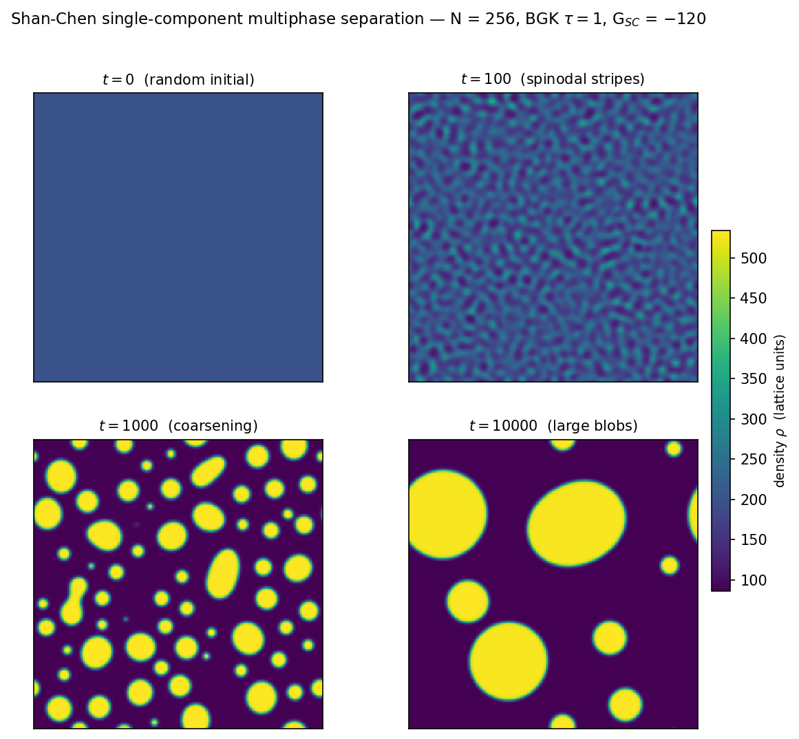

=========================
Shan-Chen Multiphase
=========================

This chapter walks through the **Shan–Chen single-component
multiphase** (SCMP) model (Shan & Chen (1993, 1994); Krüger et al.
(2017) §9.3; Mohamad (2019) §11.1).  By adding a short-range attractive
interaction force between neighbouring lattice nodes, a single BGK
fluid spontaneously separates into coexisting liquid and vapour phases
with diffuse interfaces and emergent surface tension, without explicit
interface tracking.

From a GeLB perspective, the new ingredient is a **non-local body
force** that depends on the density at all eight neighbouring cells.
This is written directly via offset slice reads
``sum(f.in[x + dx, y + dy | :])`` (or, equivalently, via a dedicated
1-DF auxiliary lattice as in
``examples/lbm/2d/shan_chen_multiphase_2d_bgk.gelb``).

.. note::

   The example walked here is ``examples/sukop/shan_chen_2d.gelb``,
   adapted from Sukop & Thorne (2006) §6.3.  Its header is tagged
   ``STATUS: EXPERIMENTAL`` because the coexistence densities in the
   original single-relaxation-time Shan–Chen scheme depend on the
   pseudopotential functional form and relaxation time :math:`\tau`; see
   ``examples/lbm/2d/shan_chen_multiphase_2d_bgk.gelb`` for the
   companion two-lattice formulation using the bounded exponential
   pseudopotential of Krüger et al. (2017) §9.3.1, Eq. (9.102).

The physics
===========

In an isothermal ideal lattice gas, the bulk pressure is
:math:`p_b = c_s^2 \rho`, which is monotonically increasing with
:math:`\rho` and cannot support two coexisting phases.  To model a
non-ideal fluid whose molecules attract at short range, Shan & Chen
(1993) introduced a nearest-neighbour interaction force (Krüger et al.
(2017) §9.3.1, Eq. 9.105):

.. math::

   \mathbf{F}_\mathrm{SC}(\mathbf{x}) = -G \, \psi\bigl(\rho(\mathbf{x})\bigr)
     \sum_i w_i \, \psi\bigl(\rho(\mathbf{x} + \mathbf{c}_i \Delta t)\bigr)
     \, \mathbf{c}_i \Delta t\,,

where :math:`\psi(\rho)` is the **pseudopotential** (or effective
density), :math:`G < 0` is the interaction strength (negative for
attraction), and :math:`w_i` are the standard D2Q9 weights.  A Taylor
expansion of :math:`\psi(\mathbf{x} + \mathbf{c}_i \Delta t)` shows
that :math:`\mathbf{F}_\mathrm{SC}` modifies the bulk equation of state
to (Krüger et al. (2017) §9.3.2.1, Eq. 9.111)

.. math::

   p_b(\rho) = c_s^2 \rho + \frac{c_s^2 \Delta t^2 G}{2} \, \psi^2(\rho)\,,

while its higher-order gradient terms supply an isotropic surface
tension across diffuse phase interfaces.

In ``examples/sukop/shan_chen_2d.gelb``, the pseudopotential has the
form used by Sukop & Thorne (2006) §6.3:

.. math::

   \psi(\rho) = \psi_0 \exp(-\rho_0 / \rho)\,,

with :math:`\psi_0 = 4`, :math:`\rho_0 = 200`, and :math:`G = -120`.
Below the critical coupling threshold (:math:`G < G_c < 0`), the
equation of state :math:`p_b(\rho)` develops a van der Waals loop
(:math:`\mathrm{d}p_b / \mathrm{d}\rho < 0` inside the spinodal
interval), and a homogeneous fluid at :math:`\rho \approx \rho_0` is
mechanically unstable.  Starting from a uniform density with small
random perturbations, the system evolves through four characteristic
stages:

1. **Random initial state** (:math:`t = 0`): uniform base density
   :math:`\rho_0 = 200` plus small white noise.
2. **Spinodal decomposition** (:math:`t \sim 100`): unstable wavelengths
   grow exponentially into a fine interconnected pattern of dense and
   dilute regions.
3. **Coarsening** (:math:`t \sim 1000`): filaments pinch off and merge
   into circular liquid droplets suspended in vapour, driven by surface
   tension to reduce total interface length.
4. **Late-stage coalescence** (:math:`t \sim 10\,000`): droplets
   continue to coalesce into a few large drops whose interior and
   exterior densities approach the planar coexistence values
   (:math:`\rho_\mathrm{liq} \approx 524`,
   :math:`\rho_\mathrm{vap} \approx 80`; see Krüger et al. (2017)
   §9.1.1 and §9.3.2.2, Eqs. 9.113–9.114).

How Shan–Chen force injection works
====================================

The interaction force :math:`\mathbf{F}_\mathrm{SC}` can be incorporated
into the collision step via several forcing schemes — including the
Strang-split or Guo schemes of :doc:`08_poiseuille_body_force` or the
**equilibrium-velocity shift** originally introduced by Shan & Chen
(1993) (Krüger et al. (2017) §6.4.2.2, with the equilibrium velocity of
eq. (6.29)).  In the
Shan–Chen equilibrium-velocity shift used by ``shan_chen_2d.gelb``, the
velocity entering the BGK equilibrium distribution is shifted by
:math:`\tau \mathbf{F}_\mathrm{SC} / \rho`:

.. math::

   \mathbf{u}^\mathrm{eq} = \mathbf{u} + \frac{\tau \, \mathbf{F}_\mathrm{SC}}{\rho}\,,

where :math:`\mathbf{u} = (\sum_i \mathbf{c}_i f_i) / \rho` is the
pre-collision velocity.  The BGK collision step then reads

.. math::

   f_i^*(\mathbf{x}, t) = f_i(\mathbf{x}, t) - \frac{1}{\tau}
     \bigl( f_i(\mathbf{x}, t) - f_i^\mathrm{eq}(\rho,
     \mathbf{u}^\mathrm{eq}) \bigr)\,.

Because the first moment of :math:`f_i^\mathrm{eq}(\rho, \mathbf{u}^\mathrm{eq})`
is :math:`\rho \mathbf{u} + \tau \mathbf{F}_\mathrm{SC}`, multiplying
by :math:`1/\tau` in the BGK relaxation operator cancels :math:`\tau`
and increments the momentum density by exactly
:math:`\mathbf{F}_\mathrm{SC} \Delta t` per step (with the physical
half-step velocity given by
:math:`\mathbf{u} + \tfrac{1}{2}\mathbf{F}_\mathrm{SC} \Delta t / \rho`).

Non-local reads in GeLB
========================

Here is the top of ``BulkDynamic`` in ``examples/sukop/shan_chen_2d.gelb``:

.. code-block:: gelb

    dynamic BulkDynamic {
        // --- Nonlocal densities ---
        real rho_C  = sum(f.in[x,     y     | :]);
        real rho_E  = sum(f.in[x + 1, y     | :]);
        real rho_W  = sum(f.in[x - 1, y     | :]);
        real rho_N  = sum(f.in[x,     y + 1 | :]);
        real rho_S  = sum(f.in[x,     y - 1 | :]);
        real rho_NE = sum(f.in[x + 1, y + 1 | :]);
        real rho_NW = sum(f.in[x - 1, y + 1 | :]);
        real rho_SW = sum(f.in[x - 1, y - 1 | :]);
        real rho_SE = sum(f.in[x + 1, y - 1 | :]);

        // --- Pseudopotentials ---
        real psi_C  = Psi(rho_C);
        real psi_E  = Psi(rho_E);
        ...

The expression ``f.in[x + 1, y + 1 | :]`` reads the 9-element
distribution vector at neighbour ``(x + 1, y + 1)`` from the previous
time step, and ``sum(...)`` reduces it to that neighbour's scalar
density.  Because ``f`` is declared doubly periodic
(``lattice f(2, 9, real, {N, N}, {true, true});``), offsets at domain
edges wrap around automatically on every backend.

.. important::

   **Rule:** Any ``dynamic`` or ``gauge`` block that reads a lattice at
   a non-zero spatial offset ``[x + dx, y + dy | ...]`` is checked
   against the geometry map and the lattice periodicity flags at
   compile time.  If a node class using that block is painted on a
   non-periodic boundary where ``x + dx`` or ``y + dy`` would fall
   outside the grid, ``gelbc`` rejects the program::

       [Problem] Out-of-bounds lattice access: block 'BulkDynamic'
       (for node class 'BULK') reads/writes lattice 'f' at offset
       -1 in x, but 'BULK' is painted at boundary position(s)
       where this would access outside the grid

       [Hint] Either make the x-dimension periodic, or avoid
       painting 'BULK' at the affected boundary, or use a
       different block for boundary nodes.

The rest of the dynamic block
==============================

Once the nine pseudopotential values ``psi_C .. psi_SE`` have been
evaluated, the weighted discrete gradient
:math:`\sum_i w_i \psi(\mathbf{x} + \mathbf{c}_i \Delta t) \mathbf{c}_i`
and interaction force :math:`\mathbf{F}_\mathrm{SC}` are assembled using
the D2Q9 cardinal weight :math:`1/9` and diagonal weight :math:`1/36`:

.. code-block:: gelb

    real sx = (1.0 /  9.0) * (psi_E  - psi_W)
            + (1.0 / 36.0) * (psi_NE - psi_NW + psi_SE - psi_SW);
    real sy = (1.0 /  9.0) * (psi_N  - psi_S)
            + (1.0 / 36.0) * (psi_NE + psi_NW - psi_SE - psi_SW);

    real Fx = -G_SC * psi_C * sx;
    real Fy = -G_SC * psi_C * sy;

The remainder of ``BulkDynamic`` pull-streams ``f``, computes the
pre-collision velocity, shifts the equilibrium velocity by
``TAU * F / rho``, and relaxes:

.. code-block:: gelb

    // --- Pull-streamed DFs and local velocity ---
    array[real, 9] fIn = upstream_dfs(f, x, y, {EX, EY});
    real rho = sum(fIn);
    real ux  = dot_prod(EX, fIn) / rho;
    real uy  = dot_prod(EY, fIn) / rho;

    // --- Shan–Chen equilibrium-velocity force injection ---
    real ux_eq = ux + TAU * Fx / rho;
    real uy_eq = uy + TAU * Fy / rho;

    f.out[x, y | :] = fIn - OMEGA * (fIn - Feq(rho, ux_eq, uy_eq));

Note that ``BulkDynamic`` reads ``f.in`` both in the non-local density
sums at the top and via ``upstream_dfs`` below.  Because ``f.in`` is
read-only throughout the step and all writes go to ``f.out``, both
reads observe the same previous-step state without conflict.

The initializer: random initial density
=========================================

.. code-block:: gelb

    initializer InitRandom {
        real rho_init = RHO_MEAN + random();
        f.out[x, y | :] = W * rho_init;
    }

The ``random()`` intrinsic returns a uniform pseudo-random number in
:math:`[0, 1)`, giving each cell an initial density
:math:`\rho_\mathrm{init} \in [200, 201)` and initial populations
:math:`f_i = w_i \rho_\mathrm{init}` corresponding to a fluid at rest.

.. important::

   **Rule:** Bind ``random()`` to a scalar local variable first (as in
   ``real rho_init = RHO_MEAN + random();``) before multiplying by the
   weight array ``W``.  Writing ``W * (RHO_MEAN + random())`` inside an
   array or slice expression evaluates ``random()`` independently for
   each of the :math:`Q` lattice directions rather than drawing a single
   scalar density per cell.

Pass ``--seed <N>`` to ``gelb-run`` for a deterministic initial
perturbation; without ``--seed``, the runtime seeds the generator from
entropy so each run produces a statistically independent droplet
realisation.

Running it
==========

.. code-block:: bash

    # Small grid for quick iteration
    gelb-run --seed 42 -D N=256 -n 10000 -w 100 \
        examples/sukop/shan_chen_2d.gelb

    # Full resolution from Sukop & Thorne (2006) §6.3 (N=1024)
    gelb-run --seed 42 -n 10000 -w 100 \
        examples/sukop/shan_chen_2d.gelb

In VS Code (:ref:`working-in-vscode`), set *Time steps* to 10000,
*Write every* to 100, and *Seed* to 42, with ``N=256`` in *Constants*
for the quick grid.

With the default ``cpu_highway`` backend, the :math:`256 \times 256`
grid completes 10 000 steps in roughly 10 seconds on a modern multicore
CPU, while the full :math:`1024 \times 1024` domain takes about three
minutes.

   Four snapshots of the density field :math:`\rho(x, y)` over 10 000
   time steps at :math:`N = 256`, :math:`\tau = 1`,
   :math:`\psi(\rho) = 4 \exp(-200/\rho)`, and :math:`G_\mathrm{SC} = -120`.
   **Top left** (:math:`t = 0`): near-uniform initial density
   :math:`\rho \in [200, 201)`.  **Top right** (:math:`t = 100`):
   spinodal decomposition amplifies unstable wavelengths into fine
   interconnected stripes.  **Bottom left** (:math:`t = 1000`):
   coarsening breaks the stripes into circular liquid droplets.
   **Bottom right** (:math:`t = 10\,000`): coalescence leaves a few
   large liquid droplets (:math:`\rho_\mathrm{liq} \approx 524`) in a
   low-density vapour background (:math:`\rho_\mathrm{vap} \approx 80`).

Summary
=======

Non-local stencil interactions such as the Shan–Chen pseudopotential
force are written directly in GeLB using offset lattice reads
``f.in[x + dx, y + dy | :]`` (or a coupled 1-DF scalar lattice ``psi``
as in ``examples/lbm/2d/shan_chen_multiphase_2d_bgk.gelb``).  The
compiler verifies stencil bounds against the declared lattice
periodicity and handles periodic wrapping and parallel execution across
all supported backends.

What's next
===========

:doc:`12_beyond_lbm_gol` steps outside LBM.  It is not a fluid
simulation at all — it implements Conway's Game of Life in GeLB to
demonstrate that the same lattice, stencil, initializer, dynamic, and
gauge primitives apply generally to explicit cellular automata and
grid-based stencil updates.

.. seealso::

   **Krüger et al. (2017)** §9.1 (*Introduction*) for liquid–gas
   coexistence, the Maxwell equal-area construction, and Laplace
   pressure, and §9.3 (*Shan-Chen Pseudopotential Method*) for the
   pseudopotential force (Eqs. 9.102 and 9.105), the non-ideal equation
   of state (Eq. 9.111), and mechanical coexistence across a planar
   interface (§9.3.2.2, Eqs. 9.113–9.114).

   **Mohamad (2019)** §11.1 (*Shan–Chen Potential Method*) for a concise
   overview of pseudopotential multiphase models.

   **Sukop, M. C. & Thorne, D. T.** (2006) *Lattice Boltzmann Modeling:
   An Introduction for Geoscientists and Engineers* (Springer), §6.3
   and Fig. 46.

   **Shan, X. & Chen, H.** (1993) "Lattice Boltzmann model for
   simulating flows with multiple phases and components." *Phys. Rev.
   E*, **47**, 1815–1819.

   **Shan, X. & Chen, H.** (1994) "Simulation of nonideal gases and
   liquid–gas phase transitions by the lattice Boltzmann equation."
   *Phys. Rev. E*, **49**, 2941–2948.
