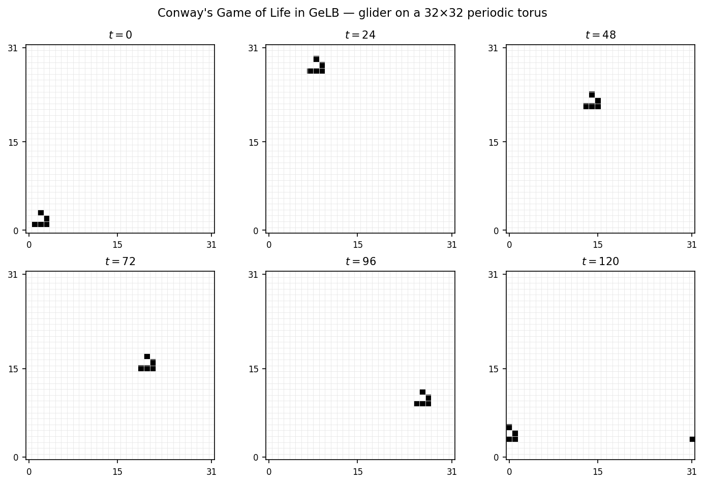

===================================
Beyond LBM: Conway's Game of Life
===================================

This chapter of the guided tour is not an LBM simulation at all — it is
Conway's Game of Life (Gardner (1970)), expressed in GeLB.  The purpose
is to show that everything introduced in the preceding chapters
(lattices, initializers, dynamics, gauges, geometry, and the
``f.in``/``f.out`` ping-pong contract) works unchanged on problems that
are not LBM, provided they can be expressed as updating each cell from
its own and its neighbours' previous state.

Conway's Game of Life is a canonical cellular-automaton stencil
computation: a binary grid, an 8-neighbour Moore stencil, and three
transition rules.  It maps onto GeLB without any new language constructs
— 63 lines including comments (37 lines of GeLB code), shorter than the
1D heat-diffusion program in :doc:`05_1d_diffusion`.

.. note::

   The example walked here is
   ``examples/lgca/2d/game_of_life_glider.gelb``.  It runs a classic
   *glider* pattern on a :math:`32 \times 32` doubly-periodic torus
   (``GRID = 32``), small enough that individual cells are clearly
   visible in the plots below.

The rules
=========

Conway's Game of Life operates on a 2D grid of cells, each either
**alive** (1) or **dead** (0).  At each discrete generation, every cell
inspects its eight Moore-neighbourhood neighbours and applies three
rules simultaneously:

1. **Birth**: a dead cell with exactly 3 live neighbours becomes alive.
2. **Survival**: a live cell with 2 or 3 live neighbours stays alive.
3. **Death**: all other cells die (or stay dead).

A *glider* is the smallest pattern that translates across the grid: a
5-cell shape with period 4 that shifts by one cell diagonally every four
generations.  On a doubly-periodic torus it wraps around both boundaries
indefinitely.

The GeLB program
=================

Here is the top of ``examples/lgca/2d/game_of_life_glider.gelb``:

.. code-block:: gelb

    simulation_description("2D Game of Life with a glider (deterministic ICs)");

    global_constants {
        const int GRID = 32;
    }

    lattices {
        lattice f(2, 1, int, {GRID, GRID}, {true, true});
    }

The program declares a single 2D lattice with **one** scalar slot per
cell (``q = 1``, rather than 5 or 9), **integer** element type (``int``
rather than ``real``), and doubly-periodic boundaries ``{true, true}``
(``GRID = 32`` by default).  It stores the cell state directly as ``1``
(alive) or ``0`` (dead).

The initializer: a glider at (1, 1)
====================================

.. code-block:: gelb

    initializer GliderInit {
        f.out[x, y | 0] = (x == 2) * (y == 3) +
                           (x == 3) * (y == 2) +
                           (x == 1) * (y == 1) +
                           (x == 2) * (y == 1) +
                           (x == 3) * (y == 1);
    }

The glider pattern consists of five live cells: ``(2, 3)``, ``(3, 2)``,
and the horizontal bar ``(1, 1)``, ``(2, 1)``, ``(3, 1)``.  With this
orientation, the glider translates by :math:`(\Delta x, \Delta y) =
(+1, -1)` every four steps.

.. important::

   **Rule:** GeLB has no ``if`` statement inside kernel blocks; instead,
   relational comparisons such as ``(x == 2)`` evaluate to ``bool`` and
   promote to ``int`` (``1`` when true, ``0`` when false) when used in
   integer arithmetic.  Multiplying two comparisons ``(x == a) * (y == b)``
   yields ``1`` at cell ``(a, b)`` and ``0`` elsewhere, and summing
   mutually exclusive indicator products sets the five glider cells to
   ``1`` without branching.

This is the same pure-expression pattern used by the ``InCircle``
geometry predicate in :doc:`10_karman_vortex`.

The dynamic: Conway's rules in four lines
==========================================

.. code-block:: gelb

    dynamic LifeEvolve {
        int neighborSum;

        neighborSum = f.in[x - 1, y - 1 | 0] + f.in[x - 1, y | 0] +
                      f.in[x - 1, y + 1 | 0] + f.in[x, y - 1 | 0] +
                      f.in[x, y + 1 | 0] + f.in[x + 1, y - 1 | 0] +
                      f.in[x + 1, y | 0] + f.in[x + 1, y + 1 | 0];

        int alive;
        int birth;
        int survive;

        alive = f.in[x, y | 0];
        birth = (neighborSum == 3);
        survive = alive * (neighborSum == 2);
        f.out[x, y | 0] = birth + survive - birth * survive;
    }

Two aspects of ``LifeEvolve`` are worth noting:

- **The 8-neighbour Moore stencil.**  Eight explicit
  ``f.in[x ± 1, y ± 1 | 0]`` reads gather the surrounding cell states —
  the same non-local offset access pattern used in
  :doc:`11_shan_chen_multiphase` for the pseudopotential force.  Because
  ``f`` is declared with ``{true, true}`` periodicity, offset reads at
  the domain edges wrap around automatically on every backend.  Declaring
  ``{false, false}`` periodicity while painting ``BULK`` on the boundary
  would trigger the compile-time out-of-bounds stencil diagnostic shown
  in :doc:`11_shan_chen_multiphase`.
- **Branch-free transition rule.**  A cell is alive in the next
  generation if and only if it has 3 live neighbours (either a birth or
  a 3-neighbour survival), *or* it is currently alive and has 2 live
  neighbours:

  - ``birth = (neighborSum == 3)`` evaluates to ``1`` whenever a cell
    (alive or dead) has exactly 3 live neighbours.
  - ``survive = alive * (neighborSum == 2)`` evaluates to ``1`` only
    when the cell is currently alive *and* has 2 live neighbours.
  - ``birth + survive - birth * survive`` computes the logical OR of the
    two mutually exclusive conditions (with ``- birth * survive``
    included as the general inclusion–exclusion guard).

The gauge and geometry
=======================

.. code-block:: gelb

    gauge CellStatus -> (int status) {
        status = f.in[x, y | 0];
    }

    node_classes {
        node_class BULK(GliderInit, LifeEvolve, CellStatus);
    }

    geometry {
        nodes[:, :] = BULK;
    }

A single node class covers the entire doubly-periodic grid.

Running it
==========

.. code-block:: bash

    ./scripts/gelb-run -n 120 -w 1 \
        examples/lgca/2d/game_of_life_glider.gelb

In VS Code (:ref:`working-in-vscode`), set *Time steps* to 120 and
*Write every* to 1.

   Six snapshots (:math:`t = 0, 24, 48, 72, 96, 120`) of the 5-cell
   glider on a :math:`32 \times 32` doubly-periodic torus
   (black = alive, white = dead).  Starting near the
   bottom-left corner at :math:`t = 0`, the glider shifts by
   :math:`(\Delta x, \Delta y) = (+1, -1)` every four generations: it
   wraps across the bottom periodic boundary (:math:`y = 0 \to 31`) to
   the top-left before :math:`t = 24`, marches diagonally down and right
   at six cells per 24-step interval (:math:`t = 24 \ldots 96`), and is
   caught mid-wrap across the right periodic boundary
   (:math:`x = 31 \to 0`) at :math:`t = 120`.

Why this matters
=================

Conway's Game of Life has no distribution functions, equilibrium
moments, relaxation time, or conservation laws.  Yet every GeLB
construct in the program — the lattice declaration, initializer, dynamic
block, gauge, ``f.in``/``f.out`` ping-pong contract, non-local offset
reads, and periodic boundary wrapping — works identically to the fluid
examples.  GeLB's core execution model is a general **structured-grid
stencil compiler** equipped with LBM-specific intrinsics
(``upstream_dfs``, ``bounce_back_dfs``, ``dot_prod``).  Any explicit cellular
automaton or finite-difference stencil update that computes each cell's
next state from a bounded neighbourhood of the previous step compiles
through the same validation and multi-backend pipeline.

What's next
===========

The next chapter, :doc:`13_salmon_ocean`, returns to fluid mechanics with
a geophysical application — the wind-driven reduced-gravity ocean
circulation model of Salmon (1999), which concludes the guided tour.

After that, Part C provides reference chapters:

- :doc:`14_boundary_conditions_cookbook` — a consolidated catalogue of
  boundary condition patterns used across the tutorial, with code
  snippets and cross-references.
- :doc:`15_stencil_visualisation` — how to use ``gelb-view source`` to
  inspect geometry maps and stencil patterns extracted by the compiler.
- :doc:`16_performance_backends` — ``cpu_highway``, ``gpu_cuda_cpp``, and
  ``cpu_fortran_serial`` backends, when to use each, and throughput
  benchmarks.
- :doc:`17_validation_and_convergence` — quantitative validation against
  analytical solutions and literature benchmarks.
- :doc:`19_numerical_semantics` — floating-point and integer semantics
  guaranteed across backends.
- :doc:`18_further_reading` — a cross-reference table mapping tutorial
  chapters to textbook sections in Krüger et al. (2017), Mohamad (2019),
  and Sukop & Thorne (2006).

