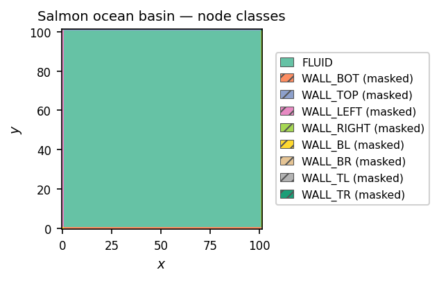
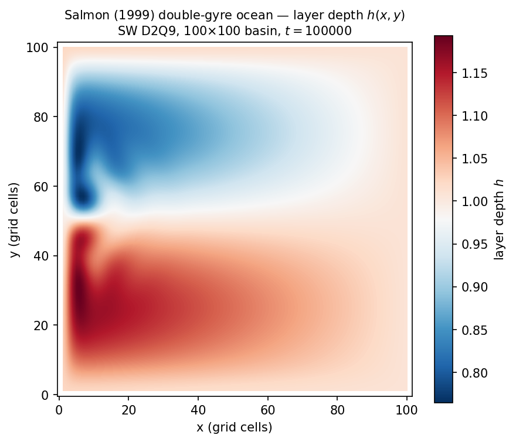

====================================
Reduced-Gravity Ocean Circulation
====================================

This chapter applies the LBM techniques from the tutorial to a
geophysical fluid dynamics problem: **wind-driven ocean circulation** in
a closed rectangular basin.  The walked example is a port of the shallow-water
D2Q9 model introduced by Salmon (1999), "The lattice Boltzmann method as
a basis for ocean circulation modeling" (§3, Eqs. 3.13–3.15, Fig. 3a),
which reproduces the classical Stommel/Munk double-gyre circulation and
western boundary current intensification using explicit local collision
and streaming rules.

For climate scientists and physical oceanographers, this chapter shows
how a rotating shallow-water basin model maps onto GeLB.  For LBM
practitioners, it demonstrates two forcing techniques — **exact-rotation
Coriolis** and **Strang-split Guo momentum injection** — combined with a
modified hydrostatic equilibrium distribution.

.. note::

   The example walked here is
   ``examples/lbm/2d/reduced_gravity_2d_sw_d2q9.gelb``.

The physics
===========

Consider a single active upper ocean layer of thickness
:math:`h(x, y, t)` overlying a deep quiescent abyss, with reduced
gravity :math:`g' = g \, \Delta \rho / \rho_0`.  The layer is confined to
a closed rectangular basin of side :math:`L` with no-slip lateral walls
and driven at the surface by a steady zonal wind stress

.. math::

   \tau_x(y) = -\tau_0 \cos\!\left(\frac{2\pi y}{L}\right),
   \qquad \tau_y = 0\,,

corresponding to easterly trades near the southern and northern walls
and westerlies at mid-latitudes.  This wind-stress curl drives a
clockwise **subtropical anticyclone** (thickened upper layer, high
:math:`h`) in the southern half of the basin and a counter-clockwise
**subpolar cyclone** (thinned upper layer, low :math:`h`) in the
northern half.

On a mid-latitude :math:`\beta`-plane where the Coriolis parameter
varies linearly with latitude as :math:`f(y) = f_0 + \beta y`, the depth-integrated
rotating shallow-water equations with lateral eddy viscosity :math:`\nu`
and Ekman bottom-drag regularisation :math:`\delta_E` read (Salmon
(1999) §3):

.. math::

   \frac{\partial (hu)}{\partial t} + \nabla \cdot (hu \, \mathbf{u})
     &= -g' h \frac{\partial h}{\partial x}
        + f(y) \, hv + \tau_x(y) \frac{h}{h + \delta_E}
        + \nu \nabla^2 (hu)\,, \\
   \frac{\partial (hv)}{\partial t} + \nabla \cdot (hv \, \mathbf{u})
     &= -g' h \frac{\partial h}{\partial y}
        - f(y) \, hu
        + \nu \nabla^2 (hv)\,, \\
   \frac{\partial h}{\partial t} + \nabla \cdot (h \, \mathbf{u}) &= 0\,.

Because :math:`\beta = \partial f / \partial y > 0`, planetary vorticity
conservation (:math:`\beta v` balance in the Sverdrup interior) shifts
the return flow of both gyres into an intense, narrow **western boundary
current** (the Stommel/Munk analogue of the Gulf Stream or Kuroshio) of
characteristic Munk width :math:`\delta_M = (\nu / \beta)^{1/3}`.

Salmon (1999) §3 (Eqs. 3.13–3.15) showed that the D2Q9 lattice Boltzmann
equation recovers these shallow-water equations at leading order when
the mass density :math:`\rho` is identified with the layer depth
:math:`h` and the isothermal pressure :math:`c_s^2 \rho` in the second
moment of the equilibrium distribution is replaced by the hydrostatic
shallow-water pressure :math:`\tfrac{1}{2} g' h^2` (see also Krüger et
al. (2017) §3.2 and §6.3 for the D2Q9 BGK and forcing framework, and
chapter 10 for the MRT collision used below).

The GeLB program
=================

The file ``examples/lbm/2d/reduced_gravity_2d_sw_d2q9.gelb`` is 395
lines including comments.  Most of the source consists of explicit
full-way bounce-back dynamic blocks (the wall midway between the nodes)
for the four basin walls and four corner cells; the shallow-water
physics lives in ``FeqSW`` and the 43-line ``BulkDynamic`` block.

The shallow-water equilibrium
------------------------------

.. code-block:: gelb

    function FeqSW(real h, real ux, real uy) -> (array[real, 9] feq) {
        real usq = ux * ux + uy * uy;
        array[real, 9] cu = EX * ux + EY * uy;

        // Standard D2Q9 BGK equilibrium with ρ ↦ h, plus Salmon's
        // pressure-like term P_COEF · g · h² (encoding −∇(gh²/2)).
        feq = W * h * (1.0 + 3.0 * cu + 4.5 * cu * cu - 1.5 * usq)
              + P_COEF * (G * h * h);
    }

Here ``FeqSW`` starts from the standard D2Q9 quadratic equilibrium with
:math:`\rho \mapsto h` and adds ``P_COEF * (G * h * h)``, where

.. code-block:: gelb

    const array[real, 9] P_COEF = {-5.0/6.0,
                                    1.0/6.0,  1.0/6.0,  1.0/6.0,  1.0/6.0,
                                    1.0/24.0, 1.0/24.0, 1.0/24.0, 1.0/24.0};

The coefficient vector ``P_COEF`` encodes the quadratic hydrostatic
pressure contribution :math:`\tfrac{1}{2} g' h^2 \delta_{\alpha\beta}`
of Salmon (1999) Eqs. (3.13)–(3.15) while satisfying three moment
constraints:

- **Zeroth moment:** :math:`\sum_{i=0}^8 \text{P\_COEF}_i = -\tfrac{5}{6} + 4(\tfrac{1}{6}) + 4(\tfrac{1}{24}) = 0`, so mass conservation :math:`\sum_i f_i^\mathrm{eq} = h` is preserved exactly.
- **First moment:** :math:`\sum_{i=0}^8 \mathbf{c}_i \, \text{P\_COEF}_i = \mathbf{0}` by lattice symmetry, so :math:`\sum_i \mathbf{c}_i f_i^\mathrm{eq} = h \mathbf{u}`.
- **Second moment:** since :math:`\text{P\_COEF}_i = \tfrac{3}{2} w_i` for :math:`i = 1 \ldots 8`, :math:`\sum_{i=0}^8 c_{i\alpha} c_{i\beta} \, \text{P\_COEF}_i (g' h^2) = \tfrac{3}{2} c_s^2 g' h^2 \delta_{\alpha\beta} = \tfrac{1}{2} g' h^2 \delta_{\alpha\beta}`, whose divergence supplies the shallow-water hydrostatic pressure force :math:`-\nabla(\tfrac{1}{2} g' h^2) = -g' h \nabla h`.

The bulk dynamic — Coriolis + wind + MRT
-----------------------------------------

.. code-block:: gelb

    dynamic BulkDynamic {
        // Pull-stream and extract conserved moments.
        array[real, 9] fIn = upstream_dfs(f, x, y, {EX, EY});
        real h   = sum(fIn);
        real hu0 = dot_prod(EX, fIn);
        real hv0 = dot_prod(EY, fIn);

        // Ekman-scaled double-gyre wind stress, y-only profile, with
        // a linear spin-up ramp τ₀ · min(1, t / T_RAMP) that reaches
        // full strength after T_RAMP outer-loop steps.
        real bf    = h / (h + DELTA_E);
        real ramp  = min(1.0, real(t) / T_RAMP);
        real tau_x = -TAU0 * cos(TWO_PI * real(y) / real(NY - 1)) * ramp;

        // Half-angle rotation coefficients for Coriolis.
        real f_loc = F0 + BETA * real(y);
        real ca    = cos(0.5 * f_loc);
        real sa    = sin(0.5 * f_loc);

        // --- 1st half force: wind/2 then rotate/2 ---
        real hu_a = hu0 + 0.5 * bf * tau_x;
        real hu_h =  ca * hu_a + sa * hv0;
        real hv_h = -sa * hu_a + ca * hv0;

        // Inject pre-collision momentum delta so mom(fInForced) = (hu_h, hv_h).
        real d1_hu = hu_h - hu0;
        real d1_hv = hv_h - hv0;
        array[real, 9] fInForced = fIn + W * 3.0 * (EX * d1_hu + EY * d1_hv);

        // --- MRT collision: feq built from (hu_h, hv_h) matches mom(fInForced);
        // h, j_x, j_y are conserved (S_DIAG = 0), so the first moment
        // after collision is exactly (hu_h, hv_h).
        array[real, 9] feq   = FeqSW(h, hu_h / h, hv_h / h);
        array[real, 9] mom   = matmul(M, fInForced);
        mom = mom - S_DIAG * (mom - matmul(M, feq));
        array[real, 9] fPost = matmul(M_INV, mom);

        // --- 2nd half force: rotate/2 then wind/2 (symmetric to the first half) ---
        real hu_b =  ca * hu_h + sa * hv_h;
        real hv_f = -sa * hu_h + ca * hv_h;
        real hu_f = hu_b + 0.5 * bf * tau_x;

        // Inject post-collision momentum delta.
        real d2_hu = hu_f - hu_h;
        real d2_hv = hv_f - hv_h;
        f.out[x, y | :] = fPost + W * 3.0 * (EX * d2_hu + EY * d2_hv);
    }

Four physical and numerical ingredients work together in ``BulkDynamic``:

1. **Exact-rotation Coriolis.**  In Salmon's dimensionless units,
   :math:`f_0 \Delta t \approx 0.4712`.  Discretising the Coriolis
   acceleration :math:`\mathrm{d}(hu)/\mathrm{d}t = f \, hv`,
   :math:`\mathrm{d}(hv)/\mathrm{d}t = -f \, hu` with explicit forward
   Euler amplifies the kinetic energy :math:`|hu|^2 + |hv|^2` by a
   factor of :math:`1 + (f \Delta t)^2 \approx 1.22` per step, blowing
   up long before viscous spin-up completes.  Instead, ``BulkDynamic``
   rotates :math:`(hu, hv)` through the exact half-angle
   :math:`\tfrac{1}{2} f(y) \Delta t` using ``cos`` and ``sin``,
   preserving :math:`|hu|^2 + |hv|^2` to machine precision.
2. **Symmetric Strang splitting with Guo momentum injection.**  As in
   :doc:`08_poiseuille_body_force`, the forcing is split symmetrically
   around collision: half wind stress followed by half Coriolis rotation
   before collision, and half Coriolis rotation followed by half wind
   stress after collision.
3. **Smooth wind spin-up via the implicit** ``t`` **symbol.**  The
   built-in time-step index ``t`` (introduced in
   :doc:`03_gelb_in_10_minutes`) drives the linear ramp
   ``min(1.0, real(t) / T_RAMP)``, bringing the wind stress smoothly to
   full amplitude over the first :math:`20\,000` steps so initial basin
   gravity waves can damp out cleanly.
4. **MRT collision at Salmon's relaxation rate.**  The example runs at
   Salmon's :math:`\lambda = 0.95\,\lambda_\mathrm{max}`
   (``OMEGA = 1.9``, :math:`\nu = c_s^2 (1/\omega - \tfrac{1}{2})
   \approx 8.8 \times 10^{-3}` in lattice units), where the Munk
   layer :math:`\delta_M = (\nu / \beta)^{1/3} \approx 1.4` cells is
   barely resolved.  With a single relaxation rate (BGK), grid-scale
   oscillations of the non-hydrodynamic moments then grow along the
   western boundary until the run fails, near step :math:`17\,000`.
   The collision is therefore done in moment space (``matmul(M, ...)``,
   as in :doc:`08_poiseuille_body_force`): the energy and stress moments
   relax at ``OMEGA``, so the shear and bulk viscosities are exactly
   those of BGK, while the three non-hydrodynamic moments
   (:math:`\epsilon, q_x, q_y`) relax at rate 1, which damps the
   grid-scale modes without changing the hydrodynamics.  ``-D
   OMEGA=1.2`` gives a more viscous, smoother basin
   (:math:`\nu \approx 0.11`, :math:`\delta_M \approx 3.4` cells).

.. important::

   **Rule:** When combining Strang-split forcing with a collision that
   conserves momentum, the pre-collision momentum increment
   :math:`(\Delta(hu)_1, \Delta(hv)_1)` must be injected into the
   distribution functions *before* the collision
   (``fInForced = fIn + W * 3.0 * (EX * d1_hu + EY * d1_hv)``), in
   addition to passing the half-step velocity into ``FeqSW``.  The MRT
   collision leaves the momentum moments unchanged, so without the
   injection the first half of the force would be lost; with BGK, whose
   post-collision first moment is
   :math:`(1 - \omega)\,\mathrm{mom}(f^\mathrm{in}) +
   \omega\,\mathrm{mom}(f^\mathrm{eq})`, it would be weighted by
   :math:`\omega` instead of 1.

The geometry — 9 node classes
==============================

.. code-block:: gelb

    node_classes {
        node_class FLUID(InitAll, BulkDynamic, OceanGauge);
        node_class WALL_BOT  (InitAll, WallBotDynamic)   masked;
        node_class WALL_TOP  (InitAll, WallTopDynamic)   masked;
        node_class WALL_LEFT (InitAll, WallLeftDynamic)  masked;
        node_class WALL_RIGHT(InitAll, WallRightDynamic) masked;
        node_class WALL_BL   (InitAll, WallBLDynamic)    masked;
        node_class WALL_BR   (InitAll, WallBRDynamic)    masked;
        node_class WALL_TL   (InitAll, WallTLDynamic)    masked;
        node_class WALL_TR   (InitAll, WallTRDynamic)    masked;
    }

The interior ``FLUID`` region is enclosed by four straight edge walls
(``WALL_BOT``, ``WALL_TOP``, ``WALL_LEFT``, ``WALL_RIGHT``) and four
single-cell corner classes (``WALL_BL``, ``WALL_BR``, ``WALL_TL``,
``WALL_TR``), giving nine node classes in total.  Each corner cell sits
at the intersection of two walls and reflects the single diagonal DF
pointing toward its sole interior fluid neighbour (for example, slot 5
``NE`` at ``WALL_BL`` reads slot 7 ``SW`` from fluid cell ``(1, 1)``).
All eight boundary classes carry the ``masked`` modifier so their gauge
fields are written as ``NaN`` in NetCDF, outlining the :math:`100 \times 100`
fluid basin automatically.

   Node-class layout for the :math:`102 \times 102` domain: ``FLUID``
   (:math:`100 \times 100` interior, teal) surrounded by four edge-wall
   and four corner node classes (all ``masked``, shown with hatching in
   the legend on the right).

Running it
==========

.. code-block:: bash

    ./scripts/gelb-run -n 100000 -w 1000 \
        examples/lbm/2d/reduced_gravity_2d_sw_d2q9.gelb

In VS Code (:ref:`working-in-vscode`), set *Time steps* to 100000 and
*Write every* to 1000.

Running 100 000 steps on the :math:`102 \times 102` grid with the
default ``cpu_highway`` backend takes about 10 seconds, compilation
included, on a 16-core desktop CPU.  The wind ramp reaches full strength at
:math:`t = 20\,000`, and the asymmetric double-gyre pattern is
established by :math:`t = 50\,000`.

   Upper-layer depth :math:`h(x, y)` at :math:`t = 100\,000` in the
   :math:`100 \times 100` fluid basin (:math:`102 \times 102` including
   masked perimeter walls).  The sinusoidal zonal wind stress drives a
   subtropical anticyclone (thickened upper layer, :math:`h > 1`, warm
   colours) in the southern half and a subpolar cyclone (thinned upper
   layer, :math:`h < 1`, cool colours) in the northern half, with strong
   **western boundary intensification** in a narrow band along the left
   wall, produced by the :math:`\beta`-plane Coriolis gradient; the two
   western boundary currents meet near mid-basin (:math:`y \approx 50`)
   and turn east together.

What this demonstrates
=======================

This example combines a non-standard hydrostatic equilibrium, exact
trigonometric Coriolis rotation, a time-dependent wind spin-up ramp, and
two-stage Strang-split Guo momentum injection and an MRT collision inside
a single 47-line ``BulkDynamic`` block that mirrors the governing equations directly.
Across the eight wall and corner classes, the compiler statically
verifies that all nine D2Q9 distribution slots are written at every
boundary cell and that no stencil read reaches outside the non-periodic
:math:`102 \times 102` grid.

.. seealso::

   **Salmon, R.** (1999) "The lattice Boltzmann method as a basis for
   ocean circulation modeling." *Journal of Marine Research*, **57**,
   503–535.  Section 3 (Eqs. 3.13–3.15) derives the shallow-water D2Q9
   formulation; Figure 3a shows the :math:`100 \times 100` double-gyre
   benchmark.

   **Krüger et al. (2017)** §3.2 (*The Lattice Boltzmann Equation in a
   Nutshell*) and §6.3 (*LBE with Body Forces*) for the D2Q9 BGK and
   Guo/Strang forcing foundations; chapter 10 (*MRT and TRT Collision
   Operators*) for the moment-space collision.

   The repository also provides two planetary-geostrophic (PG) companions
   from Salmon (1999): ``examples/lbm/2d/reduced_gravity_2d_pg_d2q9.gelb``
   (linearised PG on D2Q9, Salmon Fig. 3c–d) and
   ``examples/lbm/2d/reduced_gravity_2d_pg_d2q5.gelb`` (PG on a 5-velocity
   D2Q5 lattice, Salmon Fig. 6a), which drop the :math:`\mathcal{O}(u^2)`
   advective terms in the equilibrium to solve the planetary-geostrophic
   balance :math:`f \hat{\mathbf{z}} \times h\mathbf{u} + g' h \nabla h =
   \boldsymbol{\tau} + \nu \nabla^2(h\mathbf{u})`.

