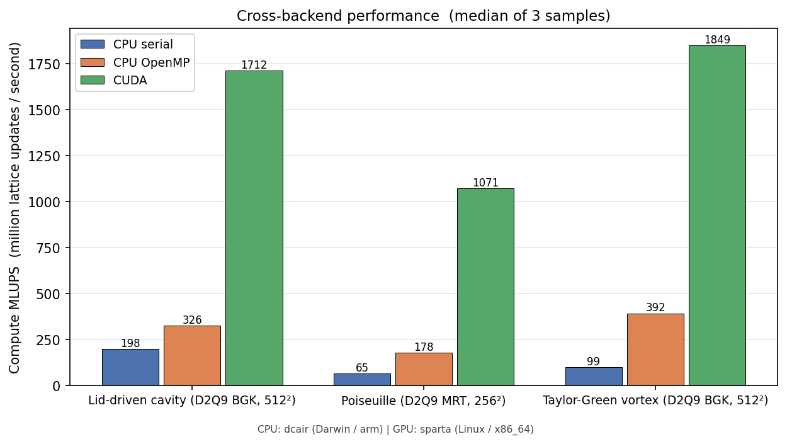

=========================
Performance and Backends
=========================

GeLB compiles to three backends.  The same ``.gelb`` source runs
on all three without changes — you choose the backend at compile
time.

The three backends
===================

**``cpu_highway``** (default).  Portable-SIMD C++ via Google
Highway, compiled with ``g++`` and parallelised with OpenMP.
Resolves to AVX-512 / AVX-2 (x86) or NEON (ARM / Apple Silicon)
at compile time.  This is the production CPU backend.

.. code-block:: bash

    ./scripts/gelb-run -n 10000 examples/lbm/2d/poiseuille_flow_2d_mrt.gelb

**``gpu_cuda_cpp``** (CUDA C++).  Requires the CUDA toolkit
(``nvcc``).  The compiler emits CUDA C++ kernels and links against
the same NetCDF-C library that ``cpu_highway`` already needs.

.. code-block:: bash

    ./scripts/gelb-run -b gpu_cuda_cpp -n 10000 \
        examples/lbm/2d/poiseuille_flow_2d_mrt.gelb

**``cpu_fortran_serial``** (educational reference).  ``gelbc``
emits plain Fortran 90, compiled with ``gfortran``.  **Strictly
single-threaded by design** — its role is to serve as the
human-readable source-level reference and the correctness anchor
that the SIMD and CUDA backends are tested against.  Use it for
debugging, small grids, and reference runs; reach for
``cpu_highway`` for actual performance work.

.. code-block:: bash

    ./scripts/gelb-run -b cpu_fortran_serial -n 10000 \
        examples/lbm/2d/poiseuille_flow_2d_mrt.gelb

When to use which
==================

- **``cpu_highway``**: the default for everything on a CPU.
  Multi-threaded via OpenMP; scales with core count up to the
  memory bandwidth limit.  For a single-threaded Highway baseline,
  set ``OMP_NUM_THREADS=1`` in the environment.
- **``gpu_cuda_cpp``**: large 3D grids (128³+) on NVIDIA GPUs.
  The kernel launch overhead means CUDA only wins at large
  problem sizes.
- **``cpu_fortran_serial``**: grids under ~100×100, debugging,
  human-readable reference, correctness anchor for the other
  backends.

Performance numbers
====================

The figure below shows Compute MLUPS (million lattice updates
per second) for three canonical 2-D examples — lid-driven cavity
(D2Q9 BGK, 512²), Poiseuille (D2Q9 MRT, 256²), and Taylor-Green
vortex (D2Q9 BGK, 512²) — across all three backends.  Each bar
is the median of three samples; CPU runs come from an
Apple M4 (MacBook Air), CUDA runs from an NVIDIA RTX 4080 Laptop
GPU.  The benchmark
harness is ``scripts/benchmark_backends.py``; the underlying
data lives in
``docs/user/figures/data/16_mlups_backend_comparison.json``.

   Cross-backend performance.  Median of three samples per case;
   gauges fire only at ``t=0`` and ``t=N`` so NetCDF I/O is
   amortised away.

A few patterns to notice:

- **CUDA dominates by an order of magnitude** at 256²–512² —
  ``CUDA / serial`` is ~9× for the BGK lid-cavity, ~16× for the
  MRT Poiseuille (where the per-step matmul amortises well on
  the GPU), and ~19× for the BGK Taylor-Green vortex.  The
  payoff grows with the per-step arithmetic intensity, which is
  why MRT widens the GPU's lead more than its CPU lead.
- **OpenMP scaling varies by case**.  Taylor-Green (BGK, 512²)
  hits ~4× over serial — close to the practical ceiling on
  this CPU.  Lid-driven cavity at the same resolution gets
  only ~1.65× because BGK at 512² is largely memory-bandwidth
  bound; threads do not buy more bandwidth.  Poiseuille MRT at
  256² lands at ~2.7× — middling because the smaller grid
  gives less work per thread, but MRT's arithmetic still
  benefits.
- **Serial Fortran is competitive at small problem sizes**.  If
  the grid fits in cache and you do not need a pretty animation,
  the serial backend is the simplest reproducibility story
  (deterministic, no thread-affinity surprises, no CUDA toolkit
  dependency).

**What the numerical guarantees cost.**  :doc:`19_numerical_semantics`
fixes the arithmetic; a few of its rules have a measured price.  The
CPU backends compile with contraction off (``-ffp-contract=off``), so
the native compiler never fuses a multiply and an addition on its own:
2.3–4.4 % on an Apple M4 across channel flow, TGV-2D BGK and Shan–Chen
(the measurements behind that decision).  Every term of a reduction
counts, zero coefficients included, with one fusion rule in every code
path: 2.1 % on TGV-2D BGK and 2.3 % on channel flow (circle obstacle,
BGK) on a Ryzen 9 7945HX, default ``cpu_highway`` build, median of
five interleaved rounds.  CUDA default builds keep nvcc's fusion
because turning it off costs 7.5–30.6 % on an RTX 4080 Laptop GPU
(``scripts/bench-cuda-fusion``); a strict build (``--strict-fp``) pays
that on CUDA and, on the CPU, the fusion inside the reduction helper:
1.3 % on channel flow and nothing measurable on the 64² Taylor–Green
vortex, same machine and protocol.

**Multi-threaded CPU versus GPU — mind the cache.**  Against the
multi-threaded ``cpu_highway`` backend on a large desktop CPU the
picture at 512² is different from the figure above: on a 16-core
Zen 4 (AMD Ryzen 9 7945HX, 64 MB L3) the TGV-2D BGK anchor reaches
about 4660 MLUPS, *twice* the RTX 4080 Laptop GPU (about 2360),
because the ~38 MB D2Q9 working set fits in L3.  That is a cache
artifact, not a GPU weakness: at 2048² the same comparison is
327 versus 2332 MLUPS (GPU 7.1×) and at 128³ it is 144 versus
825 (GPU 5.7×), with the GPU at roughly 96 % of its GDDR6
bandwidth ceiling in FP64.  When you benchmark backends yourself,
include at least one grid that does not fit in your CPU's last-level
cache (2D N=2048 or 3D N=128 on this class of hardware); the
reference numbers live in ``docs/perf_baseline_zen4.md``.

Practical notes
================

**OpenMP stack size.**  MRT and multi-lattice examples allocate
large per-thread private arrays.  If a ``cpu_highway`` simulation
segfaults under OpenMP, raise the stack size in the shell before
running (``gelb-run`` inherits your shell's limits):

.. code-block:: bash

    ulimit -s unlimited    # or: ulimit -s hard
    OMP_STACKSIZE=64M ./scripts/gelb-run -n 10000 program.gelb

**Reproducibility.**  Pass ``--seed N`` to ``gelbc`` or
``gelb-run`` to seed the PRNG deterministically.  Without
``--seed``, the runtime seeds from the system clock and
every run produces different results for programs that call
``random()``.

**macOS (Apple Silicon).**  ``gelb-run`` prefers Homebrew GCC
(``g++-16`` down to ``g++-13``; ``brew install gcc netcdf``) and
otherwise uses Apple clang from Xcode or the Command Line Tools,
which needs only the OpenMP runtime: ``brew install libomp``, or
``GELB_OMP_ROOT`` pointing at a directory that holds
``include/omp.h`` and ``lib/libomp.dylib``.  The clang build
compiles with ``-Xclang -fopenmp`` and ``-mcpu=native``, links
``-lomp``, and matches the GCC results to round-off.  ``GELB_CXX``
picks the compiler explicitly, and ``GELB_NETCDF_C_ROOT`` names a
NetCDF-C prefix (``include/`` + ``lib/``) when ``nc-config`` is not
on the PATH.  ``GELB_PYTHON`` names an
interpreter that can ``import gelb``; when it is set, ``gelb-run``
runs ``gelbc``, the progress bar and ``gelb-view`` through it and
does not need ``uv`` (the relocatable macOS bundle built by
``scripts/mac_bundle/build_bundle.sh`` works this way).
``OMP_NUM_THREADS`` defaults to the performance cores.

Hand-tuning hot kernels
========================

Most ``.gelb`` programs hit memory-bandwidth or arithmetic
limits where the *form* of the kernel — slice-style versus
explicit per-direction — barely matters.  For long-running
production jobs at large grid sizes, though, a small (~5 %)
gain is sometimes available by rewriting the bulk dynamic in a
**fully-fused form** that mirrors what a hand-coded LBM author
would write.

The technique
-------------

Three textual rewrites, all valid GeLB source:

1. **Inline the equilibrium expansion.**  Instead of computing
   ``feq[i] = W[i]·rho·(1 + 3·eu[i] + 4.5·eu[i]² − 1.5·usq)``
   for each direction inside a slice loop, expand it directly
   into the BGK update
   ``f.out[i] = (1−ω)·fIn[i] + ω·feq[i]`` for each ``i``.  This
   removes the intermediate ``eu[]`` and ``feq[]`` arrays and
   gives the compiler 9 independent expressions to schedule.

2. **Hoist shared sub-expressions.**  In D2Q9, the four diagonal
   directions share two scalars:
   ``u0Pu1 = ux + uy`` (used by NE and SW) and
   ``u0Mu1 = ux − uy`` (used by SE and NW).  ``f_eq_common
   = rho·(1 − 1.5·usq)`` is shared across all 9 directions.

3. **Pre-multiply constant coefficients.**  Replace ``ω·W[i]``
   with named constants so the compiler sees a single literal
   per direction:

   .. code-block:: text

       const real K0     = TAU_INV * 4.0 / 9.0;
       const real K_CARD = TAU_INV * 1.0 / 9.0;
       const real K_DIAG = TAU_INV * 1.0 / 36.0;

The two key shapes look like this for the rest direction (i=0)
and the cardinal east direction (i=1):

.. code-block:: text

    f.out[x, y | 0] = (1.0 - TAU_INV) * fIn[0]
                    + K0 * f_eq_common;

    f.out[x, y | 1] = (1.0 - TAU_INV) * fIn[1]
                    + K_CARD * (f_eq_common
                                + 3.0 * rho * ux
                                + 4.5 * rho * ux * ux);

A complete example lives at
``examples/lbm/2d/lid_driven_cavity_2d_bgk_fused.gelb`` —
identical physics to the canonical
``lid_driven_cavity_2d_bgk.gelb``, just with the bulk dynamic
written this way.  Output agrees with the original to within one
ULP, so it works as a drop-in replacement.

Going further: incompressible algebra
--------------------------------------

For low-Mach flows (Ma ≪ 0.1), one more rewrite is available:
work with **momentum** (``u_x = sum(c_x · fIn)``, no division by
rho) instead of velocity, and with ``delta_rho = rho − 1`` instead
of ``rho``.  This is the **incompressible** LBM equilibrium.

The win is one fewer ``vdivpd`` per cell — the compressible BGK
needs ``ux = …/rho`` and ``uy = …/rho`` which are expensive on
modern x86 (~30 cycles each).  The incompressible form sidesteps
both divisions.

The cost is a small accuracy delta of ``O(Ma²)``: at the LDC's
``U_LID = 0.1`` (Ma ≈ 0.17), the per-step cell values differ from
the compressible form at the third decimal place but converge to
the same steady-state flow within plotting precision.

A complete example is at
``examples/lbm/2d/lid_driven_cavity_2d_bgk_incomp_fused.gelb``.

Measured gains
--------------

On the Zen 4 AVX-512 reference system (AMD Ryzen 9 7945HX, 16
physical cores), LDC N=512, 5000 steps, OpenMP at 16 threads,
``--write-every=5000`` to isolate dynamic-block throughput from
gauge I/O.  Three samples per variant, median reported:

==================================  ========  ============
Variant                               MLUPS     vs default
==================================  ========  ============
Default (slice-style, with ``Eq``)    1700      1.00 ×
Fused-compressible (CSE only)         1755      1.03 ×
Fused-incompressible (no 1/rho)       1801      1.06 ×
==================================  ========  ============

Going from the default to the fused-incompressible form recovers
~6 % at 16 T.  Most of that comes from removing the two divisions;
the CSE rewrite alone is worth ~3 %.  The remaining gap to a
hand-tuned C kernel (about 50 %) lies in the generated code, not
in the source-level shape, and is not reachable from the ``.gelb``
level.

When to bother
--------------

Use the fused form when:

- The bulk dynamic is the dominant cost (large grid, low gauge
  frequency, long run).
- You're already happy with the algebra and the example will
  run unchanged for many wall-clock-hours.

Stick with the textbook ``Macro`` / ``Eq`` user-function form
when:

- You're prototyping or teaching: the slice-style code reads
  closer to a paper's notation.
- Numerical experiments: changing the equilibrium or collision
  is two lines in ``Eq``, vs nine lines in the fused form.
- The kernel isn't the bottleneck — at small grids or with
  per-step gauges enabled, the gauge sweep + I/O dominates.

The default form should always be your starting point.  Reach
for the fused form only when ``-w`` is large, the simulation is
running long enough that 6 % matters, and you've measured that
the bulk dynamic is the bottleneck.
